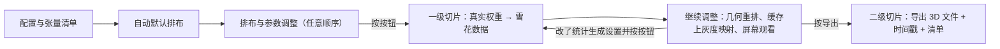

# snowglass 编辑器：排布、一级切片、二级切片（需求与设计）

> **状态：真实权重加载前的布局与编辑功能已实现并完成回归检查。** 当前适配 Qwen3.5-9B：官方 config 驱动功能分组，4.2 默认排布，块宽双模式、局部 gumball、幽灵毛坯、工程保存与布局 JSON 导出已可用。2026-11-18 的主编辑器实施批次没有读取权重数值，也没有运行一级切片或输出 OBJ / STL；后续真实小样是独立实验，不表示主编辑器已接入切片。第 12 节保留已确认的选项，第 13 节记录实施状态。第 15 节保留第二轮 UX 需求（Q16–Q22），区分用户明确要求、候选实现和小样后复议事项。真实灰度小样、全类型代表层探路及独立灰度展开已完成，本轮正式回到 UX 设计，不开始实现。用户已明确右上常驻对象树、右下常驻所选对象属性；“全局”和幽灵毛坯都作为可选对象管理；操作分组采用单父树，参数逐项实时继承，只有修改或显式锁定的项建立本地覆盖。雪花点固定毫米边长、不随包络缩放，灰度曲线始终自由调色；不随机有／无采点、不使用大小编码数值。右侧对象与属性布局、真实填充和多点曲线尚未接入主编辑器；手动压缩用每格权重数 n 仍是建议，不能将设计讨论标成代码已经完成。
>
> **与 `docs/decisions.md` 的分工。** `decisions.md` 记录整个作品的决策（D 编号）和待定项（U 编号），比如"点数是后验结果"（D2）、"框和壳是实体"（D3）、"厂家工艺规格待核实"（U12）。本文只讲**编辑器这个工具怎么工作**：用户在里面按什么顺序做什么，每一步的输入输出，哪些操作会触发重算。本文用到 D/U 编号时，会当场把那条的内容说一遍，不需要去翻 `decisions.md`。
>
> **编号导览。** Q1–Q15 是本文第 12 节的编辑方案选项编号；Q16–Q22 是第 15 节的第二轮需求与复议入口，具体状态在该节开头逐项列明；`decisions.md` 的 D/U 编号属于整件作品的决策记录。默认布局归入 D11，内部张量填充归入 D13，编辑与两级切片行为归入 D14；每个 Q 条目保留具体解释和当前状态，不以编号引用代替内容。

---

## 1. 一句话流程

用户借了 3D 打印"切片"的说法，一共两次切片：

1. **排布**：脚本根据模型的配置自动排出一套默认布局。布局本质上是很多"包络块"，每个块是等着装权重雪花的空盒子。用户可以调整这些盒子的位置、缩放和外观。
2. **一级切片**：用户定好数据参数后显式执行，后台从真实权重提取选定特征、合并压缩并保存连续统计／灰度，供每个盒子里的小块使用。具体特征和残差配比待小样后决定，不把谱筛选叫作已去除无用噪声。
3. **一级切片之后继续调整**：几何变换即时重排，不重算统计；窗口／曲线在匹配的统计缓存上即时映射输出灰度，不重读权重或重跑SVD。压缩／谱计算设置改变才标记统计需重算，按按钮执行。纯屏幕曝光和显隐另属观看设置，不能与输出灰度混为一谈。
4. **二级切片**：把整个模型导出成 3D 文件（OBJ / STL 等），文件名带时间戳。



**没有先后锁定（用户已明确）。** 一级切片之前，排布参数和雪花参数都能随时调，不存在"必须先调好包络体积再调雪花参数"。默认排布装不下默认雪花参数切出来的结果，这是完全允许的：可以带着满屏红色先切一次，再慢慢拉 gumball，直到不报红为止。一级切片之前没必要、也做不到预先判断装不装得下。

---

## 2. 术语

- **包络块**：一个功能组的外形盒子，比如"第 3 层的 Q / Gate"。它有毫米尺寸和位置，外面有框（12 根实体方梁）和包络面（6 块实体薄板），里面装雪花。一个功能组可以包含多个独立张量；盒子是展示分组，不等于一张权重表，也不意味着这些张量在计算中被合并成一个操作。
- **雪花数据**：真实权重经过特征提取与合并压缩所得的三维数值阵列；灰度曲线决定每格小几何块的灰度（0 到 1）。雪花点是有尺寸、带灰度的小块，不是厂家的激光爆点；零灰度格子可以不显示，但不随机决定格子有／无。
- **格间距**：块的毫米尺寸除以格子数，即相邻两个格子中心之间的距离。块被拉大，格间距就变大；块被压小，格间距就变小。
- **点距**：激光机能打的最小点间距，默认 0.08 mm。属于机台参数，也就是用户说的"加工精度"。
- **幽灵毛坯**：参照用的玻璃毛坯外形，可以有多个，可以新建、删除、拖拽、gumball、改尺寸。每个幽灵毛坯带一层"应力预留量"，即从外表面向内偏移的安全距离。它只做参照：模型超出时报红，但不阻止任何操作。
- **报红不阻挠（用户已明确）**：所有检查（出毛坯、超加工精度、超密度参考线、块重叠等）只显示红色或橙色提示，不禁止一级切片，也不禁止二级切片。
- **过期**：统计生成设置与已载入结果不匹配时，标为“统计需重算”，等待显式执行，画面若继续使用旧结果就明确标记。仅改窗口／曲线不使匹配的源统计过期，它即时产生当前工作灰度，保存为新映射版本；不覆盖旧磁盘结果。工艺核对与几何检查的状态另列，不能把所有变化都叫作需要重读权重。
- **降采样（用户已明确其含义）**：把相邻的一批权重**合并**成一个格子的统计值，属于池化一类的压缩。每个权重都参与计算，**不是**隔几个取一个，也**不是**一开始就把一部分权重扔掉。现在的实现按行、按列把张量切成整数段，每个权重恰好落进一个格子，这一点和拓扑脚本"每个张量恰好归入一个块"的检查是同一个思路。合并时用什么统计量（绝对值均值、均方根、行列范数、谱分解后的结构部分等）属于"灰度合成方式"（第 6 节，对应 `decisions.md` 的 U7）。
  所有源权重参与统计，不表示无损压缩，也不表示每个原始权重都对应一个小块。旧版把灰度解释为随机出点概率，已被用户纠正：灰度 0.3 是小块保存的灰度，不是 30% 的保留概率。随机化 SVD 的种子只属于数值算法可复现设置，不是艺术外观参数。
- **块的缩放（用户已明确其含义）**：只是把已经算好的雪花中心点重新摆放，点位跟着包络的形状伸缩。用户后来明确小块保持固定毫米边长，不随包络缩放；点位间距可变，小块本身不被拉长或压扁。雪花源统计、格数和灰度不变；改变压缩或谱设置才需要相应重算。
- **块间隙（用户已明确其规则）**：不改变整体排布尺寸。每个块的中心不动，只是块本身向内收缩或向外膨胀。规则详见 5.3 节。

---

## 3. 现状盘点（配置、拓扑与排布怎样生成）

| 部分 | 当前实现 | 文件 |
|---|---|---|
| 配置 | 首次获取官方 KB 级 config，之后读本地缓存；记录原始文件 SHA256。读取层数、逐层类型、文本与视觉维度，不加载权重 | `data/configs/Qwen3.5-9B.config.json` |
| 拓扑 | Python 按 4.2 功能组生成，清单只用于绑定名字、形状和量化格式；文本427、视觉334个张量全覆盖。另有纯config模式，明确标记未绑定 | `scripts/build_topology_qwen35.py` → `prototype/data/qwen35_9b.topo.json` |
| 排布 | HTML 的 `layout()` 取4.2配方，1单位＝1mm；默认369个权重功能块和1个MTP空框。默认逐块坐标与尺寸已经自动对照 | `prototype/snowglass_editor.html` |
| 编辑与显示 | 局部选择、三轴变换、幽灵参照、固定模拟样本、悬停、显示参数、保存打开和纯后验报告 | 同上 |

生成默认拓扑：`uv run --no-project python scripts/build_topology_qwen35.py`。指定配置可用 `--config <路径>`；只凭配置出架构加 `--architecture-only`，不会宣称清单覆盖已核实。当前只有 `qwen3_5_text` 的命名与分组适配器，其他架构明确拒绝，不凭字段相似猜测。

"排布只在前端实现一次，由编辑器导出 `layout.json` 交给后续步骤"这条做法保持不变，Python 端不重复写排布逻辑。

---

## 4. 默认排布：以 `real_config4.2.html` 为准

### 4.1 4.2 实际是怎么排的（Qwen3.5-9B，默认"纵向压缩"0.55）

下面的数是按 4.2 源码里的公式逐项算出来的，原型使用场景单位。编辑器初始按 1 场景单位＝1 mm 换算（Q4 已确认），所以默认坐标和尺寸可以直接取表中数值为毫米；后续全局或局部 gumball 仍可调整。

**竖直方向（从下往上，单列，不折行）：**

| 部件                 | 中心 y               | 高                         | 说明                                                              |
| -------------------- | -------------------- | -------------------------- | ----------------------------------------------------------------- |
| Token Embedding      | −12.20              | 1.40                       | 离塔底 1.2 的空隙                                                 |
| 32 层塔体            | 从 −10.30 到 +10.30 | 每层块高 0.396，层距 0.644 | 层高 = 0.72 × 压缩，层间空 = 0.45 × 压缩；层多于 45 时再乘 0.72 |
| Final Norm（"脖子"） | +11.15               | 0.40                       | 居中，宽 6.5，比上下两个头窄得多                                  |
| LM Head              | +12.80               | 1.40                       | 与 embedding 同尺寸                                               |
| MTP                  | +12.80               | 1.19                       | 在 LM Head 右侧，x = 10.5                                         |

**水平方向（每一层，从左往右）：**

| 部件                 | x 范围            | 宽                     | 深                      |
| -------------------- | ----------------- | ---------------------- | ----------------------- |
| Norm 1               | −10.53 … −9.88 | 0.65                   | 3.72（主体深度 × 0.6） |
| 序列混合（3 块等宽） | −9.20 … −1.40  | 每块 2.41，块间空 0.28 | 6.2                     |
| Norm 2               | −0.88 … −0.23  | 0.65                   | 3.72                    |
| FFN（3 块等宽）      | 0.40 … 10.00     | 每块 2.99，块间空 0.32 | 6.2                     |
| Embedding / LM Head  | −7.0 … 7.0      | 14                     | 7.13（× 1.15）         |
| Final Norm           | −3.25 … 3.25    | 6.5                    | 3.72                    |
| MTP                  | 8.4 … 12.6       | 4.2                    | 5.58                    |

**视觉塔（独立一列，中心 x = 23.5）：**

| 部件                                             | 位置                                         | 尺寸                             |
| ------------------------------------------------ | -------------------------------------------- | -------------------------------- |
| Patch / Position（入口，在下）                   | y = −10.18                                  | 8.2 × 1.1 × 5.58               |
| 27 层，每层 4 块：Norm 1、Attention、Norm 2、MLP | 层距 0.65，块高 0.40，总跨度 17.55，上下居中 | 宽分别为 0.45 / 3.6 / 0.45 / 4.0 |
| Merger / Projector（出口，在上）                 | y = +10.28                                   | 8.5 × 1.2 × 5.89               |

视觉塔左缘（x = 18.78）离文本主体右缘（x = 10.0）8.8 个单位，离 MTP 右缘 6.2 个单位。这片空白就是你说的"呼吸感"。

**整体包围盒：宽 38.9 × 高 26.4 × 深 7.1**（含视觉塔）；不含视觉塔时是宽 23.1 × 高 26.4 × 深 7.1。

**外观：** 线框透明度 0.18，面透明度 0.024（几乎看不见），点大小 0.065，叠加混合，16 % 的点是亮点（亮度 0.48–1.0），其余是暗点（0.05–0.19）。

### 4.2 迁移前差异（以下旧编辑器描述为历史对比，本轮已完成布局迁移）

| 项           | 4.2                                                           | 现在的编辑器                               | 改法                                                                        |
| ------------ | ------------------------------------------------------------- | ------------------------------------------ | --------------------------------------------------------------------------- |
| 残差棒       | 没有                                                          | 有，1.2 mm 实体棒                          | **去掉（用户已明确）**。`decisions.md` 的 D11 已更新，撤销的是其中画残差棒的选择 |
| 前后错开 | **没有**，所有块在同一深度平面（z = 0） | 有，注意力列和 MLP 列错开 4 mm | **删除专门错开规则、参数和滑块（已确认）**；需要错位时选块用局部 gumball |
| 每层的块数   | 8 块：Norm 1、混合 ×3、Norm 2、FFN ×3                       | 线性层 11 块、全注意力层 10 块（按张量拆） | 见 Q2                                                                       |
| 块宽         | 同组内**等宽**                                          | 按参数量的平方根分                         | 见 Q3                                                                       |
| norm 的位置  | Norm 1 在最左，Norm 2 夹在混合和 FFN 之间                     | 两条 norm 都在最外侧                       | 照 4.2                                                                      |
| 头的尺寸     | 宽 14（约等于整层宽 20.5 的 0.68），高 1.4（层块高的 3.5 倍） | 宽是主体的 0.78 倍                         | 照 4.2                                                                      |
| 头的左右错位 | 没有，embedding 和 LM Head 都居中（x = 0）                    | 左右各错 0.12 主体宽                       | 照 4.2                                                                      |
| 视觉塔每层   | 4 块（带两个 norm）                                           | 2 块（norm 并在块里）                      | 照 4.2，拓扑分组跟着改                                                      |
| 视觉塔位置   | 独立，空 8.8 单位                                             | 空 3 mm，挤                                | 照 4.2                                                                      |
| 相机         | 视场角 42°，水平角 0.42，俯角 0.16，按包围盒自动取距离       | 固定位置                                   | 照 4.2                                                                      |

### 4.3 "从 config 出架构"怎么做

4.2 采用"配置字段 + 模型类型规则"的写法，但当前文件用的是内嵌模型表，并没有直接读取外部 `config.json`。表里包含层数、hidden、FFN 维度、词表、视觉层数、专家数和模型类型，排布由每种模型类型对应的一组规则决定。迁移时提取这些布局规则，配置解析与张量归属另行核对，不把示意模型表等同于已经验证过的完整计算图。

- **模型类型 → 混合器名字和拆法**。Qwen 是每 4 层第 4 层为全注意力，其余为 Gated DeltaNet。Gated DeltaNet 拆成"输入投影 / 门控·Conv / 输出投影"，全注意力拆成"Q·Gate / K·V / 输出投影"。
- **块尺寸是常量**：混合区总宽 7.8，FFN 总宽 9.6，深 6.2，norm 宽 0.65，头宽 14。只有竖直方向随层数和"纵向压缩"变化。
- **视觉塔的层距**随文本塔高度变化：层距 = max(0.65, 文本塔高 × 0.85 ÷ 视觉层数)。

我们的做法：

1. **拓扑脚本**（Python）按 4.2 的拆法分组，每个块记下：属于哪一层、在该层排第几个（例如"混合第 2 块"）、含哪些张量。张量全覆盖的检查保留不变。
2. **排布函数**（编辑器 JS）里放一张"布局配方"常量表，内容就是 4.1 节那些数。`layout()` 只读这张表和拓扑，算出每块坐标。现在手写的那些比例常量全部删掉。
3. 以后接别的模型（阶段 5），就是给配方表加一种模型类型、给拓扑脚本加一套分组规则，排布函数本身不动。

### 4.4 比例冲突：4.2 是横向扁块，默认毛坯是竖长条

4.2 的整体比例是**宽 38.9 : 高 26.4 : 深 7.1**，是一块横着放的扁方块。而 `decisions.md` 默认值表里的毛坯是 25 × 25 × 80 mm 的竖长条，四周留 2.5 mm 后可用空间是 20 × 20 × 75。

如果把 4.2 原样等比缩进 20 × 20 × 75：

| 情况                                          | 能放多大（每单位多少毫米） | 模型毫米尺寸        | 一层块高                   |
| --------------------------------------------- | -------------------------- | ------------------- | -------------------------- |
| 带视觉塔，竖放                                | 0.514                      | 20.0 × 13.6 × 3.7 | 0.20 mm（只有 2.5 个点距） |
| 不带视觉塔，竖放                              | 0.865                      | 20.0 × 22.8 × 6.2 | 0.34 mm（4.3 个点距）      |
| 带视觉塔，毛坯横放（75 宽 × 20 高 × 20 深） | 0.758                      | 29.5 × 20.0 × 5.4 | 0.30 mm                    |
| 如果 1 单位 = 1 mm（不缩放）                  | 1.0                        | 38.9 × 26.4 × 7.1 | 0.40 mm（5 个点距）        |

上表只说明主动等比缩入不同毛坯时的几何结果，不是启动时的自动操作。用户已选择初始 1 场景单位＝1 mm：带视觉塔时模型约宽 38.9 × 高 26.4 × 深 7.1 mm。默认模型可以超出幽灵毛坯，出界仅提示；不自动缩进、不压窄留白，也不切浅块深。用户之后自行用 gumball 调整。

---

## 5. 排布阶段的编辑（一级切片前后都能做，都不重算雪花）

### 5.1 选择与 gumball

- **全选**：gumball 作用于整个模型（现在已有）。
- **局部选择（用户已明确）**：单击选一块，Shift 单击加选，屏幕上拖框框选；支持按层和按列选择，方便一次调整整层或整列。需要错位时选中对应块，用局部 gumball 平移，不设置专门的前后错开功能。
- gumball 三种模式：移动、旋转、缩放（三个轴可以分开缩）。
- 缩放改的是块的毫米尺寸。框和壳的毫米厚度不跟着缩放，保持物理值（现在已是这样）。

### 5.2 手动调整怎么存

每块的手动调整以相对于自动槽位的4×4仿射矩阵保存，包含移动、旋转、非均匀缩放；自动排布改变后继续套用，不重新生成雪花。提供“重置选中”和“恢复默认工程”。工程文件同时保存幽灵毛坯、基础配方参数、相机和固定模拟样本的种子 / 数量。

### 5.3 可调的排布参数

| 参数 | 来源 | 说明 |
|---|---|---|
| 块间隙 | 现有编辑器已有，**保留（用户已明确）** | 规则见本表下方 |
| 块宽模式 | Q3 已确认 | 默认同组等宽，可切换按参数规模；只重排，不重切雪花 |
| 初始单位换算 | Q4 已确认 | 1 场景单位＝1 mm；模型不随参照毛坯自动缩放 |
| 纵向压缩 | 4.2 已有 | 同时改层高和层间空 |
| 主体深度 | 4.2 的 6.2 | 用户说的"块深度"。各部件按 4.2 的倍数跟着变（norm × 0.6，头 × 1.15，视觉块 × 0.85） |
| 框：粗细、灰度 | D3 | 框是 12 根实体方梁，灰度在成品里就是点的疏密 |
| 包络面：厚度、灰度 | D3 | 6 块实体薄板 |
| 视觉塔是否进作品 | 已有 | |
| 整体缩放 | 已实现 | 滑块等比缩放基础配方；全选 gumball 记录手动空间变换，可三轴独立。两者只重排样本 |

**块间隙的规则（用户已明确：不影响总体尺寸，每一个块向内压缩或向外膨胀）。**
- 排布先给每个块分一个"槽位"：块的中心，以及它最多能占的范围，由布局配方决定。槽位只随纵向压缩、主体深度、整体缩放、gumball 变化，**不随块间隙变化**。
- 块的实际尺寸 = 槽位尺寸 − 块间隙。块间隙调大，每块绕自己的中心等量缩小；调小，每块等量变大；调成负值，块会胀出槽位、和邻居重叠（报红，不阻挠）。
- 默认块间隙取 4.2 的原值，此时排布与 4.2 完全一致。4.2 里有三处不同的间隙：层与层之间空 0.45 × 压缩，混合区各块之间空 0.28，FFN 各块之间空 0.32。所以滑块存的是"相对 4.2 默认间隙的增减量"，三处同加同减。
- 收缩只作用在左右（x）和上下（y）；深度由主体深度或 gumball 单独控制。这是 Q15 暂按推荐接受的选择。
- **已实现并验证**：间隙增减作用于每个块的 x/y 尺寸，中心和层节距不变；深度不受影响。报告同时展示“槽位总体尺寸”与“实际模型尺寸”：槽位跨度固定，实际外沿可以因各块内缩 / 外胀而变化。尺寸不允许退化成零或负数，达到该数学边界时保留最小可表示厚度并提示，不解释成工艺配额。

### 5.4 幽灵毛坯（用户已明确）

- 可以**新建、删除、拖拽、gumball**，可以**编辑特征尺寸**：长方体改三条边长，圆柱改半径和高。还要不要别的形状（球、六棱柱等），按需再加。
- 每个幽灵毛坯有自己的"应力预留量"（向内偏移），画面上同时显示外表面和向内偏移后的内表面。
- **只做参照**：模型或某个块超出内表面就报红，并高亮出界的块。不影响一级切片，也不影响二级切片。
- 毛坯已与排布脱钩：新建、改尺寸、旋转或缩放毛坯不移动模型。长方体内偏移按变换后的平面距离检查；非等比圆柱的内偏移采用保守近似，并在界面说明，不声称已做应力仿真。
- 有多个毛坯时，后验报告里和"可用空间"有关的数字以哪个为准，见 Q5。

### 5.5 现有功能保留（用户已明确：鼠标悬停、块间隙等不要删）

改排布时，下面这些现有功能全部保留。前两项是用户点名的，其余是 agent 按现状列出的，默认也保留：

- **鼠标悬停**：显示块名、尺寸，以及它来自哪些张量（GGUF 名、HF 名、形状、量化格式、二维拆三维的方式、还原规则）。分组改成 4.2 的拆法后，一个块含多个张量，悬停时全部列出。
- **块间隙**：规则按 5.3 节。
- 全选与局部 gumball（移动 W / 旋转 E / 缩放 R / 关 Q），三轴分别保留，变换存入各块相对槽位的矩阵，不把三个缩放数取平均。框壳保持请求的毫米厚度，若薄块内腔被填满则记录有效厚度并提示。
- 后验报告（第 8 节），以及参数变化后悬停卡片跟着刷新。
- 框和包络面：实体、粗细、灰度，以及"框 / 包络面 / 雪花 / 标签 / 铭牌"等显示开关、按功能着色、自转、屏幕上画多少个点。
- 加工点距、点径、打点速度、密度告警参考线、γ、底噪地板、降采样倍数这些参数滑块。
- 导出 `layout.json`。
- 毛坯预设和自定义尺寸：并入幽灵毛坯（5.4 节），不删除。
- 残差棒**删除**（用户已明确）。专门的前后错开规则、参数和滑块也删除（Q1 已确认）；局部 gumball 的移动能力保留。

### 5.6 工程保存（暂按推荐接受）

支持"保存工程 / 打开工程"：手动调整、幽灵毛坯和各种参数存成一个 `*.snowglass.json` 文件，同时在浏览器本地自动保存最近一次状态。一级切片的结果另外存在磁盘上（第 7 节），工程文件里只记它的编号。

---

## 6. 权重统计与输出灰度参数

| 参数                                       | 作用                                                           | 现状                                          |
| ------------------------------------------ | -------------------------------------------------------------- | --------------------------------------------- |
| 降采样（压缩倍数，或"每格代表多少个权重"） | 决定每块切成多少格，也就是多少个相邻权重合并成一个格子；不丢弃任何权重（第 2 节） | 编辑器有滑块，还没接后端 |
| 加工精度（点距） | 厂家爆点层的工艺参照，不是雪花小块边长；用于风险核对 | 旧滑块有，检查语义待迁移 |
| 谱分解设置 | 原始矩阵上的模式提取、求解精度和统计参照；不等同于重要性判定 | 独立实验实现，主界面未接 |
| 残差贡献／灰度地板 | 前者来自真实残差，后者是人为最低灰度；二者分开，是否保留待定 | 旧概率地板不沿用 |
| γ（对比度） | 连续数值到小块输出灰度的曲线，不是出点概率 | 正式曲线 UX 待复议 |
| 灰度来源 | 原始幅度、行列强度、谱特征或明确的合成 | U7 待小样后决定 |
| 算法种子 | 随机化 SVD 等数值方法的复现设置，不改变作品的有／无点采样 | 只作技术记录 |
| 自适应 | 后续辅助选项，当前先手调 | 已暂缓，见 7.3 |

这些参数随时可以改，但生效路径按用户本轮确认分开：压缩与谱计算等统计生成设置，改后标需重算，按按钮才执行；已有匹配统计上的窗口／曲线即时映射输出灰度，不重读权重或重跑SVD；几何即时重排与检查。数据来源若已有对应缓存，可切换后重映射；没有匹配缓存时提示待计算，不偷偷启动任务。加工点距变更仍按Q8的既有过期／核对约定处理，不因本轮灰度即时确认就自动改成新的工艺策略。

---

## 7. 一级切片

### 7.1 输入与输出

**输入**：雪花参数（第 6 节）、拓扑、每块的格子数（由降采样决定，开自适应时还要用到当前块尺寸）。

**输出**（存在磁盘上，每次切片一个编号）：

- 每个块的连续合并统计、所用通道与归一化参考、三维格子信息和初始灰度版本。保留曲线之前的统计，才能在缓存上改窗口／曲线；只保存0–1成品灰度而丢掉输入统计不满足这一要求。
- 每个格子的小块身份与**块内归一化中心坐标**（每个轴 0 到 1），保留连续灰度；尺寸和形状属于另行记录的几何设置。
- 每块的统计：候选格数、正灰度格数、每格代表多少权重、谱方向数与求解限制、灰度分布；不把正灰度小块数当成爆点数。
- 一份清单：本次切片用的全部参数、源文件校验和、切片编号、时间。

### 7.2 同一份雪花数据在空间里伸缩（用户的理解，agent 确认正确）

用户的说法：块的缩放是把已经算好的雪花重新排布，"就像捏水气球一样，里面的雪花重新流动而已"，除非改了雪花参数才重算。落到数据上就是下面这样。

一级切片之后，每块的格子数 $(n_x, n_y, n_z)$ 和点集就固定了。点集存的是块内归一化坐标，块被拉长、压扁、放大或缩小时，每个点按块的三个轴各自等比例移动，点与点的相对位置关系不变。块的毫米尺寸 $(L_x, L_y, L_z)$ 由排布决定，随 gumball 变化。两者一除就是格间距：

$$
\text{格间距} = \left(\frac{L_x}{n_x},\ \frac{L_y}{n_y},\ \frac{L_z}{n_z}\right)
$$

- **几何干涉**：中心靠近后，小块的实际形状可能相交；要用小块尺寸、朝向和位置检查，不是直接和爆点间距比较。
- **灰度表达风险**：即使几何不相交，小块相对厂家加工分辨率过小也可能丢失灰阶，需要工艺证据，不能凭候选爆点数等同灰阶数。
- **单纯重排不改变已有统计、候选格数或灰度**。用户在第二轮确认中明确选择固定毫米边长：包络缩放只改变中心点位置与间距，小块尺寸不跟随。尺寸数值、形状及作用域仍需设计，不把这个确认推成厂家已验证的加工参数。

例如某轴格间距从 0.08 mm 缩成 0.072 mm，可以确定中心间距变小；是否相交要看小块本身的尺寸，是否能表达灰度还要看厂家能力。旧版据此直接宣布“装不下”的判据已撤回。

用户之前问过两种缩放语义（"锁点密度动压缩力度"还是"动压缩力度锁采样力度"），在这个框架下两种都有：

- **锁数据（默认）**：一级切片后随便缩放，数据不变，只是密度变。
- **锁密度**：缩放后想让点的密度保持不变，就得按新尺寸重新算格子数。这必须重新做一次一级切片（打开自适应再按按钮），**不做实时自动重算**。

### 7.3 自适应选项（后续候选，当前暂缓）

用户后来明确先打地基、允许手调半小时，自适应以后再做。因此原先“第一次默认启用自适应”的实施顺序不再适用，现有面板开关只是尚未迁移的旧实现。未来是否提供按尺寸辅助计算压缩量的按钮，留到第 15 节 Q21 复议；不能把雪花小块的尺寸直接等同于机器点距，也不能在拖动 gumball 时自动重切。

### 7.4 哪些改动触发什么（用户已明确的规则）

| 改动                                                   | 一级切片                         | 立刻更新的东西                         |
| ------------------------------------------------------ | -------------------------------- | -------------------------------------- |
| 全局或局部 gumball、纵向压缩、主体深度、间隙 | **不重算** | 位置、格间距检查、后验报告、结构件点数 |
| 框 / 壳的厚度和灰度                                    | 不重算                           | 结构件、后验报告                       |
| 显示参数（点大小、亮度、屏幕上画多少点、标签）         | 不重算                           | 画面                                   |
| 幽灵毛坯                                               | 不重算                           | 出界检查                               |
| 压缩／谱计算等统计生成设置 | **标统计需重算，按按钮执行** | 有效配置与受影响范围更新；旧结果继续显示时标明来源和过期 |
| 输入窗口／输出曲线 | 不重读权重，不重跑SVD | 在匹配缓存上即时更新当前输出灰度；源统计与格数不变，保存新映射版本 |
| 数据通道选择 | 已有匹配缓存则不重算；缺缓存等待按钮 | 显示当前统计来源与可用性，不用不匹配缓存冒充当前选择 |

修改加工点距一律把已有一级切片结果标为过期，同时按新点距更新检查；在用户按按钮前仍显示旧雪花，不自动重切（Q8 暂按推荐接受）。

### 7.5 怎么跑

- 一级切片要读真实权重，必须在 Python 里做。编辑器上按按钮，经由本地 Python 服务启动一个后台任务（第 11 节）。
- 界面上显示进度：当前处理到哪个块、已用时间、预计剩余时间。
- **耗时尚需核实**：此前约 1 s 解码、1.3 s 池化、0.1 s SVD 的试算，SVD 处理的是池化后的 418 × 250 矩阵，不是原始数千万参数矩阵。不能据此推算完整一级切片只需 7–10 分钟；原始张量谱分解、重构和压缩须分别做探针，再报告预计耗时。embedding 和 LM Head 各约 10 亿参数，完整 float32 数组约 4 GB，处理时需核算峰值内存。
- **缓存与即时映射（用户已确认）**：保存曲线之前的连续统计，窗口／曲线改变只重映射这些值，不重读权重或重跑SVD。当前工作灰度可即时预览，保存时创建新映射版本并引用源统计，旧结果不覆盖。压缩或谱生成要求改变时，缓存是否足以复用取决于粒度，不能保证任意设置均无需重读；这些统计任务只有按按钮才执行，gumball和曲线拖动不触发。
- 支持"只切选中的块"，方便先拿两三层验证效果，不必每次全量重切（Q13 暂按推荐接受）。

---

## 8. 后验报告与报红（全部不阻挠）

沿用 `decisions.md` D2 的原则：点数是算出来的结果，不是配额。超了就标出来，由用户回去改前置条件再切。

| 检查           | 什么时候有                   | 判据                                                                                                |
| -------------- | ---------------------------- | --------------------------------------------------------------------------------------------------- |
| 出幽灵毛坯     | 一直有                       | 块是否超出各毛坯向内偏移后的内表面；列出出界的块                                                    |
| 雪花小块干涉 | 有统计与明确几何后 | 检查小块实际形状是否相交，不能以爆点间距代替小块尺寸 |
| 灰度表达风险 | 有工艺参照后 | 小块尺寸与厂家分辨率／可辨灰阶的关系；无证据时只标待核实 |
| 真实密度 | 一级切片后 | 未加载真实雪花前不根据模拟样本推称加工密度。真实结果需明确局部统计范围和参考来源；10 % 仍是未核实参考值 |
| 块重叠         | 一直有                       | 手动调整后可能出现。现在是"通过 / 不通过"，改成报红不阻挠                                           |
| 结构件过薄     | 一直有                       | 框或壳薄于 2 倍点距，切出来可能断断续续                                                             |
| 一级切片过期   | 一级切片后                   | 改了雪花参数还没重切                                                                                |
| 机时、总点数   | 一直有                       | 只报数，不判对错                                                                                    |

二级切片导出时，当时所有报红项都写进导出清单，事后可以查。

---

## 9. 二级切片（导出）

### 9.1 导出什么

- 雪花点：将每格小块的中心、形状与尺寸按当前排布换算到毫米，保留对应连续灰度。不能只导出孤立顶点就声称交付了带灰度小块。
- 结构件：每块的框（12 根方梁）和包络面（6 块薄板），按当前厚度。
- 文件名带时间戳（用户已明确），例如 `out/export/qwen35_9b_20261117-153012.obj`。同名再出一份清单 `…_manifest.json`，记录排布、一级切片编号、全部参数、源文件校验和、所有报红项、点数和机时。

### 9.2 Python 写不写得出 OBJ / STL

几何文件可以写，但能写不等于符合当前灰度小块契约。标准 STL 不携带通用灰度通道；OBJ 的材质或扩展颜色是否被厂家读取也待确认。以下保留早期点云／微几何的体积估计用于对比，不作为已经满足连续灰度交付的承诺：

| 写法                                          | 每点大小    | 300 万点  | 问题                                                         |
| --------------------------------------------- | ----------- | --------- | ------------------------------------------------------------ |
| OBJ，每个点一个顶点，不带面                   | 约 30 字节  | 约 90 MB  | 很多建模软件能显示；但部分切片软件不认没有面的 OBJ           |
| STL，每个点一个小四面体（4 个三角面，二进制） | 约 200 字节 | 约 600 MB | 厂家软件通常会按表面重新生成自己的点，等于把我们的点打散重排 |
| PLY 点云（二进制）                            | 约 15 字节  | 约 45 MB  | 内雕软件常见输入之一，要问厂家认不认                         |
| 结构件（框、壳）                              | —          | —        | 本身就是实体，OBJ / STL 都很自然                             |

`decisions.md` "不做什么"里写着"不默认发纯 XYZ 点云"，这条保留：纯文本 XYZ 只在厂家明确要求时才出。

### 9.3 厂家那边可能还有一次切片

我们的二级切片交出去以后，厂家软件很可能再做一次，按它自己的规则把模型转成激光点。这就是 U12 第 4 问（"收到模型后你们会不会自行改点距、跳点或简化结构，会不会事先告知"）担心的事。如果厂家会重新出点，我们点集的可追溯性就到我们的文件为止。所以导出格式怎么选，取决于问厂家的结果（U1、U12），见 Q11。

---

## 10. 显示

- **一级切片前**：块里显示模拟雪花，外观照 4.2（两档亮度、叠加混合、点大小 0.065 单位），画面上标明"模拟"。
- **一级切片后**：显示真实点集。屏幕上画多少点只是为了不卡，可以抽样，与玻璃里有多少点无关（D2 已定）。
- **灰度怎么显示**：当前旧模拟模式有亮度／大小切换，但新要求已改为等大小、连续灰度小块，大小编码暂不做。输出灰度曲线与纯屏幕曝光必须分开；新独立小样不代表主编辑器已迁移。
- 线框和面照 4.2 的观感（线 0.18、面 0.024），但我们的框和面是实体（D3 已定：零厚度的线和面切不出点，WebGL 的线宽在 Windows 上又固定为 1 像素）。默认的粗细和灰度要调到看起来接近 4.2。
- **"视图"类操作都不影响切片。** 面板"视图 · 仅影响屏幕"一节里，"全景 / 正面 / 选中对象"只改相机取景；框、面、雪花、标签、铭牌开关，功能着色、自转、屏幕抽样上限、点大小、亮度、灰度显示方式，都只改屏幕画面。画面上方的"专注视图 F"只是收起参数面板，让模型占满窗口。这些都不进一级切片，也不进二级切片导出的文件。框、面的显示开关只是在屏幕上藏起来，不等于从作品里删掉；作品收不收某个部件，由第 15 节 Q18 建议的"是否进作品"属性决定（待拍板）。标签和铭牌是否刻进玻璃仍待定，见第 15 节 Q22。

---

## 11. 技术结构

| 部分           | 做什么                                                                                                                        | 文件                                                      |
| -------------- | ----------------------------------------------------------------------------------------------------------------------------- | --------------------------------------------------------- |
| 前端编辑器     | 排布、选择、gumball、幽灵毛坯、参数面板、显示、后验报告；发起一级 / 二级切片                                                  | `prototype/snowglass_editor.html`（继续在这个文件上改） |
| 拓扑脚本       | 按 4.2 的拆法分组，检查张量全覆盖                                                                                             | `scripts/build_topology_qwen35.py`（直接改）            |
| 本地服务（新） | 同时提供静态文件和接口：发起一级切片、查进度、发起导出。只用 Python 标准库，替代现在 8123 / 8124 两个 `http.server`         | `scripts/serve.py`                                      |
| 一级切片（新） | 独立张量解码 → 谱分解及其他统计 → 池化压缩 → 灰度 → 点集。实验脚本可复用读取与池化方法，但不把池化后小矩阵的 SVD 当成原始权重谱分解 | `scripts/slice1.py` |
| 二级切片（新） | 读排布与一级切片结果，写 3D 文件和清单                                                                                        | `scripts/export.py`                                     |
| 数据目录       | 拓扑：`prototype/data/`；一级切片结果：`prototype/data/slices/<编号>/`；细粒度缓存：`out/cache/`；导出：`out/export/` |                                                           |

---

## 12. 选项与确认状态（Q1–Q15）

Q1 已确认删除专门错开功能；Q2、Q5–Q9、Q11–Q15 已按此前推荐接受。本轮用户明确接受其余三项：Q3 块宽双模式、默认同组等宽；Q4 初始 1 场景单位＝1 mm；Q10 各张量独立处理后分区填充、外面一套框。以下保留各项背景；需求选择不代表代码已经实现或已经通过工艺验证。

**Q1 前后错开功能：彻底删除（已确认）。**

默认布局照 4.2 的单平面排布；删除专门的错开规则、参数和滑块。用户需要错位时自行选择块或整列，用局部 gumball 移动。下面保留两个参考原型的坐标差异，说明此前讨论对象，不再作为待选布局。

先说清楚 `real_config.html`（第一版）里到底是谁和谁错开。下面的数是按它源码里 Qwen3.5-9B 的参数算出来的（主体宽 6.8；x 向右为正，z 朝观察者为正）：

| 部件 | x 范围 | z 范围（深度方向） | 深 |
|---|---|---|---|
| Input RMSNorm（左侧细柱） | −3.99 … −3.77 | −0.75 … +0.75 | 1.5 |
| **序列混合列**（全注意力层的 Q/K/V/O，或 GDN 层的 K-state/V-state/Gate/Conv） | −3.26 … −0.68 | −1.375 … +1.375 | 2.75（GDN 的 Conv 块深 1.7） |
| **MLP 列**（gate / up / down 三片） | −0.48 … +3.20 | **+1.11 … +2.59** | **1.48** |
| Post RMSNorm（右侧细柱） | +3.77 … +3.99 | −0.75 … +0.75 | 1.5 |
| Token Embedding / LM Head | 中心 x = −1.2 / +1.2 | 都在 z = 0 | 4.8 |

所以，**错开的是"序列混合列"和"MLP 列"**。混合列在左、靠后；MLP 列在右、整体往前推了 1.85，而且只有 1.48 深，比混合列的 2.75 薄了将近一半。从上往下看，就是你截图里的"左上、右下"两大片：两列在 x 方向隔 0.2，在深度方向只在 1.11 … 1.375 这一小段重叠，只有角对角挨着。

全注意力层和 GDN 层之间**没有**错开：32 层的混合列全部在 z = 0，MLP 列全部在 z = +1.85，层与层的区别只在混合列内部怎么拆。两条 norm 柱留在 z = 0 不动。上下两个头只在左右方向错开（−1.2 / +1.2），深度方向不错开。

`real_config4.2.html` 里所有块的 z 都是 0：混合三块和 FFN 三块同深 6.2，embedding 和 LM Head 都居中，前后、左右都不错开。上一轮编辑器里的"注意力列 z = −2 mm、MLP 列 z = +2 mm、两列同深"，是照第一版的错开方式做的，但没有照它把 MLP 变薄，因为你说过"不要变浅"。

原有四个候选方案不再并列保留；本轮确定的是删除专门错开功能，而不是仅把默认错开量调成 0。

**Q2 块怎么分组（暂按推荐接受）。** 照 4.2，每个文本层 8 个外层功能块，视觉每层 4 块。以下为采用的张量归属，原始张量身份保持独立；块内按 Q10 分区填充，不把不同张量混成一张矩阵：

| 4.2 的块 | 线性层（Gated DeltaNet）含的张量                                                                             | 全注意力层含的张量                             |
| -------- | ------------------------------------------------------------------------------------------------------------ | ---------------------------------------------- |
| Norm 1   | `attn_norm`                                                                                                | `attn_norm`                                  |
| 混合 1   | 输入投影：`attn_qkv`                                                                                       | Q / Gate：`attn_q`、`attn_q_norm`          |
| 混合 2   | 门控 / Conv：`attn_gate`、`ssm_alpha`、`ssm_beta`、`ssm_conv1d`、`ssm_a`、`ssm_dt`、`ssm_norm` | K / V：`attn_k`、`attn_v`、`attn_k_norm` |
| 混合 3   | 输出投影：`ssm_out`                                                                                        | 输出投影：`attn_output`                      |
| Norm 2   | `post_attention_norm`                                                                                      | `post_attention_norm`                        |
| FFN 1–3 | `ffn_gate` / `ffn_up` / `ffn_down`                                                                     | 同左                                           |

视觉每层：Norm 1 = `ln1`；Attention = `attn_qkv` + `attn_out`（含 bias）；Norm 2 = `ln2`；MLP = `ffn_up` + `ffn_down`（含 bias）。
总块数：文本 32 × 8 + embedding + final norm + LM Head = 259，视觉 27 × 4 + 入口 + 出口 = 110，另加一个只画框的 MTP（U9）。
接受的是外层功能分组和完整收录张量；不是把同一个盒子里的不同张量先混成一张表再算。

**Q3 块宽：两种模式都保留，默认照 4.2 同组等宽（已确认）。**

参数量是数组里数值的个数，不是重要性的评分。很小的归一化或门控参数也可能影响大量通道；因此不把体积命名为“重要性”，也不自动用参数量决定某块值不值得保留。

- **同组等宽（默认）**：同一个混合区或 FFN 区内部，各块用 4.2 的等宽槽位。它表达功能顺序与层的重复节律，最直接保留已选的排布审美；不是所有部件一律同尺寸，norm、上下两个头和视觉塔仍用各自的比例。
- **按参数规模（可选）**：在同组的可分配总宽不变、块数和顺序不变的前提下，按各块参数量分配宽度。不对 norm、端部或整座视觉塔自动套用比例。这表示存储规模，不表示重要性，也不等于按计算量分配。
- 两种模式共用张量归属和一级切片结果。切换只改变空间排布，不触发谱分解、池化或重新出点。手动 gumball 调整保留。
- **点密度与参数量分开**：一级切片后，某块雪花点数 N 固定，物理密度为 N ÷ 当前块体积 V。等宽且同高同深的两个块，只有 N 不同时才有不同的平均点密度。参数多不必然更亮或更密：开自适应时可能得到相近格数但每格合并更多权重；固定每格合并量时，较大张量通常有更多格。最终还取决于统计值、灰度转换和出点结果，报告分别显示原始参数量、每格合并量、实际点数与密度。

用户已接受这两种模式及等宽默认值。确认的是空间布局选择，不是按参数量判断重要性，也不强行令各块同密度。

**Q4 初始毫米尺寸：1 场景单位＝1 mm（已确认）。**

默认取 4.2 的坐标和尺寸直接作为毫米，带视觉塔的 Qwen3.5-9B 约宽 38.9 × 高 26.4 × 深 7.1 mm。幽灵毛坯另行参照；出界只报红，不在启动时自动缩到毛坯内，不为装进毛坯而变更部件比例或留白。整体和局部尺寸仍可用 gumball 调整。

**Q5 多个幽灵毛坯（暂按推荐接受）。** 指定一个"主参照"毛坯，用于报告里的可雕区格点数和平均填充率；其余毛坯只做出界检查。更换主参照不改模型，也不改已经生成的雪花。

**Q6 手动调整的保存（暂按推荐接受）。** 手动调整存成相对偏移和缩放倍数，自动排布重算后照样套回去；提供"重置选中块"和"重置全部"。

**Q7 一级切片分辨率：当前先手调，自适应暂缓。**

用户后续要求优先建立手动可控的地基，因此不沿用“第一次默认开启自适应”。手动压缩用每格权重数还是分轴合并数，仍需在第 15 节 Q19 明确；旧“格子边长 ÷ 爆点间距”的倍数不能与之混用。未来按尺寸给建议是候选辅助能力，不在本轮实现。

**Q8 点距改动（暂按推荐接受：一律标过期）。** 你说过"除非改降采样参数或加工精度参数，才重新切片"。因此加工点距改动一律标过期，同时刷新检查；仍须按按钮才重切。不开自适应时，新点距未必改变雪花数据本身，但采用统一的过期提示，不悄悄替换已有结果。

**Q9 灰度小块与显示（用户已纠正旧表征）。** 每格保存连续灰度，用等大小的小几何块表达；不将灰度再转成随机有／无点集，暂不使用大小编码数值。小块之间的几何干涉、单个小块在厂家工艺下可表达的灰度能力是两种检查，不能统一简写成“格间距 ≥ 机器点距就安全”。用户后来已确认固定毫米边长，不随包络缩放；具体尺寸、形状与作用域仍待定，第 15 节 Q20 保留这些问题。

**Q10 多张量：独立处理、分区填充、外面一套框（已确认）。**

张量是权重文件里独立存放的数值数组：二维的是矩阵，一维的是向量。视觉功能块是为了展示而做的分组；例如 4.2 把 GDN 压成“输入投影 / 门控与 Conv / 输出投影”三块，但实际计算中门控、短卷积和递推控制各有独立参数。它们可称为这个功能组里的子结构，不是同一权重的重复版本，也不是几层网络混到一起。

Qwen3.5-9B 第 0 层的拟议“门控 / Conv”组（形状来自张量清单）：

| 独立张量（GGUF 名） | 形状 | 作用 |
|---|---|---|
| `blk.0.attn_gate.weight` | 4096 × 4096 | 输出门控投影 |
| `blk.0.ssm_alpha.weight`、`blk.0.ssm_beta.weight` | 各 32 × 4096 | 递推控制的两个投影 |
| `blk.0.ssm_conv1d.weight` | 8192 × 4 | 各通道的短卷积核 |
| `blk.0.ssm_a`、`blk.0.ssm_dt.bias` | 各 32 | 递推控制参数 |
| `blk.0.ssm_norm.weight` | 128 | 头内归一化参数 |

一个盒子共含这 7 个数组，只在展示上合组；这个盒子横跨 GDN 内部几个步骤，并不是模型代码里天然存在一个同名的单独算子。全注意力的“K / V”盒子同样包含 K、V 两张投影矩阵和 K 的归一化向量。反过来，一张 `attn_qkv` 也可以包含 q/k/v 三个行段：张量的存储边界和展示边界不是一一对应。

内部各张量独立处理、保留自己的名字和形状，再把结果放入同一盒子的不同子区域；不把矩阵、卷积核和小向量拼起来一起做谱分解。外面仍是一套框，不自动新增 7 套嵌套框，以免破坏 4.2 的整体观感；悬停与清单能查看各张量及子区域归属。子区域边界决定后，gumball 变形整块时各子区域和已经生成的点一起伸缩，不重算一级切片。

已选的是分区填充，不采用“拼成大矩阵统一处理”。子区域记录各自边界、张量名、原形状与折叠规则；小张量也必须参与处理，不因参数少而丢弃。具体子区域和格数分配在实现中核算并写入清单，不把其视作重要性评分。内部子区域与 Q3 外层块宽模式是不同尺度的布局；整块缩放只改变已有子区域与雪花的空间映射。

**Q11 二级切片格式（连续灰度小块要求下重议）。** 早期计划为顶点 OBJ 和小四面体 STL，但它们不能因此被视为已经保留每块灰度。结构件几何导出能力保留，雪花小块的灰度承载方式和厂家读取契约必须重新核实；本轮只输出实验统计和预览，不交付加工文件。

**Q12 装不下时的可选自适应（暂缓）。** 原有“按当前尺寸自适应重切”设想留待手动地基完成后复议。导出时不自动合并格子、不偷偷删数据；提示仍不阻挠用户操作。

**Q13 局部一级切片（暂按推荐接受）。** 可以只切选中的块，用于先拿两三层验证效果，不必每次全量。

**Q14 工程保存（暂按推荐接受）。** 保存并恢复手动调整、幽灵毛坯、参数与切片结果引用；支持文件保存 / 打开和浏览器本地自动保存（5.6 节）。

**Q15 块间隙作用方向（暂按推荐接受：只作用 x / y）。** 中心和槽位不动，每块在左右和上下向内收缩或向外膨胀；深度由主体深度或 gumball 单独控制，不因间隙滑块改变。

---

## 13. 实施计划与验证状态

每一步做完都能单独验证。本轮已完成步骤1–4的无权重版本及几何后验；步骤5的真实一级切片、步骤6的真实点间距核对、步骤7的三维加工文件导出尚未接入。

| 步 | 内容 | 改哪些文件 | 做完的标准 |
|---|---|---|---|
| 1 | 拓扑分组改成 4.2 的拆法（Q2、Q10） | `scripts/build_topology_qwen35.py` | 张量全覆盖检查通过；块数与 Q2 一致；每块带层号、列位置、张量列表 |
| 2 | 默认排布取 4.2 配方，初始 1 单位＝1 mm；块宽双模式、默认等宽；去掉残差棒和专门错开功能，保留局部 gumball；间隙改为 x/y 槽位内缩；相机和外观照 4.2；毛坯与排布脱钩；现有功能保留 | `prototype/snowglass_editor.html` | 默认等宽模式坐标与 4.1 节一致；切换块宽模式只重排、不改已有雪花；改间隙时中心不动；改毛坯不缩模型；悬停仍显示全部张量；与 4.2 并排目测 |
| 3 | 选择（单击、加选、框选、按层、按列）、局部 gumball、手动调整的存储（Q6）、工程保存（Q14） | 同上 | 局部调整后改纵向压缩，调整保留；保存后刷新能恢复 |
| 4 | 幽灵毛坯：多个、长方体和圆柱、应力预留量、出界报红（Q5） | 同上 | 新建、删除、拖拽、改尺寸都可用；出界的块高亮 |
| 5 | 本地服务 + 一级切片（先支持选中块，再全量）+ 进度 + 过期标记 + 结果载入（Q7、Q8、Q9、Q13） | `scripts/serve.py`、`scripts/slice1.py`、编辑器 | 选中两三层先计算真实统计；窗口／曲线在匹配缓存上即时更新灰度，保存新映射版本；改压缩／谱设置显示需重算，按按钮才执行。缩放包络只移动中心点，小块保持毫米尺寸，源统计与格数不变。**全量切片前先报告预计耗时，经你同意再跑** |
| 6 | 后验检查补全：加工精度逐块逐轴检查、块重叠改报红（第 8 节） | 编辑器 | 缩小包络使实际雪花小块相交时报红，解除相交后提示更新；加工灰度表达风险另核对，不能以机器点距替代小块尺寸 |
| 7 | 二级切片导出 + 时间戳 + 清单（Q11） | `scripts/export.py`、编辑器 | 导出文件能在常见 3D 查看器里打开；清单里有当时全部报红项 |

---

## 14. 2026-11-18 实施批次的同步与验证记录

- D11 已同步 4.2 默认排布、删除棒与专门错开功能、块宽双模式及等宽默认、初始 1 场景单位＝1 mm。
- D13 已同步独立张量分区填充，不将不同张量混成大矩阵，不为每个子区域额外画一套外框。
- D14 已同步编辑功能与两级切片行为：布局或块宽模式变更只重排，已有雪花不自动重切；局部 gumball、工程保存、主参照毛坯、x/y 间隙、自适应和导出保留。
- 无权重布局与编辑已实现；本轮只更新布局相关Python / HTML和拓扑JSON，没有重跑真实权重、科学图或已有灰度数据。
- 默认模型38.925宽 × 26.392高 × 7.13深mm、370个实体零重叠；默认毛坯有143块出界，只提示，不自动缩放。截图：`out/fig/editor_preweights_focus_20261118.png`。
- U7 灰度合成、U1 / U12 厂家接收与加工约定等仍待后续核实。

### 可复现检查

- Python：`uv run --no-project python -m unittest discover -s tests -v`，`tests/test_preweights_topology.py` 的10项全部通过，覆盖配置字段、层类型优先级、重复归属和文本 / 视觉形状冲突等。
- 浏览器：项目根静态服务8124，打开编辑器后，在控制台执行 `(0,eval)(await (await fetch('../tests/preweights_editor_checks.js')).text())`。10项全部通过，含逐块对照4.2、间隙、双模式、三轴局部变形、样本哈希不变、工程往返、无效输入及旋转盒重叠核对。检查结束恢复之前的工程状态。
- 原生页面操作：按层选选中8块，缩放模式按钮可绑定选择；悬停能显示多个原始张量。页面正常渲染，未见控制台error / warning。完整手工鼠标操作可在预览继续验收。
- 按F切换专注视图，避免参数面板遮挡模型；这是显示操作，不改模型。
- 当前工程保存为带时间戳的 `.snowglass.json`，布局导出为 `layout_<时间戳>.json`。切片与OBJ / STL按钮明确显示尚未接入。
- 多张量归属和独立折叠描述已存入拓扑；真正的子区域格数与真实雪花填充留到一级切片实现，不将当前模拟点宣称为张量统计。

---

## 15. 第二轮 UX 设计：已确认需求与待定交互（Q16–Q22）

本节是编辑器下一轮设计的完整入口，不是小样页面的实施清单。原两块三版、全类型代表层及灰度展开小样已完成，用户明确回到 UX 设计，编码在后。新的已确认项直接写入对应条目，未确认的候选继续标记，不把 Bambu Studio 参考图或实验旋钮自动当成已接受方案。主编辑器的对象树、分组、多点曲线编辑器及新标签系统尚未实现。

### 用户要求与待定实现的边界

| 讨论位置 | 用户明确提出的需求或纠正 | 小样后仍需决定的事项 |
|---|---|---|
| 本节 Q16：数值面板与 gumball | 数值可见与直接拖拽都有价值，需要权衡重复关系 | 哪些滑块删除、哪些保留为配方；两类入口如何共用状态；缩放中心与最终毫米读数 |
| 本节 Q17：框选、组与对象树 | 框选后能打组；单父操作树，组可嵌套；右上常驻树、右下编辑所选对象；全局与幽灵毛坯也作为对象 | 树的具体组织、跨层分组的交互、解组与迁移、撤销和旧工程兼容；毛坯能否随模型组移动。单父规则与面板入口不再待选 |
| 本节 Q18：参数作用域 | 只有改动或显式锁定的属性覆盖；其余实时继承最近上级的有效值，最终回到全局；父项更新未覆盖子项跟随。机台参数只设全局 | 哪些算法设置可覆盖、字段呈现与锁定按钮、只更新受影响对象；统计窗口派生值、有效配置与已生成结果不能混为一谈 |
| 本节 Q19：局部压缩 | 用户倾向允许不同块使用不同压缩力度，超大模型按工艺品可读性手调，不按参数量或“重要性”强行统一密度 | 压缩力度的数值定义、分轴分配、局部缓存与计算代价；不是全模型自动均匀化 |
| 本文第 10 节：视图 | 用户询问视图是否影响切片；当前相机、专注视图与屏幕开关不改变数据 | 清楚区分“屏幕隐藏”“不进作品”以及真正改变输出灰度的曲线，不能都叫显示参数 |
| 本节 Q20：灰度与大小 | 雪花点是带灰度的小块，爆点由厂家处理；固定毫米边长、不随包络缩放；保留解析式／多点贝塞尔调色曲线，始终允许自由、非单调调色；不做大小编码 | 具体尺寸、形状与作用域；曲线节点和数值输入细节、输入窗口与独立筛选；几何干涉与厂家灰度表达能力分别检查 |
| 本节 Q21：实施顺序 | 先手动可控的地基，自适应以后再说，手调半小时可以接受 | 自适应入口移除还是置灰；后续辅助功能何时恢复，不提前引入参数自动牵制 |
| 本节 Q22：标签 | 文字是所指对象的属性；字体、字号、隐藏、相对形心的 xyz 绝对偏移可全局和局部设定；打组不把成员标签改成组标签；字体细节最后处理 | 世界轴还是对象轴、形心口径、单位、屏幕文字或加工文字，以及字形与输出契约 |

已确认的表征边界：真实权重 → 特征提取／池化 → 连续灰度小块，不进行随机有／无采点。谱残差不等于训练前初始化，也未被证明无用；人为灰度地板与真实残差不是同一项。去残差是本轮小样的候选，不是作品决定。

手动优先、自动化暂缓是用户要求。排布变化不自动重算已有统计；后验只提示，不反向调整数据或几何。固定毫米边长、不随包络缩放已经由用户确认；但其数值、几何形状及全局／局部作用域并未因此确定。

小样完成后的回看顺序：先看实际灰度与空间表现，再复议 Q20 的表征与检查 → Q18/Q19 的作用域与压缩 → Q16/Q17 的操作与状态 → Q22 的标签；Q21 的手调优先保持。实验方法、结果和运行记录集中在 `docs/weight_sample_comparison.md`，不会把实验旋钮默认提升为主编辑器规格。

### Q16 数值面板与 gumball：状态只有一份，界面可以两种

**需求（用户）。** 面板里的"纵向压缩""主体深度""整体缩放"可能和 gumball 重复。数值滑块的好处是能直接看到数字，gumball 的好处是上手方便，两边都有道理。需要定它们是什么关系、要不要只留一个。（"压缩比"按面板"默认排布"一节里的"纵向压缩 / 胖瘦"理解，不是雪花参数里的"合并压缩力度"。）

**现状（已核对 `snowglass_editor.html` 的 `layout()`）。** 三个滑块和 gumball 的关系各不相同：

| 滑块 | 实际做什么 | 和 gumball 的关系 |
|---|---|---|
| 整体缩放 | 在全体外面乘一个等比缩放 | **完全重复**：全选 gumball 的等比缩放做的是同一件事。唯一差别是标签字号跟着这个滑块变、不跟 gumball 变，这本身是个不一致 |
| 主体深度 | 所有块的深度都是它的固定倍数（norm × 0.6、头 × 1.15、MTP × 0.9、视觉块 × 0.5–0.95），所有块中心都在 z = 0 | **基本重复**：等于"所有块各自绕自己的中心在 z 方向同比缩放"。没有手动前后错位时，也等于整体 z 缩放；有错位时，整体 z 缩放会把错位量一起放大，主体深度只让块原地变厚 |
| 纵向压缩 | 改层高和层节距（层节距 = 1.17 × 压缩），但 Embedding / LM Head 高度有 1.4 mm 的下限，Embedding 与塔体之间的 1.2 mm 等间隔是常数，视觉塔层距另按 $\max(0.65,\ 0.85H/27)$ 算（$H$ 是文本塔高） | **不重复**：它是配方参数，不是线性拉伸 |

纵向压缩的例子：从 0.55 调到 1.1，文本塔高 20.6 → 41.2 mm（× 2），头高 1.4 → 2.75 mm，塔底空隙仍是 1.2 mm，视觉塔层距 0.65 → 1.30 mm。gumball 在 y 方向 × 2，则会把这些全部 × 2，空隙也变成 2.4 mm。

块间隙同样不重复：它从每块的 x/y 尺寸里减去同一个毫米数，宽块和窄块减得一样多；缩放是乘一个比例，宽块缩得多。

**分析。** 两种界面本身不冲突，冲突的是"同一件事存了两份状态"。整体缩放滑块和全选 gumball 各存一个倍数，最后相乘；用户看到的毫米尺寸来自两处，回头说不清是哪一处改的。数值和手柄应当是同一份状态的两种操作方式，像 Blender 的变换面板：拖手柄，数字跟着变；输数字，手柄跟着动。

**建议（待拍板）。**
- 每个对象（块、组、根）只存一份相对上级的变换。数值面板显示它，也能直接输入：位置、旋转、三轴缩放倍数，以及换算出的毫米尺寸。gumball 改的是同一份数据。
- 删除"整体缩放"滑块，由根节点的数值面板代替。
- 删除"主体深度"滑块，同时给 gumball 缩放加一个切换："缩放中心：选区中心 / 各自中心"。选中全部块、用"各自中心"做 z 缩放，效果就是现在的主体深度滑块：各块原地变厚，错位量不变。
  - 备选：如果更想保留"主体深度 6.2 mm"这种直接的配方数字，也可以留作配方参数。代价是 z 方向有两个乘数（配方深度 × gumball 缩放），数值面板必须显示两者乘出来的最终毫米数。
- 保留"纵向压缩"和"块间隙"，归入"排布配方"，因为 gumball 做不出它们的效果。面板上标明"配方"，旁边显示换算出的层节距、层高毫米数。

### Q17 对象树：打组、局部覆盖与可追溯

**需求（用户）。** 框选的作用被低估了。框选之后应能打组；组上可以设置覆盖全局的局部参数，包括但不限于包络结构、雪花参数、块宽模式，不只是大小。组要按面向对象的方式维护，可能需要一个可拖拽的对象树；幽灵毛坯也直接放进树里。对象树很重要：否则自由拖拽后没有参数化的记录，状态就跟丢了，只能一步步撤回。

**现状。** 目前只有选择（单击、Shift 加选、框选、按层、按列），每块一个相对槽位的手动矩阵，外加一个全选变换。没有组，也没有局部参数，所有参数都是全局一份。编辑器里**没有撤销功能**（代码里没有 undo）。

**界面位置与对象入口（用户已确认）。** 参考 Bambu Studio 的对象选择与参数编辑，但不采用参考图中“全局／对象”二选一的面板组织。snowglass 的右上对象树与右下属性区同时存在；点树节点，下方直接编辑该对象。全局设置和幽灵毛坯都走同一个对象选择入口，不另外留一套会与所选对象混淆的编辑面板。

以下为布局示意，不是已经实现的界面。单父操作树规则已经确认，示例中具体节点如何组织仍属于设计内容：

```text
┌─────────────────────────────┬────────────────────────┐
│ 工具栏／三维视口            │ 对象树（右上）         │
│                             │ 全局                   │
│                             │ 作品／模型／层／块／组 │
│                             │ 幽灵毛坯与主参照标记   │
│                             ├────────────────────────┤
│                             │ 所选对象属性（右下）   │
│                             │ 名称、类型、当前状态   │
│                             │ 本对象的适用参数       │
│                             │ 生效值、来源、覆盖开关 │
└─────────────────────────────┴────────────────────────┘
```

- 树和属性不互斥切换。分隔条可调整高度、两个区独立滚动是候选交互，不让参数变长时把对象树挤出视口。
- 树选择、视口选择、下方属性、gumball共用选择状态。全局是配置对象，没有几何轮廓，不附加空间变换手柄；“全局参数对象”和“整件模型的可变换根”不能混成一份变换。
- 选全局时，下方显示全局默认配方、只允许全局的机台／报告参照参数与屏幕观察设置；选组时显示该组变换及逐项继承／覆盖；选块时显示源身份、当前有效设置与局部几何；选毛坯时只显示参照属性，不显示无关的谱与雪花曲线。
- **属性级实时继承（用户已确认）。** 每项允许局部设置的参数只分“继承”与“本地覆盖”。实际修改该项，或显式锁定当前值，才建立该项覆盖；其他项继续随上级更新。创建组、选中对象、展开面板、查看某项都不复制全套参数、不自动建立覆盖。
- 锁定在这里表示把该属性当前有效值固定为本地值、不随上级变化，不是禁止编辑对象的操作锁。值即使与父值相同，显式锁定仍有意义；已覆盖项后来恰好等于父值，也不自动清除覆盖。恢复继承是明确操作，会去掉本地值并立刻读取当前上级值，而不是恢复创建组时的快照。
- 覆盖曲线时只复制该曲线的数据，不与父节点共享可修改引用；未覆盖曲线则解析父节点当前有效曲线。界面展示有效值不等于将这些值全写入子对象，工程只保存明确覆盖项和对象关系。
- 父项更新时，未覆盖后代的有效配置、来源显示和受影响范围立即更新；已生成统计若需要重算，则按规则标为过期、等待按钮执行。配置跟随不能误称为已经重新生成，也不能让面板继续拿旧值冒充当前继承结果。
- 多选不等于打组。候选交互是显示共同值／混合值并提供打组入口；混合值不能冒充零或默认值，未操作的项目不批量覆盖。未选对象时显示选择提示，不自动退回全局并让一次误操作改全局。
- 原右上报告、右下悬停卡片的位置被对象与属性占用。报告仍需独立可访问入口，悬停仍需显示张量来源，但它不能改变正式选择或把下方属性切到悬停对象。报告入口位置和悬停卡片的避让方式待设计，不因面板迁移删掉这些已要求的功能。

**幽灵毛坯的属性（用户要求各基本特征可调；以下区分已有与待设计）。**

- 现有代码支持多个长方体与圆柱、新建、删除、名称、长方体三轴尺寸、圆柱半径和高、向内预留量、主参照，以及gumball变换。工程与布局JSON记录毛坯，作为参照数据，不是作品实体。
- 右下毛坯属性应保留名字、形状与对应尺寸字段、位置／旋转／缩放、向内预留、主参照标记，并显示实际尺寸及内参照状态。数值输入与gumball最终必须共用状态，不能把基础尺寸乘上缩放后的结果仍显示为未变的基础值。
- 形状使用已存在的长方体和圆柱，不借参考图自行增加球体或其他形状。创建后切换形状的尺寸换算、复制、独立显隐和透明程度控制属于候选交互：目前代码没有实现复制，已有显示透明度为固定值，不能说这些控件已经可用。
- 原有外轮廓与内偏移轮廓、出界核对继续保留。改毛坯只更新参照及相关报告，不自动缩模型、不重算权重、不随意改变雪花。
- 毛坯存进工程是为了恢复参照，不等于进入加工输出。主参照是报告属性，不是自动把其他毛坯删掉；删除主参照时的替补／取消行为需明确提示。

**树的具体组织（候选；单父规则已确认）。**
- 默认树由拓扑生成，不需要手建：
  - 全局（配置对象）：全局默认值与只允许全局的参数
  - 作品（可变换的模型根，不是全局配置对象）
    - 文本塔：Token Embedding、L0 … L31（每层下面 8 个块）、Final Norm、LM Head、MTP 空框
    - 视觉塔：Patch、V0 … V26（每层下面 4 个块）、Merger
    - 铭牌（文字对象，见 Q22）
  - 参照（另一个顶层分支）：幽灵毛坯 1、2……
- 用户打组：多选或框选后按"打组"，新建一个组节点，选中的对象从原来的上级移到这个组下面。组可以嵌套。
- 幽灵毛坯放在"参照"分支，不放在"作品"下面：它不导出，也不吃模型参数（框粗细、γ 之类对毛坯没有意义）。是否允许把毛坯拖进某个模型组、让它跟着组一起移动，待定。

**单父操作树（用户已确认）。** 每个操作对象只有一个上级，组可以嵌套。模型原始层号、功能位置和张量身份独立保存，不随操作分组变化。某项可继承参数从本对象开始向上寻找最近的明确覆盖；没有覆盖才使用全局配置对象的默认值。全局配置对象不是空间变换的作品根。

继承是实时解析，不是创建对象时复制父参数。例如组A只改了框灰度，压缩和曲线都没改：组A的框灰度固定使用本地值，压缩和曲线继续跟随上级；组A的成员若没有自己的对应覆盖，再跟随组A的有效值。全局更新曲线，会传到整条未覆盖继承链；如果组A后来锁定曲线，则只有曲线停止跟随，压缩等其他项仍继承。不能因为某一项覆盖，就让整个子对象脱离父更新。

代价要说清楚：默认树按层组织，"所有层的第 1 个 FFN 块"这样的一列就不能同时是树上的一个分支。建议：
- 按层选、按列选继续作为选择方式；另外可以加"选择集"，只记成员，不带参数，不参与继承，用来一键重新选中一列。
- 要给一列设参数，就把这一列打成组。这些块会离开各自的层节点，层上的覆盖参数不再作用到它们。树上要显示出这一点，不能悄悄发生。

**面板怎么显示参数。** 选中一个节点时，每项显示当前生效值、来源（全局／来自组A／本节点覆盖）和继承状态。修改该值建立本地覆盖；还可显式锁定当前值、恢复继承。浏览或聚焦字段不算修改。只允许全局的机台等参数，不提供局部覆盖或局部锁定入口。

**变换怎么叠。** 块的最终位置 = 作品根变换 × 各级组变换 × 配方槽位 × 块自己的手动变换。改配方（纵向压缩等）时槽位移动，组变换和手动变换照旧叠上去，不需要重新拖。组建立时，以成员的包围盒中心作为组原点并记录下来，之后组的旋转、缩放都绕这个点进行；组原点可以手动改。

**拖拽改上级、解组。**
- 把对象拖到别的组下：世界位置保持不变（重算它相对新上级的变换），本对象已有的明确覆盖保留；未覆盖项按新上级重新解析。拖入前列出哪些继承值会变，不为保持旧外观偷偷给所有项建立本地副本。
- **解组并继续继承（用户已确认的默认行为）。** 成员回到组的上级，世界位置保持不变；成员已有的修改／锁定保留，未覆盖项重新解析新上级。原组的局部覆盖随组撤销，不自动复制到成员。有效值改变时在操作前显示变化清单；源层号、张量身份、成员标签和已生成统计不因解组被抹掉。
- **解组并保留组的局部设置（用户已确认的显式选项）。** 仅将原组实际覆盖、且直接成员没有自行覆盖的适用项，转成成员的本地固定值；不复制原组继承来的整套有效参数，不盖过成员原有覆盖。确认前显示将新增哪些覆盖，并明确这些项以后不跟随父更新，直到恢复继承。
- 解组不等于删除组及内容，两种操作入口必须区分。两种解组都应支持撤销／重做，恢复上级关系、变换和覆盖项，而不是只恢复位置。具体菜单文字、提示样式与删除确认仍在 UX 设计中，不能将本次行为确认当作代码已经实现。

**撤销。** 对象树解决"做过什么查得到、参数改得回"，撤销解决"手滑了退一步"，两者都需要。树的状态整体可以序列化，撤销 / 重做可以按"每次操作前存一份状态"实现。建议撤销一并列入地基。

**工程文件。** 工程结构要升级。保存对象上级关系、本对象变换及实际修改／锁定的覆盖项；计算出的有效值可供诊断，但不能在打开工程时全部变成独立参数。建议验证旧工程的矩阵、全局参数与全选变换能否迁移到新树，在兼容测试前不保证无损。对象的网络语义身份（源层号、张量归属、独立标签）与用户操作分组分开保存，跨层打组不能把这些身份抹掉。

### Q18 参数作用域：哪些只能全局，哪些可以局部

**需求（用户）。** 机台参数等必须全局统一，不能各局部的机台参数不同。要逐个排清楚，哪些只能全局，哪些可以打组后各自局部设置。

**判据（建议）。** 参数描述的东西是不是"整件作品只有一个"：一台机器、一块玻璃、一张报告、一把跨块共用的标尺。是，就只能全局；否则可以局部。

| 参数 | 作用域（建议） | 理由 |
|---|---|---|
| 加工点距、点径、打点速度 | 只能全局 | 同一台机器一次加工 |
| 密度告警参考线 | 只能全局 | 同一块玻璃、同一工艺；它的来源仍待厂家核实（`decisions.md` U12） |
| 主参照毛坯 | 只能全局 | 报告里的可用空间只有一个分母 |
| 数值算法种子 | 技术配置，记录在实验清单；不作为外观参数 | 用于随机化 SVD 等算法复现；不存在灰度随机有／无采点的作品种子 |
| 灰度来源、输入窗口与映射曲线 | 默认取全局，组可逐项选择覆盖；具体字段待设计 | 参数继承与数值计算分开。全局若选“按各张量范围展开”，不同源端点是派生结果，不等于自动创建局部配方；局部改窗口后不再保证跨块绝对亮度可比 |
| 谱分解最多取几个方向 K | 全局（暂定） | 算法上限，不是外观；有需要再开放 |
| 纵向压缩（层节距） | 只能全局 | 层的位置逐层累加，局部改会把上面所有层整体推走；视觉塔层距也由文本塔高度算出 |
| 屏幕显示参数（点大小、亮度、抽样上限、灰度显示方式、功能着色、自转） | 全局 | 只影响屏幕，不进玻璃 |
| 块宽模式 | 可局部；最小单位是"一层里的一个槽位组"，即该层的混合区或该层的 FFN 区 | 宽度是在组内几个块之间分配的，单个块谈不上宽度模式。同一槽位组内各块解析出的模式一致才生效；不一致时这一组退回全局值，并提示 |
| 块间隙 | 可局部，到单块 | 每块绕自己的中心收缩，互不牵连 |
| 框粗细 / 灰度，包络面厚度 / 灰度 | 可局部，到单块 | 各块的结构件各自独立 |
| 对比度、残差贡献和 Q20 的灰度映射曲线 | 可局部是需求方向，最终字段待小样后复议 | 改的是小块的输出灰度；不再是出点概率，地板也不自动保留 |
| 合并压缩力度 | 可局部（建议，见 Q19） | |
| 是否进作品 | 节点属性，可局部 | 现在的"视觉塔"开关变成视觉塔节点的这个属性；MTP、单个块同理 |
| 文字样式 | 可局部（见 Q22） | |
| 变换 | 每个节点自己一份，沿树逐级相乘 | 是叠加，不是"继承" |
| 幽灵毛坯的形状、尺寸、应力预留量 | 毛坯自己的属性 | 不参与模型参数的继承 |

**右下属性区的内容组织（候选，未实现）。** 所有对象使用同一个属性区，按对象类型与选择范围显示适用字段。继承、修改／锁定和恢复继承沿用已确认的统一规则，不给每类参数另造一套覆盖机制。具体分栏、折叠顺序、默认展开项仍是设计草案。

- 顶部固定显示所选对象名、类型、作用范围与当前状态。组和幽灵毛坯名称可编辑；原始层号、张量名、格式和来源只读，不把用户操作组的名字写回模型身份。组的属性修改影响哪些未覆盖成员要可查看。
- **选全局配置对象**：显示全局默认的雪花数据来源、压缩口径、输入窗口与输出曲线、小块毫米尺寸、框壳默认厚度／灰度及标签样式；另分机台／报告参照、默认排布配方、屏幕观察设置。全局对象没有空间变换。仅允许全局的字段从这里改，组面板不另存一套机台值。
- **选模型／层／组／块**：按下表组织，只有适用内容出现。原始张量依旧独立，不因为选中了多个对象或一个功能组，就拼成一张矩阵。SVD不适用、既有谱结果截断、所需统计未计算等情况在对应数据选择旁提示。

| 区域 | 内容与含义 |
|---|---|
| 变换与几何 | 位置、旋转、三轴缩放及实际毫米尺寸；数值和gumball共用状态。小块的固定毫米边长另设，不随包络缩放。对象自己的变换不是参数复制式继承 |
| 排布配方 | 对当前作用范围可用的块间隙、块宽模式等。纵向压缩等全局配方不冒充局部变换；块宽模式保留原槽位组的约束，不随用户打组任意重分宽度 |
| 权重处理与压缩 | 完整幅度与可选谱等统计来源、适用的计算设置、合并力度、实际每格计数与三轴格数。主控以n为当前建议，不将未拍板的口径写成已定 |
| 输出灰度 | 输入窗口、多点调色曲线与独立位置筛选；窗口、曲线、筛选不是一个含糊的“对比度”开关。显示源跨度，保留自由非单调调色，不宣称亮度等于重要性 |
| 框与包络面 | 框截面、壳厚和各自的输出灰度。它们与雪花的数据来源、尺寸、曲线分开；毫米厚度不随包络缩放 |
| 标签与作品组成 | 成员自己的标签与样式、偏移等；组的样式覆盖不改成员名字。屏幕显隐与是否进入作品分开，最终加工文字契约仍待核实 |
| 结果与检查 | 来源／切片编号、统计是否匹配当前配置、候选格数与输出灰度情况、几何干涉、出界与工艺待核实提示。结果只读，不把后验报告变成自动调整参数的控制器 |

- 曲线对归一输入映射到输出灰度；选组含多个张量时，窗口策略可共同继承，但各张量实际原值范围要能分别查看。不能把其中一张量的原单位刻度冒充整组统一原值轴。曲线编辑器的节点、手柄、预设与数值输入细节下一步单独设计。
- **选幽灵毛坯**：显示名称、已有长方体／圆柱形状及相应基本尺寸、位置／旋转／缩放与实际尺寸、向内预留量、主参照和参照检查。不显示雪花处理与曲线。独立显隐／透明度与创建后形状切换仍是候选，不能说旧代码已经实现；调整参照不驱动模型或重算权重。
- 名称、模型来源、毛坯自身尺寸等对象固有属性，与可继承的默认样式／数据配置分清。不能因全局或组改名就改成员身份，也不能将机台参数下放为各毛坯自己的机器。
- 组与多选范围出现不同有效值时显示“混合”，不显示伪造的单一平均值。候选做法是查看各成员差异，编辑一个字段只修改这一项；未操作项不批量建立覆盖。未选择对象只给选择提示，不暗中把后续输入当作修改全局。

**有效配置、统计与映射版本分开（分工已确认，具体状态显示待设计）。** 局部修改仅影响相应未覆盖成员；全局修改沿继承链影响未覆盖后代。窗口／曲线在匹配缓存上即时映射，保存为新映射版本，不覆盖源统计或旧结果；压缩／谱计算设置改变则标“统计需重算”，按按钮执行；几何即时重排并刷新检查。缺少匹配缓存时明确显示待计算，不自动启动或用旧缓存冒充。工艺参照的核对状态另列，Q8加工点距约定未被本轮改写。

同时修改统计配方和曲线时，曲线若仍预览旧统计，必须标“基于旧统计的预览”。新统计载入后使用当前有效窗口／曲线重新映射，不自动重置用户曲线或清除局部覆盖；窗口不适用时提示，不静默猜一个新窗口。界面显示的灰度来源、统计版本和映射设置应能对应起来，不能只给一个含糊的“已更新”。

### Q19 合并压缩力度：先统一定义，再定是否可局部

**需求（用户）。** 对比度和底噪应该能局部设置。压缩力度要不要也能局部，还是全局统一？局部的话，脚本可能要跑不止一次压缩，同一个模型会按不同精度可视化。用户的倾向是做：遇到超大模型时，点云密度至少看着匀称一些，LM Head 照样很大，主体也不会密到装不下；本来就是工艺品，不是玻璃硬盘。

**先要解决的定义冲突。** 文档里"压缩力度"有两种互相矛盾的写法：
- 写法甲（`decisions.md` 默认值表；编辑器滑块的 1–8 × 也照此）：压缩倍数 = 数据格子边长 ÷ 点距。格子数由**切片时块的毫米尺寸**决定，块越大格子越多。也就是说排布会影响数据：把一个块拖大再切，同一个压缩倍数会得到更多格子。
- 写法乙（第 12 节 Q7 的"不开自适应"）：用户直接定"每格合并多少个权重"，与块尺寸无关。排布不影响数据。

写法甲其实就是"按当前尺寸反算格数"，相当于自适应乘了一个系数。建议手动参数取写法乙，即每格合并的权重数 $n$：排布永远不影响数据，依赖只有一个方向，也和 Q21 的"先手调"一致。写法甲留给以后的自适应，作为"按当前尺寸和点距帮我算出 $n$"的辅助功能。$n$ 的跨度很大（小的 norm 向量每格几个到几十个，Embedding 每格上千个），滑块宜用对数刻度。某个张量怎样把 $n$ 分到三个轴上，由 D13 的折叠方式决定，并写进清单。

**局部压缩的代价，不是"多跑几遍全模型"。** 每个张量本来就只压一次，用的是它自己的 $n$；各块 $n$ 不同，并不增加全量计算。真正的代价是改了某组的 $n$ 以后，要重切这组块。谱分解在原始张量上做，与 $n$ 无关；如果缓存了分解结果，改 $n$ 只需重做池化和出点。能不能不重读权重，取决于缓存粒度，需要探针核实（第 7.5 节）。另外，将来的自适应本来就会给每块挑不同的压缩量，所以局部 $n$ 和自适应并不矛盾。

**要如实说明的视觉副作用。** 每格合并的权重越多，格与格之间的随机波动越小：纯噪声下，格均值的变异系数按 $1/\sqrt{n}$ 缩小（高斯权重取绝对值时约为 $0.756/\sqrt{n}$）。所以 $n$ 大的块看起来更平滑、纹理更弱，$n$ 小的块颗粒感更强，哪怕两块权重的统计性质完全一样。不同精度改变的不只是点数，还有纹理对比。这和 U7 的亮度标尺怎么定直接相关。

**建议（待拍板）。** 同意用户的判断：压缩力度可以局部，同一件作品允许不同精度。条件是：每块的 $n$ 写进清单和悬停卡片；提供一个只影响屏幕的"按每格权重数着色"视图，方便看出精度怎么分布；不把粗精度区域的平滑解读成"那里没有结构"。

### Q20 数值怎么表征：连续灰度小块，大小通道暂不做

**需求沿革。** 用户最初提出灰度、大小两个通道，都希望能输入解析式（如对数）或拖贝塞尔曲线。随后明确纠正：雪花点本身是一个带灰度的小块，内部爆点怎样生成由厂家负责；大小通道先不要，所有雪花点等大小。灰度曲线的交互诉求保留，不能因大小通道暂缓而一并删除。本轮明确固定毫米边长、不随包络缩放，并选择曲线始终自由调色：可反转、可非单调，不以输出灰度保证源数值强弱顺序。

**当前实现与要求分开。** 主编辑器仍使用固定模拟点，旧脚本中的 `p_floor + (1-p_floor)*g**gamma` 是出点概率，不是当前要求的输出灰度实现。后续数据应确定地保存“格子身份、位置、连续灰度”，不按概率抽掉格子。随机化 SVD 可以固定技术种子以复现，但不提供改变作品随机疏密的种子。

**灰度的语义。** 原始幅度、提取的谱模式、剩余部分是不同数据。谱残差不等于初始化噪声，谱强度不等于模型功能重要性；只显示谱特征是可视化筛选，不是已提纯知识。一个灰度通道合成两个数后不能反解其来源，弱结构与强残差可能同灰度。是否合成、配比、标尺、阈值和地板均待小样后决定，不把“底噪全砍掉”提前定为默认。

**曲线的已确认要求。** 支持多点贝塞尔／调色曲线的编辑诉求保留，不能用gamma滑块替代；允许自由非单调调色。局部沿已确认的属性级继承：只修改或显式固定曲线才覆盖，其余跟随上级；窗口／曲线在匹配统计上即时更新，不重跑权重计算。只有一条当前有效的输出灰度映射，纯屏幕曝光、位置筛选、谱模式选择分别管理。

**多点编辑器的候选交互（设计草案，未实现）。**

```text
输出灰度                 继承自：全局  [固定当前曲线]
输入窗口                 模式／黑端／白端／实际源范围
编辑方式                 曲线  /  解析式
预设                     线性、反转、幂次、对数
曲线图                   横轴：窗口后输入0–1
                         纵轴：输出灰度0–1
所选节点                 输入x [数值]  输出g [数值]
节点工具                 添加、删除、切线手柄
恢复工具                 恢复线性、恢复继承
```

- **输入轴与原数值。** 横轴是经过当前窗口归一的输入，不是模型重要性。单张量可并列查看其原始统计范围及节点对应值；一个组覆盖多个张量时，实际原值范围逐张量列出，不虚构统一原单位刻度。移动窗口不移动归一曲线节点，但其对应的原值范围会变化，必须显示。
- **节点和手柄。** 候选采用分段贝塞尔：曲线穿过各编辑节点，切线手柄调弯曲而不要求曲线经过手柄端点。双击曲线可加点，拖节点改变该处输入／输出，数值框可精确输入；增加节点不必改变原曲线形状，但它仍属于本地编辑。仅内部节点可删除，两个输入端点保留。具体鼠标手势和默认切线方式待确认。
- **自由调色与单值。** 输入节点按x排序且不重合，横轴不能折返导致一个输入对应多个输出；这不限制纵轴单调性。可升可降、可反转、可产生峰谷。输入端点x固定0与1，端点灰度可以改；输出限定0–1，不把控制点当作权重位置或大小编码。
- **第一次编辑继承曲线。** 查看、聚焦、选择节点不建立覆盖。第一次实际改动时只复制当前有效曲线为本节点的本地曲线；不复制其他参数，不修改父曲线。显式固定当前曲线也可建立覆盖，即使形状未变。恢复线性仍是一条本地曲线，恢复继承才删除本地覆盖并读取上级当前曲线，两个动作不得混同。
- **预设与解析式。** 线性、反转、幂次、对数等提供明确预设，用户可输入解析式。曲线编辑与解析式是同一输出映射的两种来源，同一时刻只启用一种，不偷偷把两者相乘。公式模式绘图但不伪造可编辑贝塞尔节点；转换为节点若采用有限拟合必须标近似、由用户确认，不能声称无损。模式切换后的草稿保留规则、具体预设和表达式语法待确认。
- **表达式安全与无效值。** 只允许明确的数学表达式语法，不能执行任意JS或Python代码；白名单和运算符写法待定。输入不合法或得到非有限值时给出位置／原因并保留上一有效映射，不悄悄画成零。超出灰度范围的处理方式与裁切显示需设计。常数或全零统计不通过随机扰动补纹理，特殊窗口状态要提示。
- **即时反馈与版本。** 拖动中用已有统计更新受影响对象。可以节流画面刷新，但松手必须用最终值完成映射；渲染节流不能丢最后一次修改，也不能改变实际灰度数据。实时工作预览不逐帧写磁盘；保存工程记录曲线及继承状态，保存结果创建新灰度版本并引用源统计。预览与导出对应同一映射，不能导出旧灰度却展示新曲线。保存具体入口与自动保存频率待设计。
- **撤销与复现。** 一次连续拖动建议算一次撤销操作，而不是每次鼠标移动占一步；撤销需恢复曲线和该属性的继承状态。保存节点、手柄或表达式参数，不只保存曲线图片。前后端求值必须验证一致；若用查找表，记录精度与误差，它只是数值近似，不声称有限表精确表示任意函数。
- **未载入真实统计。** 可先编辑配方曲线，但明确说明尚无真实数据反馈，不因拖曲线自动读取权重，也不把模拟点当作真实效果。若加入弱值归零门槛，要标为视觉选择；独立位置筛选不会因曲线非单调而改读成模型无用权重判断。

**两类“装不下”分开。** 一类是小块之间实际发生几何干涉；另一类是小块相对于加工分辨率太小，厂家难以表达灰度差异。小块尺寸、格间距、爆点尺寸／最小间距不是同一个量。爆点位置数不能直接推成可辨认灰阶数；厂家未提供证据时只能提示风险，不能声称仿真了成品。

**仍待定。** 小块用立方体、球或其他形状；固定毫米边长的具体值与全局／局部作用域；灰度为零的格子怎样参与几何检查；厂家接收连续灰度的文件契约。缩包络时小块尺寸固定已经确认，不再重复列为待选。此次小样使用等大立方体只是可对照的实验条件，不是最终形状或工艺参数的拍板。

**小样后必须回看 UX。** 重新分清：真正改变输出灰度的映射、只影响屏幕的观看曝光、只作性能降级的显示抽样，以及是否进作品。原先“一条进玻璃的概率曲线＋两条屏幕曲线”的建议已撤回，不再作为实现方案。

### Q21 先打地基：手调优先，自适应暂缓

**需求（用户）。** 先打地基。默认状态下手调半小时不算麻烦，自适应之类以后再说；一开始就做自适应，优先级和参数之间的牵制、依赖会很乱。

**与已接受条目的冲突。** 第 12 节 Q7 写的是"第一次切片默认开自适应"，Q12 有"按当前尺寸自适应重切"按钮，`decisions.md` D14 也写了"首次默认启用自适应"；编辑器面板里"一级切片自适应"开关默认是开的。

**建议（待拍板）。**
- 一级切片首版只做手动：用 Q19 写法乙的每格权重数 $n$，可全局、可局部。
- 面板上的自适应开关在首版移除，或置灰并标"暂缓"。Q7、Q12 的状态改为"暂缓"，D14 同步。
- 后验分别检查雪花小块干涉与加工灰度表达风险，用户据此手动调整压缩或几何。只报告，不自动改任何参数；不沿用把雪花点直接当爆点的单一判据。
- 地基阶段参数的生效顺序只有一条：本节点覆盖 > 上级组 > 全局。没有任何参数会自动去改别的参数。

### Q22 文字标签：对象的属性，不是组的属性

**需求（用户）。** 文字也应该算对象属性，可以全局设，也可以局部设：字体、字号、是否隐藏，以及相对于所指对象形心的 xyz 绝对偏移量。打组以后，文字标签不变成组的标签：组是操作单位，组里每个有独立名字的对象该叫什么还叫什么，标签指的依旧是这些对象。字体的坑可能很深，放到最后。

**现状。** 标签是屏幕上始终朝向镜头的文字贴片，位置写死：文本塔每 4 层和每个全注意力层在左侧 x = −14.1 标一个，端部各一个，视觉塔每 6 层一个。字号随"整体缩放"滑块变。只有一个全局开关。标签挂在"层"和"端部"上，不是每个块都有。

**建议（待拍板）。**
- 标签是有名字的对象的属性：块、层、塔、端部、铭牌。文字内容就是这个对象自己的名字，不继承。
- 样式属性可以继承、可以局部覆盖：字体、字号（毫米）、显示 / 隐藏、偏移（x, y, z，毫米）。
- 用户自建的组本身不带标签；在组上设置的样式覆盖，作用于组里各个有名字的对象的标签。
- 默认值重现现在的样子：层标签按现行规则显示，块标签默认隐藏；默认偏移由现在的位置换算出来。
- **形心的口径**：单个块取它的中心；层、塔这类由多个块组成的对象，取它在世界坐标下包围盒的中心。不取按体积加权的质心，因为块宽不等时质心会偏，用户不好预判。
- **偏移沿哪个坐标轴**：建议沿世界坐标轴，块被 gumball 转了以后标签不跟着歪。待拍板。

**最大的待定：标签进不进玻璃。**
- 只在屏幕上：它就是显示参数，用浏览器字体即可，问题不大。
- 要刻进玻璃：它就成了作品几何。玻璃里没有"始终朝向镜头"，文字要做成固定朝向的三维字形；字体要能导出轮廓，还有授权和中文字形的问题；笔画宽度要对照点距；标签的点数也要进后验报告。铭牌看起来是要进玻璃的（`decisions.md` D12 写了铭牌上标 `Qwen3.5-9B · Q4_K_M`）。

建议首版只做屏幕标签，数据结构按上面的属性定好；"进不进玻璃、用什么字体"留到最后单独定。
