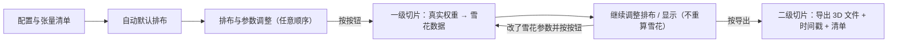

# snowglass 编辑器：排布、一级切片、二级切片（需求与设计）

> **状态：真实权重加载前的布局与编辑功能已实现并完成回归检查。** 当前适配 Qwen3.5-9B：官方 config 驱动功能分组，4.2 默认排布，块宽双模式、局部 gumball、幽灵毛坯、工程保存与布局 JSON 导出已可用。本轮没有读取权重数值，也没有运行一级切片或输出 OBJ / STL；真实灰度、工艺与最终作品范围仍待后续。第 12 节保留已确认的选项，第 13 节记录实施状态。
>
> **与 `docs/decisions.md` 的分工。** `decisions.md` 记录整个作品的决策（D 编号）和待定项（U 编号），比如"点数是后验结果"（D2）、"框和壳是实体"（D3）、"厂家工艺规格待核实"（U12）。本文只讲**编辑器这个工具怎么工作**：用户在里面按什么顺序做什么，每一步的输入输出，哪些操作会触发重算。本文用到 D/U 编号时，会当场把那条的内容说一遍，不需要去翻 `decisions.md`。
>
> **编号导览。** Q1–Q15 是本文第 12 节的编辑方案选项编号；`decisions.md` 的 D/U 编号属于整件作品的决策记录。默认布局归入 D11，内部张量填充归入 D13，编辑与两级切片行为归入 D14；每个 Q 条目保留具体解释和当前状态，不以编号引用代替内容。

---

## 1. 一句话流程

用户借了 3D 打印"切片"的说法，一共两次切片：

1. **排布**：脚本根据模型的配置自动排出一套默认布局。布局本质上是很多"包络块"，每个块是等着装权重雪花的空盒子。用户可以调整这些盒子的位置、缩放和外观。
2. **一级切片**：用户定好雪花参数（降采样、加工精度、底噪等）后按下按钮，后台读取真实权重，做谱分解、滤底噪、降采样，得到每个块的雪花数据，再填回各个盒子。
3. **一级切片之后继续调整**：拖 gumball、改显示参数都不会重算雪花数据，只是把同一份雪花数据在空间里重新摆放。
4. **二级切片**：把整个模型导出成 3D 文件（OBJ / STL 等），文件名带时间戳。

**没有先后锁定（用户已明确）。** 一级切片之前，排布参数和雪花参数都能随时调，不存在"必须先调好包络体积再调雪花参数"。默认排布装不下默认雪花参数切出来的结果，这是完全允许的：可以带着满屏红色先切一次，再慢慢拉 gumball，直到不报红为止。一级切片之前没必要、也做不到预先判断装不装得下。

---

## 2. 术语

- **包络块**：一个功能组的外形盒子，比如"第 3 层的 Q / Gate"。它有毫米尺寸和位置，外面有框（12 根实体方梁）和包络面（6 块实体薄板），里面装雪花。一个功能组可以包含多个独立张量；盒子是展示分组，不等于一张权重表，也不意味着这些张量在计算中被合并成一个操作。
- **雪花数据**：一级切片的产物。每个包络块对应一个三维格子阵列，每个格子存一个灰度（0 到 1），再按灰度生成点。
- **格间距**：块的毫米尺寸除以格子数，即相邻两个格子中心之间的距离。块被拉大，格间距就变大；块被压小，格间距就变小。
- **点距**：激光机能打的最小点间距，默认 0.08 mm。属于机台参数，也就是用户说的"加工精度"。
- **幽灵毛坯**：参照用的玻璃毛坯外形，可以有多个，可以新建、删除、拖拽、gumball、改尺寸。每个幽灵毛坯带一层"应力预留量"，即从外表面向内偏移的安全距离。它只做参照：模型超出时报红，但不阻止任何操作。
- **报红不阻挠（用户已明确）**：所有检查（出毛坯、超加工精度、超密度参考线、块重叠等）只显示红色或橙色提示，不禁止一级切片，也不禁止二级切片。
- **过期**：一级切片之后，如果改了雪花参数但还没重新切片，现有的雪花数据就是"过期"的。画面上继续显示旧数据，但标明已过期。
- **降采样（用户已明确其含义）**：把相邻的一批权重**合并**成一个格子的统计值，属于池化一类的压缩。每个权重都参与计算，**不是**隔几个取一个，也**不是**一开始就把一部分权重扔掉。现在的实现按行、按列把张量切成整数段，每个权重恰好落进一个格子，这一点和拓扑脚本"每个张量恰好归入一个块"的检查是同一个思路。合并时用什么统计量（绝对值均值、均方根、行列范数、谱分解后的结构部分等）属于"灰度合成方式"（第 6 节，对应 `decisions.md` 的 U7）。
  另有一步容易混淆：一级切片最后"按灰度出点"，是用随机抽样把已经合并好的格子值表现成点的疏密。出点概率 0.3 表示约 3 成概率出一个点；灰度须经 γ 和底噪地板转换后才得到这个概率。所有源权重参与统计，不表示压缩无损、能恢复逐个权重，也不表示每个原始权重都对应一个可见点。
- **块的缩放（用户已明确其含义）**：只是把已经算好的雪花重新摆放，块里的雪花跟着块的形状一起伸缩。用户的原话是"就像捏水气球一样，里面的雪花重新流动而已"。雪花数据本身不变，除非改了雪花参数并重新切片。
- **块间隙（用户已明确其规则）**：不改变整体排布尺寸。每个块的中心不动，只是块本身向内收缩或向外膨胀。规则详见 5.3 节。

---

## 3. 现状盘点（配置、拓扑与排布怎样生成）

| 部分 | 当前实现 | 文件 |
|---|---|---|
| 配置 | 首次获取官方 KB 级 config，之后读本地缓存；记录原始文件 SHA256。读取层数、逐层类型、文本与视觉维度，不加载权重 | `data/configs/Qwen3.5-9B.config.json` |
| 拓扑 | Python 按 4.2 功能组生成，清单只用于绑定名字、形状和量化格式；文本427、视觉334个张量全覆盖。另有纯config模式，明确标记未绑定 | `scripts/build_topology_qwen35.py` → `prototype/data/qwen35_9b.topo.json` |
| 排布 | HTML 的 `layout()` 取4.2配方，1单位＝1mm；默认369个权重功能块和1个MTP空框。默认逐块坐标与尺寸已经自动对照 | `prototype/snowglass_editor.html` |
| 编辑与显示 | 局部选择、三轴变换、幽灵参照、固定模拟样本、悬停、显示参数、保存打开和纯后验报告 | 同上 |

生成默认拓扑：`uv run --no-project python scripts/build_topology_qwen35.py`。指定配置可用 `--config <路径>`；只凭配置出架构加 `--architecture-only`，不会宣称清单覆盖已核实。当前只有 `qwen3_5_text` 的命名与分组适配器，其他架构明确拒绝，不凭字段相似猜测。

"排布只在前端实现一次，由编辑器导出 `layout.json` 交给后续步骤"这条做法保持不变，Python 端不重复写排布逻辑。

---

## 4. 默认排布：以 `real_config4.2.html` 为准

### 4.1 4.2 实际是怎么排的（Qwen3.5-9B，默认"纵向压缩"0.55）

下面的数是按 4.2 源码里的公式逐项算出来的，原型使用场景单位。编辑器初始按 1 场景单位＝1 mm 换算（Q4 已确认），所以默认坐标和尺寸可以直接取表中数值为毫米；后续全局或局部 gumball 仍可调整。

**竖直方向（从下往上，单列，不折行）：**

| 部件                 | 中心 y               | 高                         | 说明                                                              |
| -------------------- | -------------------- | -------------------------- | ----------------------------------------------------------------- |
| Token Embedding      | −12.20              | 1.40                       | 离塔底 1.2 的空隙                                                 |
| 32 层塔体            | 从 −10.30 到 +10.30 | 每层块高 0.396，层距 0.644 | 层高 = 0.72 × 压缩，层间空 = 0.45 × 压缩；层多于 45 时再乘 0.72 |
| Final Norm（"脖子"） | +11.15               | 0.40                       | 居中，宽 6.5，比上下两个头窄得多                                  |
| LM Head              | +12.80               | 1.40                       | 与 embedding 同尺寸                                               |
| MTP                  | +12.80               | 1.19                       | 在 LM Head 右侧，x = 10.5                                         |

**水平方向（每一层，从左往右）：**

| 部件                 | x 范围            | 宽                     | 深                      |
| -------------------- | ----------------- | ---------------------- | ----------------------- |
| Norm 1               | −10.53 … −9.88 | 0.65                   | 3.72（主体深度 × 0.6） |
| 序列混合（3 块等宽） | −9.20 … −1.40  | 每块 2.41，块间空 0.28 | 6.2                     |
| Norm 2               | −0.88 … −0.23  | 0.65                   | 3.72                    |
| FFN（3 块等宽）      | 0.40 … 10.00     | 每块 2.99，块间空 0.32 | 6.2                     |
| Embedding / LM Head  | −7.0 … 7.0      | 14                     | 7.13（× 1.15）         |
| Final Norm           | −3.25 … 3.25    | 6.5                    | 3.72                    |
| MTP                  | 8.4 … 12.6       | 4.2                    | 5.58                    |

**视觉塔（独立一列，中心 x = 23.5）：**

| 部件                                             | 位置                                         | 尺寸                             |
| ------------------------------------------------ | -------------------------------------------- | -------------------------------- |
| Patch / Position（入口，在下）                   | y = −10.18                                  | 8.2 × 1.1 × 5.58               |
| 27 层，每层 4 块：Norm 1、Attention、Norm 2、MLP | 层距 0.65，块高 0.40，总跨度 17.55，上下居中 | 宽分别为 0.45 / 3.6 / 0.45 / 4.0 |
| Merger / Projector（出口，在上）                 | y = +10.28                                   | 8.5 × 1.2 × 5.89               |

视觉塔左缘（x = 18.78）离文本主体右缘（x = 10.0）8.8 个单位，离 MTP 右缘 6.2 个单位。这片空白就是你说的"呼吸感"。

**整体包围盒：宽 38.9 × 高 26.4 × 深 7.1**（含视觉塔）；不含视觉塔时是宽 23.1 × 高 26.4 × 深 7.1。

**外观：** 线框透明度 0.18，面透明度 0.024（几乎看不见），点大小 0.065，叠加混合，16 % 的点是亮点（亮度 0.48–1.0），其余是暗点（0.05–0.19）。

### 4.2 迁移前差异（以下旧编辑器描述为历史对比，本轮已完成布局迁移）

| 项           | 4.2                                                           | 现在的编辑器                               | 改法                                                                        |
| ------------ | ------------------------------------------------------------- | ------------------------------------------ | --------------------------------------------------------------------------- |
| 残差棒       | 没有                                                          | 有，1.2 mm 实体棒                          | **去掉（用户已明确）**。`decisions.md` 的 D11 已更新，撤销的是其中画残差棒的选择 |
| 前后错开 | **没有**，所有块在同一深度平面（z = 0） | 有，注意力列和 MLP 列错开 4 mm | **删除专门错开规则、参数和滑块（已确认）**；需要错位时选块用局部 gumball |
| 每层的块数   | 8 块：Norm 1、混合 ×3、Norm 2、FFN ×3                       | 线性层 11 块、全注意力层 10 块（按张量拆） | 见 Q2                                                                       |
| 块宽         | 同组内**等宽**                                          | 按参数量的平方根分                         | 见 Q3                                                                       |
| norm 的位置  | Norm 1 在最左，Norm 2 夹在混合和 FFN 之间                     | 两条 norm 都在最外侧                       | 照 4.2                                                                      |
| 头的尺寸     | 宽 14（约等于整层宽 20.5 的 0.68），高 1.4（层块高的 3.5 倍） | 宽是主体的 0.78 倍                         | 照 4.2                                                                      |
| 头的左右错位 | 没有，embedding 和 LM Head 都居中（x = 0）                    | 左右各错 0.12 主体宽                       | 照 4.2                                                                      |
| 视觉塔每层   | 4 块（带两个 norm）                                           | 2 块（norm 并在块里）                      | 照 4.2，拓扑分组跟着改                                                      |
| 视觉塔位置   | 独立，空 8.8 单位                                             | 空 3 mm，挤                                | 照 4.2                                                                      |
| 相机         | 视场角 42°，水平角 0.42，俯角 0.16，按包围盒自动取距离       | 固定位置                                   | 照 4.2                                                                      |

### 4.3 "从 config 出架构"怎么做

4.2 采用"配置字段 + 模型类型规则"的写法，但当前文件用的是内嵌模型表，并没有直接读取外部 `config.json`。表里包含层数、hidden、FFN 维度、词表、视觉层数、专家数和模型类型，排布由每种模型类型对应的一组规则决定。迁移时提取这些布局规则，配置解析与张量归属另行核对，不把示意模型表等同于已经验证过的完整计算图。

- **模型类型 → 混合器名字和拆法**。Qwen 是每 4 层第 4 层为全注意力，其余为 Gated DeltaNet。Gated DeltaNet 拆成"输入投影 / 门控·Conv / 输出投影"，全注意力拆成"Q·Gate / K·V / 输出投影"。
- **块尺寸是常量**：混合区总宽 7.8，FFN 总宽 9.6，深 6.2，norm 宽 0.65，头宽 14。只有竖直方向随层数和"纵向压缩"变化。
- **视觉塔的层距**随文本塔高度变化：层距 = max(0.65, 文本塔高 × 0.85 ÷ 视觉层数)。

我们的做法：

1. **拓扑脚本**（Python）按 4.2 的拆法分组，每个块记下：属于哪一层、在该层排第几个（例如"混合第 2 块"）、含哪些张量。张量全覆盖的检查保留不变。
2. **排布函数**（编辑器 JS）里放一张"布局配方"常量表，内容就是 4.1 节那些数。`layout()` 只读这张表和拓扑，算出每块坐标。现在手写的那些比例常量全部删掉。
3. 以后接别的模型（阶段 5），就是给配方表加一种模型类型、给拓扑脚本加一套分组规则，排布函数本身不动。

### 4.4 比例冲突：4.2 是横向扁块，默认毛坯是竖长条

4.2 的整体比例是**宽 38.9 : 高 26.4 : 深 7.1**，是一块横着放的扁方块。而 `decisions.md` 默认值表里的毛坯是 25 × 25 × 80 mm 的竖长条，四周留 2.5 mm 后可用空间是 20 × 20 × 75。

如果把 4.2 原样等比缩进 20 × 20 × 75：

| 情况                                          | 能放多大（每单位多少毫米） | 模型毫米尺寸        | 一层块高                   |
| --------------------------------------------- | -------------------------- | ------------------- | -------------------------- |
| 带视觉塔，竖放                                | 0.514                      | 20.0 × 13.6 × 3.7 | 0.20 mm（只有 2.5 个点距） |
| 不带视觉塔，竖放                              | 0.865                      | 20.0 × 22.8 × 6.2 | 0.34 mm（4.3 个点距）      |
| 带视觉塔，毛坯横放（75 宽 × 20 高 × 20 深） | 0.758                      | 29.5 × 20.0 × 5.4 | 0.30 mm                    |
| 如果 1 单位 = 1 mm（不缩放）                  | 1.0                        | 38.9 × 26.4 × 7.1 | 0.40 mm（5 个点距）        |

上表只说明主动等比缩入不同毛坯时的几何结果，不是启动时的自动操作。用户已选择初始 1 场景单位＝1 mm：带视觉塔时模型约宽 38.9 × 高 26.4 × 深 7.1 mm。默认模型可以超出幽灵毛坯，出界仅提示；不自动缩进、不压窄留白，也不切浅块深。用户之后自行用 gumball 调整。

---

## 5. 排布阶段的编辑（一级切片前后都能做，都不重算雪花）

### 5.1 选择与 gumball

- **全选**：gumball 作用于整个模型（现在已有）。
- **局部选择（用户已明确）**：单击选一块，Shift 单击加选，屏幕上拖框框选；支持按层和按列选择，方便一次调整整层或整列。需要错位时选中对应块，用局部 gumball 平移，不设置专门的前后错开功能。
- gumball 三种模式：移动、旋转、缩放（三个轴可以分开缩）。
- 缩放改的是块的毫米尺寸。框和壳的毫米厚度不跟着缩放，保持物理值（现在已是这样）。

### 5.2 手动调整怎么存

每块的手动调整以相对于自动槽位的4×4仿射矩阵保存，包含移动、旋转、非均匀缩放；自动排布改变后继续套用，不重新生成雪花。提供“重置选中”和“恢复默认工程”。工程文件同时保存幽灵毛坯、基础配方参数、相机和固定模拟样本的种子 / 数量。

### 5.3 可调的排布参数

| 参数 | 来源 | 说明 |
|---|---|---|
| 块间隙 | 现有编辑器已有，**保留（用户已明确）** | 规则见本表下方 |
| 块宽模式 | Q3 已确认 | 默认同组等宽，可切换按参数规模；只重排，不重切雪花 |
| 初始单位换算 | Q4 已确认 | 1 场景单位＝1 mm；模型不随参照毛坯自动缩放 |
| 纵向压缩 | 4.2 已有 | 同时改层高和层间空 |
| 主体深度 | 4.2 的 6.2 | 用户说的"块深度"。各部件按 4.2 的倍数跟着变（norm × 0.6，头 × 1.15，视觉块 × 0.85） |
| 框：粗细、灰度 | D3 | 框是 12 根实体方梁，灰度在成品里就是点的疏密 |
| 包络面：厚度、灰度 | D3 | 6 块实体薄板 |
| 视觉塔是否进作品 | 已有 | |
| 整体缩放 | 已实现 | 滑块等比缩放基础配方；全选 gumball 记录手动空间变换，可三轴独立。两者只重排样本 |

**块间隙的规则（用户已明确：不影响总体尺寸，每一个块向内压缩或向外膨胀）。**
- 排布先给每个块分一个"槽位"：块的中心，以及它最多能占的范围，由布局配方决定。槽位只随纵向压缩、主体深度、整体缩放、gumball 变化，**不随块间隙变化**。
- 块的实际尺寸 = 槽位尺寸 − 块间隙。块间隙调大，每块绕自己的中心等量缩小；调小，每块等量变大；调成负值，块会胀出槽位、和邻居重叠（报红，不阻挠）。
- 默认块间隙取 4.2 的原值，此时排布与 4.2 完全一致。4.2 里有三处不同的间隙：层与层之间空 0.45 × 压缩，混合区各块之间空 0.28，FFN 各块之间空 0.32。所以滑块存的是"相对 4.2 默认间隙的增减量"，三处同加同减。
- 收缩只作用在左右（x）和上下（y）；深度由主体深度或 gumball 单独控制。这是 Q15 暂按推荐接受的选择。
- **已实现并验证**：间隙增减作用于每个块的 x/y 尺寸，中心和层节距不变；深度不受影响。报告同时展示“槽位总体尺寸”与“实际模型尺寸”：槽位跨度固定，实际外沿可以因各块内缩 / 外胀而变化。尺寸不允许退化成零或负数，达到该数学边界时保留最小可表示厚度并提示，不解释成工艺配额。

### 5.4 幽灵毛坯（用户已明确）

- 可以**新建、删除、拖拽、gumball**，可以**编辑特征尺寸**：长方体改三条边长，圆柱改半径和高。还要不要别的形状（球、六棱柱等），按需再加。
- 每个幽灵毛坯有自己的"应力预留量"（向内偏移），画面上同时显示外表面和向内偏移后的内表面。
- **只做参照**：模型或某个块超出内表面就报红，并高亮出界的块。不影响一级切片，也不影响二级切片。
- 毛坯已与排布脱钩：新建、改尺寸、旋转或缩放毛坯不移动模型。长方体内偏移按变换后的平面距离检查；非等比圆柱的内偏移采用保守近似，并在界面说明，不声称已做应力仿真。
- 有多个毛坯时，后验报告里和"可用空间"有关的数字以哪个为准，见 Q5。

### 5.5 现有功能保留（用户已明确：鼠标悬停、块间隙等不要删）

改排布时，下面这些现有功能全部保留。前两项是用户点名的，其余是 agent 按现状列出的，默认也保留：

- **鼠标悬停**：显示块名、尺寸，以及它来自哪些张量（GGUF 名、HF 名、形状、量化格式、二维拆三维的方式、还原规则）。分组改成 4.2 的拆法后，一个块含多个张量，悬停时全部列出。
- **块间隙**：规则按 5.3 节。
- 全选与局部 gumball（移动 W / 旋转 E / 缩放 R / 关 Q），三轴分别保留，变换存入各块相对槽位的矩阵，不把三个缩放数取平均。框壳保持请求的毫米厚度，若薄块内腔被填满则记录有效厚度并提示。
- 后验报告（第 8 节），以及参数变化后悬停卡片跟着刷新。
- 框和包络面：实体、粗细、灰度，以及"框 / 包络面 / 雪花 / 标签 / 铭牌"等显示开关、按功能着色、自转、屏幕上画多少个点。
- 加工点距、点径、打点速度、密度告警参考线、γ、底噪地板、降采样倍数这些参数滑块。
- 导出 `layout.json`。
- 毛坯预设和自定义尺寸：并入幽灵毛坯（5.4 节），不删除。
- 残差棒**删除**（用户已明确）。专门的前后错开规则、参数和滑块也删除（Q1 已确认）；局部 gumball 的移动能力保留。

### 5.6 工程保存（暂按推荐接受）

支持"保存工程 / 打开工程"：手动调整、幽灵毛坯和各种参数存成一个 `*.snowglass.json` 文件，同时在浏览器本地自动保存最近一次状态。一级切片的结果另外存在磁盘上（第 7 节），工程文件里只记它的编号。

---

## 6. 雪花参数（一级切片的输入）

| 参数                                       | 作用                                                           | 现状                                          |
| ------------------------------------------ | -------------------------------------------------------------- | --------------------------------------------- |
| 降采样（压缩倍数，或"每格代表多少个权重"） | 决定每块切成多少格，也就是多少个相邻权重合并成一个格子；不丢弃任何权重（第 2 节） | 编辑器有滑块，还没接后端 |
| 加工精度（点距）                           | 机台最小点间距；用来判断"装不装得下"；开自适应时用来反算格子数 | 有                                            |
| 谱分解设置                                 | 界外奇异方向的判定（噪声上界）、最多取几个方向                 | 脚本里有，界面没有                            |
| 底噪地板                                   | 灰度为 0 的格子也保留的最低出点概率，免得太空                  | 有                                            |
| γ（对比度）                               | 灰度到出点概率的曲线                                           | 有                                            |
| 灰度合成方式                               | 用哪种统计量当灰度（abs 均值、行列范数、谱结构、残差的组合）   | U7 未定：阶段 2 第一轮测了五种，倾向 abs 均值 |
| 随机种子                                   | 灰度到点的抽样可复现                                           | 有                                            |
| 自适应开关                                 | 一级切片时按当前块尺寸和点距自动挑降采样                       | 新增，见 7.3                                  |

这些参数随时可以改。改了以后**不自动重算**，只把现有雪花数据标成"过期"，等用户按一级切片按钮。

---

## 7. 一级切片

### 7.1 输入与输出

**输入**：雪花参数（第 6 节）、拓扑、每块的格子数（由降采样决定，开自适应时还要用到当前块尺寸）。

**输出**（存在磁盘上，每次切片一个编号）：

- 每个块的灰度格子阵列（三维，0–1）。
- 每个块的点集，坐标是**块内归一化坐标**（每个轴 0 到 1），与块的毫米尺寸无关。
- 每块的统计：格子数、每格代表多少权重、谱分解界外方向数、平均灰度、出点数、局部峰值等。
- 一份清单：本次切片用的全部参数、源文件校验和、切片编号、时间。

### 7.2 同一份雪花数据在空间里伸缩（用户的理解，agent 确认正确）

用户的说法：块的缩放是把已经算好的雪花重新排布，"就像捏水气球一样，里面的雪花重新流动而已"，除非改了雪花参数才重算。落到数据上就是下面这样。

一级切片之后，每块的格子数 $(n_x, n_y, n_z)$ 和点集就固定了。点集存的是块内归一化坐标，块被拉长、压扁、放大或缩小时，每个点按块的三个轴各自等比例移动，点与点的相对位置关系不变。块的毫米尺寸 $(L_x, L_y, L_z)$ 由排布决定，随 gumball 变化。两者一除就是格间距：

$$
\text{格间距} = \left(\frac{L_x}{n_x},\ \frac{L_y}{n_y},\ \frac{L_z}{n_z}\right)
$$

- **任一轴的格间距小于点距**：相邻两点比机器能打的还近，就是"装不下"，报红。
- **格间距大于点距**：点变稀，不是问题，就是你说的"张开自然张开"。
- **雪花点的总数不随缩放变**。随尺寸变的只有框和壳，它们是几何件。

举例（按 1 单位 = 1 mm）：一个混合块是 2.41 × 0.40 × 6.2 mm。如果切成 30 × 5 × 77 格，格间距正好约 0.08 mm。之后把它缩到 0.9 倍，格间距变成 0.072 mm，小于点距，报红；放大到 1.2 倍，格间距变成 0.096 mm，正常，只是更稀。

用户之前问过两种缩放语义（"锁点密度动压缩力度"还是"动压缩力度锁采样力度"），在这个框架下两种都有：

- **锁数据（默认）**：一级切片后随便缩放，数据不变，只是密度变。
- **锁密度**：缩放后想让点的密度保持不变，就得按新尺寸重新算格子数。这必须重新做一次一级切片（打开自适应再按按钮），**不做实时自动重算**。

### 7.3 自适应选项（用户已明确：可选）

勾选后，一级切片会根据配置、张量形状、当前块尺寸和点距，自动挑出每块的降采样，使格间距尽量接近点距、不超过机器分辨率。目的是"得到一个尽可能合适的默认值"。不勾时，按用户填的降采样执行。第一次切片默认勾选，之后可关闭并锁住降采样；这是 Q7 暂按推荐接受的选择。自适应只在按下切片按钮时执行，拖动 gumball 不触发重切。

### 7.4 哪些改动触发什么（用户已明确的规则）

| 改动                                                   | 一级切片                         | 立刻更新的东西                         |
| ------------------------------------------------------ | -------------------------------- | -------------------------------------- |
| 全局或局部 gumball、纵向压缩、主体深度、间隙 | **不重算** | 位置、格间距检查、后验报告、结构件点数 |
| 框 / 壳的厚度和灰度                                    | 不重算                           | 结构件、后验报告                       |
| 显示参数（点大小、亮度、屏幕上画多少点、标签）         | 不重算                           | 画面                                   |
| 幽灵毛坯                                               | 不重算                           | 出界检查                               |
| 雪花参数（第 6 节那张表）                              | **标过期，按了按钮才重算** | 画面继续显示旧数据，并标明已过期       |

修改加工点距一律把已有一级切片结果标为过期，同时按新点距更新检查；在用户按按钮前仍显示旧雪花，不自动重切（Q8 暂按推荐接受）。

### 7.5 怎么跑

- 一级切片要读真实权重，必须在 Python 里做。编辑器上按按钮，经由本地 Python 服务启动一个后台任务（第 11 节）。
- 界面上显示进度：当前处理到哪个块、已用时间、预计剩余时间。
- **耗时尚需核实**：此前约 1 s 解码、1.3 s 池化、0.1 s SVD 的试算，SVD 处理的是池化后的 418 × 250 矩阵，不是原始数千万参数矩阵。不能据此推算完整一级切片只需 7–10 分钟；原始张量谱分解、重构和压缩须分别做探针，再报告预计耗时。embedding 和 LM Head 各约 10 亿参数，完整 float32 数组约 4 GB，处理时需核算峰值内存。
- **缓存**：尽量保存可复用的谱分解与细粒度统计。仅改变 γ、底噪或灰度合成时可以复用前面的计算；改变压缩要求时，是否能由缓存完成取决于缓存粒度，不能保证任何参数下都无需重读。无论采用哪条计算路径，只有按下一级切片按钮才执行，不把拖动 gumball 变成自动重算。
- 支持"只切选中的块"，方便先拿两三层验证效果，不必每次全量重切（Q13 暂按推荐接受）。

---

## 8. 后验报告与报红（全部不阻挠）

沿用 `decisions.md` D2 的原则：点数是算出来的结果，不是配额。超了就标出来，由用户回去改前置条件再切。

| 检查           | 什么时候有                   | 判据                                                                                                |
| -------------- | ---------------------------- | --------------------------------------------------------------------------------------------------- |
| 出幽灵毛坯     | 一直有                       | 块是否超出各毛坯向内偏移后的内表面；列出出界的块                                                    |
| 加工精度装不下 | 一级切片后                   | 任一块、任一轴的格间距 < 点距；列出块名和最小格间距                                                 |
| 真实密度 | 一级切片后 | 未加载真实雪花前不根据模拟样本推称加工密度。真实结果需明确局部统计范围和参考来源；10 % 仍是未核实参考值 |
| 块重叠         | 一直有                       | 手动调整后可能出现。现在是"通过 / 不通过"，改成报红不阻挠                                           |
| 结构件过薄     | 一直有                       | 框或壳薄于 2 倍点距，切出来可能断断续续                                                             |
| 一级切片过期   | 一级切片后                   | 改了雪花参数还没重切                                                                                |
| 机时、总点数   | 一直有                       | 只报数，不判对错                                                                                    |

二级切片导出时，当时所有报红项都写进导出清单，事后可以查。

---

## 9. 二级切片（导出）

### 9.1 导出什么

- 雪花点：把每块的归一化点集，按当前排布（含手动调整）换算成毫米坐标。
- 结构件：每块的框（12 根方梁）和包络面（6 块薄板），按当前厚度。
- 文件名带时间戳（用户已明确），例如 `out/export/qwen35_9b_20261117-153012.obj`。同名再出一份清单 `…_manifest.json`，记录排布、一级切片编号、全部参数、源文件校验和、所有报红项、点数和机时。

### 9.2 Python 写不写得出 OBJ / STL

写得出。OBJ 和 STL 都是结构很简单的文本或二进制格式，用 numpy 直接写就行，不需要额外的库。真正的问题在文件大小，以及厂家那边怎么读：

| 写法                                          | 每点大小    | 300 万点  | 问题                                                         |
| --------------------------------------------- | ----------- | --------- | ------------------------------------------------------------ |
| OBJ，每个点一个顶点，不带面                   | 约 30 字节  | 约 90 MB  | 很多建模软件能显示；但部分切片软件不认没有面的 OBJ           |
| STL，每个点一个小四面体（4 个三角面，二进制） | 约 200 字节 | 约 600 MB | 厂家软件通常会按表面重新生成自己的点，等于把我们的点打散重排 |
| PLY 点云（二进制）                            | 约 15 字节  | 约 45 MB  | 内雕软件常见输入之一，要问厂家认不认                         |
| 结构件（框、壳）                              | —          | —        | 本身就是实体，OBJ / STL 都很自然                             |

`decisions.md` "不做什么"里写着"不默认发纯 XYZ 点云"，这条保留：纯文本 XYZ 只在厂家明确要求时才出。

### 9.3 厂家那边可能还有一次切片

我们的二级切片交出去以后，厂家软件很可能再做一次，按它自己的规则把模型转成激光点。这就是 U12 第 4 问（"收到模型后你们会不会自行改点距、跳点或简化结构，会不会事先告知"）担心的事。如果厂家会重新出点，我们点集的可追溯性就到我们的文件为止。所以导出格式怎么选，取决于问厂家的结果（U1、U12），见 Q11。

---

## 10. 显示

- **一级切片前**：块里显示模拟雪花，外观照 4.2（两档亮度、叠加混合、点大小 0.065 单位），画面上标明"模拟"。
- **一级切片后**：显示真实点集。屏幕上画多少点只是为了不卡，可以抽样，与玻璃里有多少点无关（D2 已定）。
- **灰度怎么显示**：默认用点的亮度，也提供点大小显示的切换（Q9 暂按推荐接受）。这只影响屏幕显示，不影响导出；未把“点大小表示灰度”确定为厂家加工约定。
- 线框和面照 4.2 的观感（线 0.18、面 0.024），但我们的框和面是实体（D3 已定：零厚度的线和面切不出点，WebGL 的线宽在 Windows 上又固定为 1 像素）。默认的粗细和灰度要调到看起来接近 4.2。

---

## 11. 技术结构

| 部分           | 做什么                                                                                                                        | 文件                                                      |
| -------------- | ----------------------------------------------------------------------------------------------------------------------------- | --------------------------------------------------------- |
| 前端编辑器     | 排布、选择、gumball、幽灵毛坯、参数面板、显示、后验报告；发起一级 / 二级切片                                                  | `prototype/snowglass_editor.html`（继续在这个文件上改） |
| 拓扑脚本       | 按 4.2 的拆法分组，检查张量全覆盖                                                                                             | `scripts/build_topology_qwen35.py`（直接改）            |
| 本地服务（新） | 同时提供静态文件和接口：发起一级切片、查进度、发起导出。只用 Python 标准库，替代现在 8123 / 8124 两个 `http.server`         | `scripts/serve.py`                                      |
| 一级切片（新） | 独立张量解码 → 谱分解及其他统计 → 池化压缩 → 灰度 → 点集。实验脚本可复用读取与池化方法，但不把池化后小矩阵的 SVD 当成原始权重谱分解 | `scripts/slice1.py` |
| 二级切片（新） | 读排布与一级切片结果，写 3D 文件和清单                                                                                        | `scripts/export.py`                                     |
| 数据目录       | 拓扑：`prototype/data/`；一级切片结果：`prototype/data/slices/<编号>/`；细粒度缓存：`out/cache/`；导出：`out/export/` |                                                           |

---

## 12. 选项与确认状态（Q1–Q15）

Q1 已确认删除专门错开功能；Q2、Q5–Q9、Q11–Q15 已按此前推荐接受。本轮用户明确接受其余三项：Q3 块宽双模式、默认同组等宽；Q4 初始 1 场景单位＝1 mm；Q10 各张量独立处理后分区填充、外面一套框。以下保留各项背景；需求选择不代表代码已经实现或已经通过工艺验证。

**Q1 前后错开功能：彻底删除（已确认）。**

默认布局照 4.2 的单平面排布；删除专门的错开规则、参数和滑块。用户需要错位时自行选择块或整列，用局部 gumball 移动。下面保留两个参考原型的坐标差异，说明此前讨论对象，不再作为待选布局。

先说清楚 `real_config.html`（第一版）里到底是谁和谁错开。下面的数是按它源码里 Qwen3.5-9B 的参数算出来的（主体宽 6.8；x 向右为正，z 朝观察者为正）：

| 部件 | x 范围 | z 范围（深度方向） | 深 |
|---|---|---|---|
| Input RMSNorm（左侧细柱） | −3.99 … −3.77 | −0.75 … +0.75 | 1.5 |
| **序列混合列**（全注意力层的 Q/K/V/O，或 GDN 层的 K-state/V-state/Gate/Conv） | −3.26 … −0.68 | −1.375 … +1.375 | 2.75（GDN 的 Conv 块深 1.7） |
| **MLP 列**（gate / up / down 三片） | −0.48 … +3.20 | **+1.11 … +2.59** | **1.48** |
| Post RMSNorm（右侧细柱） | +3.77 … +3.99 | −0.75 … +0.75 | 1.5 |
| Token Embedding / LM Head | 中心 x = −1.2 / +1.2 | 都在 z = 0 | 4.8 |

所以，**错开的是"序列混合列"和"MLP 列"**。混合列在左、靠后；MLP 列在右、整体往前推了 1.85，而且只有 1.48 深，比混合列的 2.75 薄了将近一半。从上往下看，就是你截图里的"左上、右下"两大片：两列在 x 方向隔 0.2，在深度方向只在 1.11 … 1.375 这一小段重叠，只有角对角挨着。

全注意力层和 GDN 层之间**没有**错开：32 层的混合列全部在 z = 0，MLP 列全部在 z = +1.85，层与层的区别只在混合列内部怎么拆。两条 norm 柱留在 z = 0 不动。上下两个头只在左右方向错开（−1.2 / +1.2），深度方向不错开。

`real_config4.2.html` 里所有块的 z 都是 0：混合三块和 FFN 三块同深 6.2，embedding 和 LM Head 都居中，前后、左右都不错开。上一轮编辑器里的"注意力列 z = −2 mm、MLP 列 z = +2 mm、两列同深"，是照第一版的错开方式做的，但没有照它把 MLP 变薄，因为你说过"不要变浅"。

原有四个候选方案不再并列保留；本轮确定的是删除专门错开功能，而不是仅把默认错开量调成 0。

**Q2 块怎么分组（暂按推荐接受）。** 照 4.2，每个文本层 8 个外层功能块，视觉每层 4 块。以下为采用的张量归属，原始张量身份保持独立；块内按 Q10 分区填充，不把不同张量混成一张矩阵：

| 4.2 的块 | 线性层（Gated DeltaNet）含的张量                                                                             | 全注意力层含的张量                             |
| -------- | ------------------------------------------------------------------------------------------------------------ | ---------------------------------------------- |
| Norm 1   | `attn_norm`                                                                                                | `attn_norm`                                  |
| 混合 1   | 输入投影：`attn_qkv`                                                                                       | Q / Gate：`attn_q`、`attn_q_norm`          |
| 混合 2   | 门控 / Conv：`attn_gate`、`ssm_alpha`、`ssm_beta`、`ssm_conv1d`、`ssm_a`、`ssm_dt`、`ssm_norm` | K / V：`attn_k`、`attn_v`、`attn_k_norm` |
| 混合 3   | 输出投影：`ssm_out`                                                                                        | 输出投影：`attn_output`                      |
| Norm 2   | `post_attention_norm`                                                                                      | `post_attention_norm`                        |
| FFN 1–3 | `ffn_gate` / `ffn_up` / `ffn_down`                                                                     | 同左                                           |

视觉每层：Norm 1 = `ln1`；Attention = `attn_qkv` + `attn_out`（含 bias）；Norm 2 = `ln2`；MLP = `ffn_up` + `ffn_down`（含 bias）。
总块数：文本 32 × 8 + embedding + final norm + LM Head = 259，视觉 27 × 4 + 入口 + 出口 = 110，另加一个只画框的 MTP（U9）。
接受的是外层功能分组和完整收录张量；不是把同一个盒子里的不同张量先混成一张表再算。

**Q3 块宽：两种模式都保留，默认照 4.2 同组等宽（已确认）。**

参数量是数组里数值的个数，不是重要性的评分。很小的归一化或门控参数也可能影响大量通道；因此不把体积命名为“重要性”，也不自动用参数量决定某块值不值得保留。

- **同组等宽（默认）**：同一个混合区或 FFN 区内部，各块用 4.2 的等宽槽位。它表达功能顺序与层的重复节律，最直接保留已选的排布审美；不是所有部件一律同尺寸，norm、上下两个头和视觉塔仍用各自的比例。
- **按参数规模（可选）**：在同组的可分配总宽不变、块数和顺序不变的前提下，按各块参数量分配宽度。不对 norm、端部或整座视觉塔自动套用比例。这表示存储规模，不表示重要性，也不等于按计算量分配。
- 两种模式共用张量归属和一级切片结果。切换只改变空间排布，不触发谱分解、池化或重新出点。手动 gumball 调整保留。
- **点密度与参数量分开**：一级切片后，某块雪花点数 N 固定，物理密度为 N ÷ 当前块体积 V。等宽且同高同深的两个块，只有 N 不同时才有不同的平均点密度。参数多不必然更亮或更密：开自适应时可能得到相近格数但每格合并更多权重；固定每格合并量时，较大张量通常有更多格。最终还取决于统计值、灰度转换和出点结果，报告分别显示原始参数量、每格合并量、实际点数与密度。

用户已接受这两种模式及等宽默认值。确认的是空间布局选择，不是按参数量判断重要性，也不强行令各块同密度。

**Q4 初始毫米尺寸：1 场景单位＝1 mm（已确认）。**

默认取 4.2 的坐标和尺寸直接作为毫米，带视觉塔的 Qwen3.5-9B 约宽 38.9 × 高 26.4 × 深 7.1 mm。幽灵毛坯另行参照；出界只报红，不在启动时自动缩到毛坯内，不为装进毛坯而变更部件比例或留白。整体和局部尺寸仍可用 gumball 调整。

**Q5 多个幽灵毛坯（暂按推荐接受）。** 指定一个"主参照"毛坯，用于报告里的可雕区格点数和平均填充率；其余毛坯只做出界检查。更换主参照不改模型，也不改已经生成的雪花。

**Q6 手动调整的保存（暂按推荐接受）。** 手动调整存成相对偏移和缩放倍数，自动排布重算后照样套回去；提供"重置选中块"和"重置全部"。

**Q7 一级切片分辨率与自适应（暂按推荐接受）。**

- 不开自适应：用户直接定"每格代表多少行 × 多少列权重"，跟块的毫米尺寸无关。装不下就报红。
- 开自适应：按当前块尺寸和点距反算。
第一次切片默认开，之后可以关掉，把降采样锁住。

**Q8 点距改动（暂按推荐接受：一律标过期）。** 你说过"除非改降采样参数或加工精度参数，才重新切片"。因此加工点距改动一律标过期，同时刷新检查；仍须按按钮才重切。不开自适应时，新点距未必改变雪花数据本身，但采用统一的过期提示，不悄悄替换已有结果。

**Q9 灰度出点与显示（暂按推荐接受）。** 每格最多出一个点，出点概率由灰度经 γ 和底噪地板换算。点取在格子中心、不加位置抖动时，各轴格间距均 ≥ 点距是块内点间距满足要求的充分条件；不是等价关系，稀疏出点可能让较细的栅格也没有实际近邻冲突，跨块还要另外检查。显示默认用亮度，点大小作为切换选项。

**Q10 多张量：独立处理、分区填充、外面一套框（已确认）。**

张量是权重文件里独立存放的数值数组：二维的是矩阵，一维的是向量。视觉功能块是为了展示而做的分组；例如 4.2 把 GDN 压成“输入投影 / 门控与 Conv / 输出投影”三块，但实际计算中门控、短卷积和递推控制各有独立参数。它们可称为这个功能组里的子结构，不是同一权重的重复版本，也不是几层网络混到一起。

Qwen3.5-9B 第 0 层的拟议“门控 / Conv”组（形状来自张量清单）：

| 独立张量（GGUF 名） | 形状 | 作用 |
|---|---|---|
| `blk.0.attn_gate.weight` | 4096 × 4096 | 输出门控投影 |
| `blk.0.ssm_alpha.weight`、`blk.0.ssm_beta.weight` | 各 32 × 4096 | 递推控制的两个投影 |
| `blk.0.ssm_conv1d.weight` | 8192 × 4 | 各通道的短卷积核 |
| `blk.0.ssm_a`、`blk.0.ssm_dt.bias` | 各 32 | 递推控制参数 |
| `blk.0.ssm_norm.weight` | 128 | 头内归一化参数 |

一个盒子共含这 7 个数组，只在展示上合组；这个盒子横跨 GDN 内部几个步骤，并不是模型代码里天然存在一个同名的单独算子。全注意力的“K / V”盒子同样包含 K、V 两张投影矩阵和 K 的归一化向量。反过来，一张 `attn_qkv` 也可以包含 q/k/v 三个行段：张量的存储边界和展示边界不是一一对应。

内部各张量独立处理、保留自己的名字和形状，再把结果放入同一盒子的不同子区域；不把矩阵、卷积核和小向量拼起来一起做谱分解。外面仍是一套框，不自动新增 7 套嵌套框，以免破坏 4.2 的整体观感；悬停与清单能查看各张量及子区域归属。子区域边界决定后，gumball 变形整块时各子区域和已经生成的点一起伸缩，不重算一级切片。

已选的是分区填充，不采用“拼成大矩阵统一处理”。子区域记录各自边界、张量名、原形状与折叠规则；小张量也必须参与处理，不因参数少而丢弃。具体子区域和格数分配在实现中核算并写入清单，不把其视作重要性评分。内部子区域与 Q3 外层块宽模式是不同尺度的布局；整块缩放只改变已有子区域与雪花的空间映射。

**Q11 二级切片格式（暂按推荐接受）。** 先实现 OBJ（雪花点作顶点 + 结构件作网格）和 STL（雪花点作小四面体 + 结构件），各带清单。能导出这两种格式，不等于厂家已经确认接收方式；实际交付约定仍待 U1 / U12 核实。

**Q12 装不下时的可选自适应（暂按推荐接受）。** 提供按钮"按当前尺寸自适应重切"，等于勾上自适应再跑一次一级切片。导出时不自动合并相邻格、不偷偷删点；报红仍不阻挠导出。

**Q13 局部一级切片（暂按推荐接受）。** 可以只切选中的块，用于先拿两三层验证效果，不必每次全量。

**Q14 工程保存（暂按推荐接受）。** 保存并恢复手动调整、幽灵毛坯、参数与切片结果引用；支持文件保存 / 打开和浏览器本地自动保存（5.6 节）。

**Q15 块间隙作用方向（暂按推荐接受：只作用 x / y）。** 中心和槽位不动，每块在左右和上下向内收缩或向外膨胀；深度由主体深度或 gumball 单独控制，不因间隙滑块改变。

---

## 13. 实施计划与验证状态

每一步做完都能单独验证。本轮已完成步骤1–4的无权重版本及几何后验；步骤5的真实一级切片、步骤6的真实点间距核对、步骤7的三维加工文件导出尚未接入。

| 步 | 内容 | 改哪些文件 | 做完的标准 |
|---|---|---|---|
| 1 | 拓扑分组改成 4.2 的拆法（Q2、Q10） | `scripts/build_topology_qwen35.py` | 张量全覆盖检查通过；块数与 Q2 一致；每块带层号、列位置、张量列表 |
| 2 | 默认排布取 4.2 配方，初始 1 单位＝1 mm；块宽双模式、默认等宽；去掉残差棒和专门错开功能，保留局部 gumball；间隙改为 x/y 槽位内缩；相机和外观照 4.2；毛坯与排布脱钩；现有功能保留 | `prototype/snowglass_editor.html` | 默认等宽模式坐标与 4.1 节一致；切换块宽模式只重排、不改已有雪花；改间隙时中心不动；改毛坯不缩模型；悬停仍显示全部张量；与 4.2 并排目测 |
| 3 | 选择（单击、加选、框选、按层、按列）、局部 gumball、手动调整的存储（Q6）、工程保存（Q14） | 同上 | 局部调整后改纵向压缩，调整保留；保存后刷新能恢复 |
| 4 | 幽灵毛坯：多个、长方体和圆柱、应力预留量、出界报红（Q5） | 同上 | 新建、删除、拖拽、改尺寸都可用；出界的块高亮 |
| 5 | 本地服务 + 一级切片（先支持选中块，再全量）+ 进度 + 过期标记 + 结果载入（Q7、Q8、Q9、Q13） | `scripts/serve.py`、`scripts/slice1.py`、编辑器 | 选中两三层先切，画面显示真实点；改 γ 后显示"过期"，按按钮后更新；缩放块时点跟着伸缩、点数不变。**全量切片前先报告预计耗时，经你同意再跑** |
| 6 | 后验检查补全：加工精度逐块逐轴检查、块重叠改报红（第 8 节） | 编辑器 | 缩小一个块到格间距 < 点距时报红，放大后消失 |
| 7 | 二级切片导出 + 时间戳 + 清单（Q11） | `scripts/export.py`、编辑器 | 导出文件能在常见 3D 查看器里打开；清单里有当时全部报红项 |

---

## 14. 与 `decisions.md` 的同步

- D11 已同步 4.2 默认排布、删除棒与专门错开功能、块宽双模式及等宽默认、初始 1 场景单位＝1 mm。
- D13 已同步独立张量分区填充，不将不同张量混成大矩阵，不为每个子区域额外画一套外框。
- D14 已同步编辑功能与两级切片行为：布局或块宽模式变更只重排，已有雪花不自动重切；局部 gumball、工程保存、主参照毛坯、x/y 间隙、自适应和导出保留。
- 无权重布局与编辑已实现；本轮只更新布局相关Python / HTML和拓扑JSON，没有重跑真实权重、科学图或已有灰度数据。
- 默认模型38.925宽 × 26.392高 × 7.13深mm、370个实体零重叠；默认毛坯有143块出界，只提示，不自动缩放。截图：`out/fig/editor_preweights_focus_20261118.png`。
- U7 灰度合成、U1 / U12 厂家接收与加工约定等仍待后续核实。

### 可复现检查

- Python：`uv run --no-project python -m unittest discover -s tests -v`，`tests/test_preweights_topology.py` 的10项全部通过，覆盖配置字段、层类型优先级、重复归属和文本 / 视觉形状冲突等。
- 浏览器：项目根静态服务8124，打开编辑器后，在控制台执行 `(0,eval)(await (await fetch('../tests/preweights_editor_checks.js')).text())`。10项全部通过，含逐块对照4.2、间隙、双模式、三轴局部变形、样本哈希不变、工程往返、无效输入及旋转盒重叠核对。检查结束恢复之前的工程状态。
- 原生页面操作：按层选选中8块，缩放模式按钮可绑定选择；悬停能显示多个原始张量。页面正常渲染，未见控制台error / warning。完整手工鼠标操作可在预览继续验收。
- 按F切换专注视图，避免参数面板遮挡模型；这是显示操作，不改模型。
- 当前工程保存为带时间戳的 `.snowglass.json`，布局导出为 `layout_<时间戳>.json`。切片与OBJ / STL按钮明确显示尚未接入。
- 多张量归属和独立折叠描述已存入拓扑；真正的子区域格数与真实雪花填充留到一级切片实现，不将当前模拟点宣称为张量统计。
