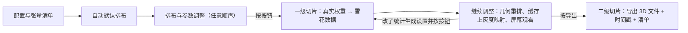

# snowglass 编辑器：排布、一级切片、二级切片（需求与设计）

> **当前状态：独立编辑器已接入本机一级切片任务，二级加工导出未接入。** 主文件是 `prototype/editor_ux/20261122-055413-124110/index.html`，服务入口是 `scripts/serve_editor.py`。当前通过 `preprocess.py` 按需生成：完整幅度不运行SVD，行列与谱统计依来源选项启用；HF约定对齐、额外诊断另行可选。任务、范围、三轴网格、进度、取消、完成项复用及引用恢复保留，原数学脚本和代表缓存不覆盖。准备不显示雪花，预览显示全部已载入统计；只改灰度或包络不重读权重，包络变化会重排雪花中心点，小块自身保持固定毫米边长。原有65组／124张量继续保留，完整范围清单369块／761张量已核对；一级切片接入时只核验一个4096元素的F32小样。本轮标注仅用合成结构与现成缓存，不读取原权重，不自动重启任何全范围任务。标签只使用新版独立标注：九种按列／截面生成、固定朝向、源块引用跟随与双中心变换保留，启用时显示并输出，旧块标签已移除。新组默认共用统一字体字号标尺；组对象可设左／右／居中对齐，只移动标签位置，不拉伸文字。当前契约在第15节Q22。自适应、任意解析式、可调谱配方、加工字形及厂家导出仍未完成。本文第13节保留分阶段实施记录，不能把早期“按钮未接入”的历史说明当作当前状态；当前一级切片契约见第7节，按需处理的验证记录见第13节“按需处理与验证”；预算配方版记录已标为历史。
>
> **与 `docs/decisions.md` 的分工。** `decisions.md` 记录整个作品的决策（D 编号）和待定项（U 编号），比如"点数是后验结果"（D2）、"框和壳是实体"（D3）、"厂家工艺规格待核实"（U12）。本文只讲**编辑器这个工具怎么工作**：用户在里面按什么顺序做什么，每一步的输入输出，哪些操作会触发重算。本文用到 D/U 编号时，会当场把那条的内容说一遍，不需要去翻 `decisions.md`。
>
> **编号导览。** Q1–Q15 是本文第 12 节的编辑方案选项编号；Q16–Q22 是第 15 节的第二轮需求与复议入口，具体状态在该节开头逐项列明；`decisions.md` 的 D/U 编号属于整件作品的决策记录。默认布局归入 D11，内部张量填充归入 D13，编辑与两级切片行为归入 D14；每个 Q 条目保留具体解释和当前状态，不以编号引用代替内容。

---

## 1. 一句话流程

用户借了 3D 打印"切片"的说法，一共两次切片：

1. **排布**：脚本根据模型的配置自动排出一套默认布局。布局本质上是很多"包络块"，每个块是等着装权重雪花的空盒子。用户可以调整这些盒子的位置、缩放和外观。
2. **一级切片**：用户定好数据参数后显式执行，后台从真实权重提取选定特征、合并压缩并保存连续统计／灰度，供每个盒子里的小块使用。具体特征和残差配比待小样后决定，不把谱筛选叫作已去除无用噪声。
3. **一级切片之后继续调整**：几何变换即时重排，不重算统计；窗口／曲线在匹配的统计缓存上即时映射输出灰度，不重读权重或重跑SVD。压缩／谱计算设置改变才标记统计需重算，按按钮执行。纯屏幕曝光和显隐另属观看设置，不能与输出灰度混为一谈。
4. **二级切片**：把整个模型导出成 3D 文件（OBJ / STL 等），文件名带时间戳。



**没有先后锁定（用户已明确）。** 一级切片之前，排布参数和雪花参数都能随时调，不存在"必须先调好包络体积再调雪花参数"。默认排布装不下默认雪花参数切出来的结果，这是完全允许的：可以带着满屏红色先切一次，再慢慢拉 gumball，直到不报红为止。一级切片之前没必要、也做不到预先判断装不装得下。

---

## 2. 术语

- **包络块**：一个功能组的外形盒子，比如"第 3 层的 Q / Gate"。它有毫米尺寸和位置，外面有框（12 根实体方梁）和包络面（6 块实体薄板），里面装雪花。一个功能组可以包含多个独立张量；盒子是展示分组，不等于一张权重表，也不意味着这些张量在计算中被合并成一个操作。
- **雪花数据**：真实权重经过特征提取与合并压缩所得的三维数值阵列；灰度曲线决定每格小几何块的灰度（0 到 1）。雪花点是有尺寸、带灰度的小块，不是厂家的激光爆点；零灰度格子可以不显示，但不随机决定格子有／无。
- **格间距**：块的毫米尺寸除以格子数，即相邻两个格子中心之间的距离。块被拉大，格间距就变大；块被压小，格间距就变小。
- **点距**：激光机能打的最小点间距，默认 0.08 mm。属于机台参数，也就是用户说的"加工精度"。
- **幽灵毛坯**：参照用的玻璃毛坯外形，可以有多个，可以新建、删除、拖拽、gumball、改尺寸。每个幽灵毛坯带一层"应力预留量"，即从外表面向内偏移的安全距离。它只做参照：模型超出时报红，但不阻止任何操作。
- **报红不阻挠（用户已明确）**：所有检查（出毛坯、超加工精度、超密度参考线、块重叠等）只显示红色或橙色提示，不禁止一级切片，也不禁止二级切片。
- **过期**：统计生成设置与已载入结果不匹配时，标为“统计需重算”，等待显式执行，画面若继续使用旧结果就明确标记。仅改窗口／曲线不使匹配的源统计过期，它即时产生当前工作灰度，保存为新映射版本；不覆盖旧磁盘结果。工艺核对与几何检查的状态另列，不能把所有变化都叫作需要重读权重。
- **降采样（用户已明确其含义）**：把相邻的一批权重**合并**成一个格子的统计值，属于池化一类的压缩。每个权重都参与计算，**不是**隔几个取一个，也**不是**一开始就把一部分权重扔掉。现在的实现按行、按列把张量切成整数段，每个权重恰好落进一个格子，这一点和拓扑脚本"每个张量恰好归入一个块"的检查是同一个思路。合并时用什么统计量（绝对值均值、均方根、行列范数、谱分解后的结构部分等）属于"灰度合成方式"（第 6 节，对应 `decisions.md` 的 U7）。
  所有源权重参与统计，不表示无损压缩，也不表示每个原始权重都对应一个小块。旧版把灰度解释为随机出点概率，已被用户纠正：灰度 0.3 是小块保存的灰度，不是 30% 的保留概率。随机化 SVD 的种子只属于数值算法可复现设置，不是艺术外观参数。
- **块的缩放（用户已明确其含义）**：只是把已经算好的雪花中心点重新摆放，点位跟着包络的形状伸缩。用户后来明确小块保持固定毫米边长，不随包络缩放；点位间距可变，小块本身不被拉长或压扁。雪花源统计、格数和灰度不变；改变压缩或谱设置才需要相应重算。
- **块间隙（用户已明确其规则）**：不改变整体排布尺寸。每个块的中心不动，只是块本身向内收缩或向外膨胀。规则详见 5.3 节。

---

## 3. 现状盘点（配置、拓扑与排布怎样生成）

| 部分 | 当前实现 | 文件 |
|---|---|---|
| 配置 | 首次获取官方 KB 级 config，之后读本地缓存；记录原始文件 SHA256。读取层数、逐层类型、文本与视觉维度，不加载权重 | `data/configs/Qwen3.5-9B.config.json` |
| 拓扑 | Python 按 4.2 功能组生成，清单只用于绑定名字、形状和量化格式；文本427、视觉334个张量全覆盖。另有纯config模式，明确标记未绑定 | `scripts/build_topology_qwen35.py` → `prototype/data/qwen35_9b.topo.json` |
| 排布 | HTML 的 `layout()` 取4.2配方，1单位＝1mm；默认369个权重功能块和1个MTP空框。默认逐块坐标与尺寸已经自动对照 | `prototype/snowglass_editor.html` |
| 原编辑器的编辑与显示 | 局部选择、三轴变换、幽灵参照、固定模拟样本、悬停、显示参数、保存打开和纯后验报告；旧文件保持不动 | 同上 |
| 独立新版核心 UX | 右上树／右下属性、单父分组、逐项继承、真实缓存、多点曲线、数值变换、保存撤销；未计算对象不填模拟 | `prototype/editor_ux/20261122-055413-124110/` |

生成默认拓扑：`uv run --no-project python scripts/build_topology_qwen35.py`。指定配置可用 `--config <路径>`；只凭配置出架构加 `--architecture-only`，不会宣称清单覆盖已核实。当前只有 `qwen3_5_text` 的命名与分组适配器，其他架构明确拒绝，不凭字段相似猜测。

"排布只在前端实现一次，由编辑器导出 `layout.json` 交给后续步骤"这条做法保持不变，Python 端不重复写排布逻辑。

---

## 4. 默认排布：以 `real_config4.2.html` 为准

### 当前世界坐标与源配方

世界统一采用右手Z-up：+X从左到右，+Y从前到后，+Z从下到上。正面是眼睛在−Y向+Y看，俯视是从+Z向−Z看；相机up、世界轴、gumball和数值变换都采用该口径。视觉塔仍在主塔+X侧，模型不因为换坐标而改变物理排布。

4.2原文件及下节表格保留源Y-up坐标：源y是上方向，源z是前方向。换到当前世界时：

$$
(x_{\mathrm{new}},y_{\mathrm{new}},z_{\mathrm{new}})=(x_{\mathrm{old}},-z_{\mathrm{old}},y_{\mathrm{old}})
$$

所以源表“中心y”对应当前世界Z，源z对应世界−Y；约38.9宽×26.4高×7.1深的实体尺寸不变，按当前XYZ读数排列则是38.9×7.1×26.4mm。`assets/coordinates.js`在前端对源配方输出做一次变换，不在Python重写布局，不覆盖4.2或统计文件。

工程记录`coordinateSystem: snowglass.xyz-z-up.v1`。无坐标标记的旧工程先复制再转换：节点local、新版标注base、跟随参考／冻结矩阵做坐标基变换，相机向量转换。旧版独立标注模式的轴／平面、放置侧和初始字面同步转换，独立标签文字不替换；带新标记的工程不再二次转换。用户随后明确不要旧块标签，因此旧labelText及labelDx／Dy／Dz、labels／labelOutput直接忽略，不再转换旧偏移或生成替代对象。模型身份、非标签参数和已创建独立标注保留。浏览器读取旧.v2后保存到独立.v3-zup，磁盘旧文件保留。

权重网格、字体UV和盒／柱局部形状数据不重排。`matrix_mm`把原局部几何映射到新世界，输出明确记录`localGeometryBasis`；不能把数据网格XYZ当成世界轴。手柄和数值使用对象的Z-up操作帧，不把网格／字形的额外局部基当成手柄轴。原连续统计、counts、网格生成参数和计算签名不变，不重新切权重。

### 4.1 4.2 实际是怎么排的（Qwen3.5-9B，默认"纵向压缩"0.55）

下面的数是按 4.2 源码里的公式逐项算出来的，原型使用场景单位。编辑器初始按 1 场景单位＝1 mm 换算（Q4 已确认），所以默认坐标和尺寸可以直接取表中数值为毫米；后续全局或局部 gumball 仍可调整。

**竖直方向（从下往上，单列，不折行）：**

| 部件                 | 中心 y               | 高                         | 说明                                                              |
| -------------------- | -------------------- | -------------------------- | ----------------------------------------------------------------- |
| Token Embedding      | −12.20              | 1.40                       | 离塔底 1.2 的空隙                                                 |
| 32 层塔体            | 从 −10.30 到 +10.30 | 每层块高 0.396，层距 0.644 | 层高 = 0.72 × 压缩，层间空 = 0.45 × 压缩；层多于 45 时再乘 0.72 |
| Final Norm（"脖子"） | +11.15               | 0.40                       | 居中，宽 6.5，比上下两个头窄得多                                  |
| LM Head              | +12.80               | 1.40                       | 与 embedding 同尺寸                                               |
| MTP                  | +12.80               | 1.19                       | 在 LM Head 右侧，x = 10.5                                         |

**水平方向（每一层，从左往右）：**

| 部件                 | x 范围            | 宽                     | 深                      |
| -------------------- | ----------------- | ---------------------- | ----------------------- |
| Norm 1               | −10.53 … −9.88 | 0.65                   | 3.72（主体深度 × 0.6） |
| 序列混合（3 块等宽） | −9.20 … −1.40  | 每块 2.41，块间空 0.28 | 6.2                     |
| Norm 2               | −0.88 … −0.23  | 0.65                   | 3.72                    |
| FFN（3 块等宽）      | 0.40 … 10.00     | 每块 2.99，块间空 0.32 | 6.2                     |
| Embedding / LM Head  | −7.0 … 7.0      | 14                     | 7.13（× 1.15）         |
| Final Norm           | −3.25 … 3.25    | 6.5                    | 3.72                    |
| MTP                  | 8.4 … 12.6       | 4.2                    | 5.58                    |

**视觉塔（独立一列，中心 x = 23.5）：**

| 部件                                             | 位置                                         | 尺寸                             |
| ------------------------------------------------ | -------------------------------------------- | -------------------------------- |
| Patch / Position（入口，在下）                   | y = −10.18                                  | 8.2 × 1.1 × 5.58               |
| 27 层，每层 4 块：Norm 1、Attention、Norm 2、MLP | 层距 0.65，块高 0.40，总跨度 17.55，上下居中 | 宽分别为 0.45 / 3.6 / 0.45 / 4.0 |
| Merger / Projector（出口，在上）                 | y = +10.28                                   | 8.5 × 1.2 × 5.89               |

视觉塔左缘（x = 18.78）离文本主体右缘（x = 10.0）8.8 个单位，离 MTP 右缘 6.2 个单位。这片空白就是你说的"呼吸感"。

**整体包围盒：宽 38.9 × 高 26.4 × 深 7.1**（含视觉塔）；不含视觉塔时是宽 23.1 × 高 26.4 × 深 7.1。

**外观：** 线框透明度 0.18，面透明度 0.024（几乎看不见），点大小 0.065，叠加混合，16 % 的点是亮点（亮度 0.48–1.0），其余是暗点（0.05–0.19）。

### 4.2 迁移前差异（以下旧编辑器描述为历史对比，本轮已完成布局迁移）

| 项           | 4.2                                                           | 现在的编辑器                               | 改法                                                                        |
| ------------ | ------------------------------------------------------------- | ------------------------------------------ | --------------------------------------------------------------------------- |
| 残差棒       | 没有                                                          | 有，1.2 mm 实体棒                          | **去掉（用户已明确）**。`decisions.md` 的 D11 已更新，撤销的是其中画残差棒的选择 |
| 前后错开 | **没有**，所有块在同一深度平面（z = 0） | 有，注意力列和 MLP 列错开 4 mm | **删除专门错开规则、参数和滑块（已确认）**；需要错位时选块用局部 gumball |
| 每层的块数   | 8 块：Norm 1、混合 ×3、Norm 2、FFN ×3                       | 线性层 11 块、全注意力层 10 块（按张量拆） | 见 Q2                                                                       |
| 块宽         | 同组内**等宽**                                          | 按参数量的平方根分                         | 见 Q3                                                                       |
| norm 的位置  | Norm 1 在最左，Norm 2 夹在混合和 FFN 之间                     | 两条 norm 都在最外侧                       | 照 4.2                                                                      |
| 头的尺寸     | 宽 14（约等于整层宽 20.5 的 0.68），高 1.4（层块高的 3.5 倍） | 宽是主体的 0.78 倍                         | 照 4.2                                                                      |
| 头的左右错位 | 没有，embedding 和 LM Head 都居中（x = 0）                    | 左右各错 0.12 主体宽                       | 照 4.2                                                                      |
| 视觉塔每层   | 4 块（带两个 norm）                                           | 2 块（norm 并在块里）                      | 照 4.2，拓扑分组跟着改                                                      |
| 视觉塔位置   | 独立，空 8.8 单位                                             | 空 3 mm，挤                                | 照 4.2                                                                      |
| 相机         | 视场角 42°，水平角 0.42，俯角 0.16，按包围盒自动取距离       | 固定位置                                   | 照 4.2                                                                      |

### 4.3 "从 config 出架构"怎么做

4.2 采用"配置字段 + 模型类型规则"的写法，但当前文件用的是内嵌模型表，并没有直接读取外部 `config.json`。表里包含层数、hidden、FFN 维度、词表、视觉层数、专家数和模型类型，排布由每种模型类型对应的一组规则决定。迁移时提取这些布局规则，配置解析与张量归属另行核对，不把示意模型表等同于已经验证过的完整计算图。

- **模型类型 → 混合器名字和拆法**。Qwen 是每 4 层第 4 层为全注意力，其余为 Gated DeltaNet。Gated DeltaNet 拆成"输入投影 / 门控·Conv / 输出投影"，全注意力拆成"Q·Gate / K·V / 输出投影"。
- **块尺寸是常量**：混合区总宽 7.8，FFN 总宽 9.6，深 6.2，norm 宽 0.65，头宽 14。只有竖直方向随层数和"纵向压缩"变化。
- **视觉塔的层距**随文本塔高度变化：层距 = max(0.65, 文本塔高 × 0.85 ÷ 视觉层数)。

我们的做法：

1. **拓扑脚本**（Python）按 4.2 的拆法分组，每个块记下：属于哪一层、在该层排第几个（例如"混合第 2 块"）、含哪些张量。张量全覆盖的检查保留不变。
2. **排布函数**（编辑器 JS）里放一张"布局配方"常量表，内容就是 4.1 节那些数。`layout()` 只读这张表和拓扑，算出每块坐标。现在手写的那些比例常量全部删掉。
3. 以后接别的模型（阶段 5），就是给配方表加一种模型类型、给拓扑脚本加一套分组规则，排布函数本身不动。

### 4.4 比例冲突：4.2 是横向扁块，默认毛坯是竖长条

4.2 的整体比例是**宽 38.9 : 高 26.4 : 深 7.1**，是一块横着放的扁方块。而 `decisions.md` 默认值表里的毛坯是 25 × 25 × 80 mm 的竖长条，四周留 2.5 mm 后可用空间是 20 × 20 × 75。

如果把 4.2 原样等比缩进 20 × 20 × 75：

| 情况                                          | 能放多大（每单位多少毫米） | 模型毫米尺寸        | 一层块高                   |
| --------------------------------------------- | -------------------------- | ------------------- | -------------------------- |
| 带视觉塔，竖放                                | 0.514                      | 20.0 × 13.6 × 3.7 | 0.20 mm（只有 2.5 个点距） |
| 不带视觉塔，竖放                              | 0.865                      | 20.0 × 22.8 × 6.2 | 0.34 mm（4.3 个点距）      |
| 带视觉塔，毛坯横放（75 宽 × 20 高 × 20 深） | 0.758                      | 29.5 × 20.0 × 5.4 | 0.30 mm                    |
| 如果 1 单位 = 1 mm（不缩放）                  | 1.0                        | 38.9 × 26.4 × 7.1 | 0.40 mm（5 个点距）        |

上表只说明主动等比缩入不同毛坯时的几何结果，不是启动时的自动操作。用户已选择初始 1 场景单位＝1 mm：带视觉塔时模型约宽 38.9 × 高 26.4 × 深 7.1 mm。默认模型可以超出幽灵毛坯，出界仅提示；不自动缩进、不压窄留白，也不切浅块深。用户之后自行用 gumball 调整。

---

## 5. 排布阶段的编辑（一级切片前后都能做，都不重算雪花）

### 5.1 选择与 gumball

- **全选**：gumball 作用于整个模型（现在已有）。
- **局部选择（用户已明确）**：单击选一块，Shift 单击加选，屏幕上拖框框选；支持按层和按列选择，方便一次调整整层或整列。需要错位时选中对应块，用局部 gumball 平移，不设置专门的前后错开功能。
- gumball 三种模式：移动、旋转、缩放（三个轴可以分开缩）。
- 缩放改的是块的毫米尺寸。框和壳的毫米厚度不跟着缩放，保持物理值（现在已是这样）。

### 5.2 手动调整怎么存

每块的手动调整以相对于自动槽位的4×4仿射矩阵保存，包含移动、旋转、非均匀缩放；自动排布改变后继续套用，不重新生成雪花。提供“重置选中”和“恢复默认工程”。工程文件同时保存幽灵毛坯、基础配方参数、相机和固定模拟样本的种子 / 数量。

### 5.3 可调的排布参数

| 参数 | 来源 | 说明 |
|---|---|---|
| 块间隙 | 现有编辑器已有，**保留（用户已明确）** | 规则见本表下方 |
| 块宽模式 | Q3 已确认 | 默认同组等宽，可切换按参数规模；只重排，不重切雪花 |
| 初始单位换算 | Q4 已确认 | 1 场景单位＝1 mm；模型不随参照毛坯自动缩放 |
| 纵向压缩 | 4.2 已有 | 同时改层高和层间空 |
| 主体深度 | 4.2 的 6.2 | 用户说的"块深度"。各部件按 4.2 的倍数跟着变（norm × 0.6，头 × 1.15，视觉块 × 0.85） |
| 框：粗细、灰度 | D3 | 框是 12 根实体方梁，灰度在成品里就是点的疏密 |
| 包络面：厚度、灰度 | D3 | 6 块实体薄板 |
| 视觉塔是否进作品 | 已有 | |
| 整体缩放 | 已实现 | 滑块等比缩放基础配方；全选 gumball 记录手动空间变换，可三轴独立。两者只重排样本 |

**块间隙的规则（用户已明确：不影响总体尺寸，每一个块向内压缩或向外膨胀）。**
- 排布先给每个块分一个"槽位"：块的中心，以及它最多能占的范围，由布局配方决定。槽位只随纵向压缩、主体深度、整体缩放、gumball 变化，**不随块间隙变化**。
- 块的实际尺寸 = 槽位尺寸 − 块间隙。块间隙调大，每块绕自己的中心等量缩小；调小，每块等量变大；调成负值，块会胀出槽位、和邻居重叠（报红，不阻挠）。
- 默认块间隙取 4.2 的原值，此时排布与 4.2 完全一致。4.2 里有三处不同的间隙：层与层之间空 0.45 × 压缩，混合区各块之间空 0.28，FFN 各块之间空 0.32。所以滑块存的是"相对 4.2 默认间隙的增减量"，三处同加同减。
- 收缩只作用在左右（x）和上下（y）；深度由主体深度或 gumball 单独控制。这是 Q15 暂按推荐接受的选择。
- **已实现并验证**：间隙增减作用于每个块的 x/y 尺寸，中心和层节距不变；深度不受影响。报告同时展示“槽位总体尺寸”与“实际模型尺寸”：槽位跨度固定，实际外沿可以因各块内缩 / 外胀而变化。尺寸不允许退化成零或负数，达到该数学边界时保留最小可表示厚度并提示，不解释成工艺配额。

### 5.4 幽灵毛坯（用户已明确）

- 可以**新建、删除、拖拽、gumball**，可以**编辑特征尺寸**：长方体改三条边长，圆柱改半径和高。还要不要别的形状（球、六棱柱等），按需再加。
- 每个幽灵毛坯有自己的"应力预留量"（向内偏移），画面上同时显示外表面和向内偏移后的内表面。
- **只做参照**：模型或某个块超出内表面就报红，并高亮出界的块。不影响一级切片，也不影响二级切片。
- 毛坯已与排布脱钩：新建、改尺寸、旋转或缩放毛坯不移动模型。长方体内偏移按变换后的平面距离检查；非等比圆柱的内偏移采用保守近似，并在界面说明，不声称已做应力仿真。
- 有多个毛坯时，后验报告里和"可用空间"有关的数字以哪个为准，见 Q5。

### 5.5 现有功能保留（用户已明确：鼠标悬停、块间隙等不要删）

改排布时，下面这些现有功能全部保留。前两项是用户点名的，其余是 agent 按现状列出的，默认也保留：

- **鼠标悬停**：显示块名、尺寸，以及它来自哪些张量（GGUF 名、HF 名、形状、量化格式、二维拆三维的方式、还原规则）。分组改成 4.2 的拆法后，一个块含多个张量，悬停时全部列出。
- **块间隙**：规则按 5.3 节。
- 全选与局部 gumball（移动 W / 旋转 E / 缩放 R / 关 Q），三轴分别保留，变换存入各块相对槽位的矩阵，不把三个缩放数取平均。框壳保持请求的毫米厚度，若薄块内腔被填满则记录有效厚度并提示。
- 后验报告（第 8 节），以及参数变化后悬停卡片跟着刷新。
- 框和包络面：实体、粗细、灰度，以及"框 / 包络面 / 雪花 / 标签 / 铭牌"等显示开关、按功能着色、自转、屏幕上画多少个点。
- 加工点距、点径、打点速度、密度告警参考线、γ、底噪地板、降采样倍数这些参数滑块。
- 导出 `layout.json`。
- 毛坯预设和自定义尺寸：并入幽灵毛坯（5.4 节），不删除。
- 残差棒**删除**（用户已明确）。专门的前后错开规则、参数和滑块也删除（Q1 已确认）；局部 gumball 的移动能力保留。

### 5.6 工程保存（暂按推荐接受）

支持"保存工程 / 打开工程"：手动调整、幽灵毛坯和各种参数存成一个 `*.snowglass.json` 文件，同时在浏览器本地自动保存最近一次状态。一级切片的结果另外存在磁盘上（第 7 节），工程文件里只记它的编号。

---

## 6. 权重统计与输出灰度参数

| 参数                                       | 作用                                                           | 现状                                          |
| ------------------------------------------ | -------------------------------------------------------------- | --------------------------------------------- |
| 合并压缩／三轴网格上限 | 决定每块分区怎样合并；不丢弃任何权重，每格实际数量见counts | 已接入三轴上限；不是已拍板的固定n |
| 加工精度（点距） | 厂家爆点层的工艺参照，不是雪花小块边长；用于风险核对 | 旧滑块有，检查语义待迁移 |
| 谱处理 | 原矩阵的低秩模式；不等同于重要性判定 | 仅feature/residual来源启用；求解方向／迭代配方仍固定 |
| 残差贡献／灰度地板 | 前者来自真实残差，后者是人为最低灰度；二者分开，是否保留待定 | 旧概率地板不沿用 |
| γ（对比度） | 连续数值到小块输出灰度的曲线，不是出点概率 | 正式曲线 UX 待复议 |
| 统计来源 | full、rowcol、feature、residual | 已接按需生成；有缓存即时切，未生成须显式切片；不做未确认合成 |
| 数值约定 | GGUF文件原值／HF约定对齐 | 新工程默认原值；旧工程缺字段保留HF；不恢复量化前精度 |
| 额外诊断 | 带符号均值、原矩阵RMS／极值／零比例 | 默认关闭；谱阈值所需RMS仍是谱算法的必要依赖 |
| 算法种子 | 随机化 SVD 等数值方法的复现设置，不改变作品的有／无点采样 | 只作技术记录 |
| 自适应 | 后续辅助选项，当前先手调 | 已暂缓，见 7.3 |

这些参数随时可以改，但生效路径按用户本轮确认分开：压缩与谱计算等统计生成设置，改后标需重算，按按钮才执行；已有匹配统计上的窗口／曲线即时映射输出灰度，不重读权重或重跑SVD；几何即时重排与检查。数据来源若已有对应缓存，可切换后重映射；没有匹配缓存时提示待计算，不偷偷启动任务。加工点距变更仍按Q8的既有过期／核对约定处理，不因本轮灰度即时确认就自动改成新的工艺策略。

---

## 7. 一级切片

### 7.1 输入与输出

**输入**：雪花参数（第 6 节）、拓扑、每块的格子数（由降采样决定，开自适应时还要用到当前块尺寸）。

**输出**（存在磁盘上，每次切片一个编号）：

- 每个块的连续合并统计、所用通道与归一化参考、三维格子信息和初始灰度版本。保留曲线之前的统计，才能在缓存上改窗口／曲线；只保存0–1成品灰度而丢掉输入统计不满足这一要求。
- 每个格子的小块身份与**块内归一化中心坐标**（每个轴 0 到 1），保留连续灰度；尺寸和形状属于另行记录的几何设置。
- 每块的统计：候选格数、正灰度格数、每格代表多少权重、谱方向数与求解限制、灰度分布；不把正灰度小块数当成爆点数。
- 一份清单：本次切片用的全部参数、源文件校验和、切片编号、时间。

**当前已接入的执行路径。** `scripts/serve_editor.py` 同时提供页面与本机任务接口；`scripts/slice1.py` 是界面和命令行共用入口。用户选择“作品范围”或“所选对象”，确认清单后才执行。每块记录继承后的三轴网格上限，默认16×16×32；实际每格合并量由 `counts` 给出，不把固定网格说成已确认的固定 n。统计来源、数值约定和额外诊断也按每块继承结果进入请求快照。full只直接池化；rowcol才算行列RMS外积；feature/residual才执行原256方向／12次或96方向／4次谱配方，并成对生成。一维或不适用张量保留明确的直接幅度／不适用提示，不把残差解释为无用噪声。

**必需与可选的边界。** 从实际下载的量化GGUF取得数值，必要时分块解量化；这只是读取量化后的近似值，不读取未量化模型、不恢复已丢失精度。全覆盖分区池化、counts、非有限值及源字节／结果校验始终保留。Full模式关闭诊断时，原矩阵RMS、极值、零比例、带符号均值与其他观察通道不再预算；幅度参考均值可从池化值和counts推得。池化后的窗口统计只扫描小数组。

HF对齐只是按既有规则做Norm减1、head重排、A_log等约定转换；选GGUF原值时不执行它，保留文件数值和行顺序，不冒称已还原HF头顺序。两项新增选项继续使用属性级继承／锁定，锁不是暂停计算。新工程默认GGUF原值、诊断关闭；旧工程缺新增字段时保留HF约定和所有变换，新增诊断开关默认关闭。

**缓存可用性。** 新结果记录`channel_status`：ready、not_generated、not_applicable。未生成的来源要求显式切片，不用full冒充；不适用的张量保留旧直接幅度回退及说明。不同网格／约定分开保存；同一配置补通道不删除已有其他通道，混用前核对原张量字节、格数和counts。导出记录实际通道的哈希、约定和来源编号；选定约定／网格没有对应数据时拒绝把旧数据保存成新设置。

任务在 `out/slices/jobs/<编号>/` 保存计划、状态、逐张量进度与清单。成功结果另存在 `out/slices/artifacts/<签名>/<尝试编号>/`，只有结果文件和完成标记都通过校验才允许复用。复用比较网格、实际生成集合、约定、诊断、原件／核心身份、当前原张量压缩字节 SHA256 和结果 SHA256；不是看“文件存在”就跳过。取消与失败保留完成项，再次提交相同请求建立新任务并补缺，不覆盖已有任务清单。只有一个块的全部成员张量成功，才将该块结果装入编辑器，避免半个块新统计、半个块旧统计混用。

网格改后对应块标为“待切片”，但不会自动读权重。已有匹配统计上的通道、窗口、曲线、几何与小块尺寸继续即时处理；预览里的一级切片按钮在所选执行范围都匹配时置灰，网格或范围需要数据时重新可用。计算完成后载入新结果并自动进预览，工程只保存任务引用，不把大型数组塞进工程。完整范围可提交不等于已完成全层；本次真实核验只覆盖L00.attn_norm，全量运行时间与量化变体仍须另行验证。

### 7.2 同一份雪花数据在空间里伸缩（用户的理解，agent 确认正确）

用户的说法：块的缩放是把已经算好的雪花重新排布，"就像捏水气球一样，里面的雪花重新流动而已"，除非改了雪花参数才重算。落到数据上就是下面这样。

一级切片之后，每块的格子数 $(n_x, n_y, n_z)$ 和点集就固定了。点集存的是块内归一化坐标，块被拉长、压扁、放大或缩小时，每个点按块的三个轴各自等比例移动，点与点的相对位置关系不变。块的毫米尺寸 $(L_x, L_y, L_z)$ 由排布决定，随 gumball 变化。两者一除就是格间距：

$$
\text{格间距} = \left(\frac{L_x}{n_x},\ \frac{L_y}{n_y},\ \frac{L_z}{n_z}\right)
$$

- **几何干涉**：中心靠近后，小块的实际形状可能相交；要用小块尺寸、朝向和位置检查，不是直接和爆点间距比较。
- **灰度表达风险**：即使几何不相交，小块相对厂家加工分辨率过小也可能丢失灰阶，需要工艺证据，不能凭候选爆点数等同灰阶数。
- **单纯重排不改变已有统计、候选格数或灰度**。用户在第二轮确认中明确选择固定毫米边长：包络缩放只改变中心点位置与间距，小块尺寸不跟随。尺寸数值、形状及作用域仍需设计，不把这个确认推成厂家已验证的加工参数。

例如某轴格间距从 0.08 mm 缩成 0.072 mm，可以确定中心间距变小；是否相交要看小块本身的尺寸，是否能表达灰度还要看厂家能力。旧版据此直接宣布“装不下”的判据已撤回。

用户之前问过两种缩放语义（"锁点密度动压缩力度"还是"动压缩力度锁采样力度"），在这个框架下两种都有：

- **锁数据（默认）**：一级切片后随便缩放，数据不变，只是密度变。
- **锁密度**：缩放后想让点的密度保持不变，就得按新尺寸重新算格子数。这必须重新做一次一级切片（打开自适应再按按钮），**不做实时自动重算**。

### 7.3 自适应选项（后续候选，当前暂缓）

用户后来明确先打地基、允许手调半小时，自适应以后再做。因此原先“第一次默认启用自适应”的实施顺序不再适用，现有面板开关只是尚未迁移的旧实现。未来是否提供按尺寸辅助计算压缩量的按钮，留到第 15 节 Q21 复议；不能把雪花小块的尺寸直接等同于机器点距，也不能在拖动 gumball 时自动重切。

### 7.4 哪些改动触发什么（用户已明确的规则）

| 改动                                                   | 一级切片                         | 立刻更新的东西                         |
| ------------------------------------------------------ | -------------------------------- | -------------------------------------- |
| 全局或局部 gumball、纵向压缩、主体深度、间隙 | **不重算** | 位置、格间距检查、后验报告、结构件点数 |
| 框 / 壳的厚度和灰度                                    | 不重算                           | 结构件、后验报告                       |
| 显示参数（点大小、亮度、屏幕上画多少点、标签）         | 不重算                           | 画面                                   |
| 幽灵毛坯                                               | 不重算                           | 出界检查                               |
| 压缩／数值约定／所需诊断／谱计算等生成设置 | **缺对应缓存才标待切片，按按钮执行** | 有效配置与受影响范围更新；旧结果继续显示时标明来源和过期 |
| 输入窗口／输出曲线 | 不重读权重，不重跑SVD | 在匹配缓存上即时更新当前输出灰度；源统计与格数不变，保存新映射版本 |
| 数据通道选择 | 已有匹配缓存则不重算；缺缓存等待按钮 | 显示当前统计来源与可用性，不用不匹配缓存冒充当前选择 |

修改加工点距一律把已有一级切片结果标为过期，同时按新点距更新检查；在用户按按钮前仍显示旧雪花，不自动重切（Q8 暂按推荐接受）。

### 7.5 怎么跑

- 一级切片要读真实权重，必须在 Python 里做。编辑器上按按钮，经由本地 Python 服务启动一个后台任务（第 11 节）。
- 界面上显示进度：当前处理到哪个块、已用时间、预计剩余时间。
- **耗时尚需核实**：此前约 1 s 解码、1.3 s 池化、0.1 s SVD 的试算，SVD 处理的是池化后的 418 × 250 矩阵，不是原始数千万参数矩阵。不能据此推算完整一级切片只需 7–10 分钟；原始张量谱分解、重构和压缩须分别做探针，再报告预计耗时。embedding 和 LM Head 各约 10 亿参数，完整 float32 数组约 4 GB，处理时需核算峰值内存。
- **缓存与即时映射（用户已确认）**：保存曲线之前的连续统计，窗口／曲线改变只重映射这些值，不重读权重或重跑SVD。当前工作灰度可即时预览，保存时创建新映射版本并引用源统计，旧结果不覆盖。压缩或谱生成要求改变时，缓存是否足以复用取决于粒度，不能保证任意设置均无需重读；这些统计任务只有按按钮才执行，gumball和曲线拖动不触发。
- 支持"只切选中的块"，方便先拿两三层验证效果，不必每次全量重切（Q13 暂按推荐接受）。

---

## 8. 后验报告与报红（全部不阻挠）

沿用 `decisions.md` D2 的原则：点数是算出来的结果，不是配额。超了就标出来，由用户回去改前置条件再切。

| 检查           | 什么时候有                   | 判据                                                                                                |
| -------------- | ---------------------------- | --------------------------------------------------------------------------------------------------- |
| 出幽灵毛坯     | 一直有                       | 块是否超出各毛坯向内偏移后的内表面；列出出界的块                                                    |
| 雪花小块干涉 | 有统计与明确几何后 | 检查小块实际形状是否相交，不能以爆点间距代替小块尺寸 |
| 灰度表达风险 | 有工艺参照后 | 小块尺寸与厂家分辨率／可辨灰阶的关系；无证据时只标待核实 |
| 真实密度 | 一级切片后 | 未加载真实雪花前不根据模拟样本推称加工密度。真实结果需明确局部统计范围和参考来源；10 % 仍是未核实参考值 |
| 块重叠         | 一直有                       | 手动调整后可能出现。现在是"通过 / 不通过"，改成报红不阻挠                                           |
| 结构件过薄     | 一直有                       | 框或壳薄于 2 倍点距，切出来可能断断续续                                                             |
| 一级切片过期   | 一级切片后                   | 改了雪花参数还没重切                                                                                |
| 机时、总点数   | 一直有                       | 只报数，不判对错                                                                                    |

二级切片导出时，当时所有报红项都写进导出清单，事后可以查。

---

## 9. 二级切片（导出）

### 9.1 导出什么

- 雪花点：将每格小块的中心、形状与尺寸按当前排布换算到毫米，保留对应连续灰度。不能只导出孤立顶点就声称交付了带灰度小块。
- 结构件：每块的框（12 根方梁）和包络面（6 块薄板），按当前厚度。
- 文件名带时间戳（用户已明确），例如 `out/export/qwen35_9b_20261117-153012.obj`。同名再出一份清单 `…_manifest.json`，记录排布、一级切片编号、全部参数、源文件校验和、所有报红项、点数和机时。

### 9.2 Python 写不写得出 OBJ / STL

几何文件可以写，但能写不等于符合当前灰度小块契约。标准 STL 不携带通用灰度通道；OBJ 的材质或扩展颜色是否被厂家读取也待确认。以下保留早期点云／微几何的体积估计用于对比，不作为已经满足连续灰度交付的承诺：

| 写法                                          | 每点大小    | 300 万点  | 问题                                                         |
| --------------------------------------------- | ----------- | --------- | ------------------------------------------------------------ |
| OBJ，每个点一个顶点，不带面                   | 约 30 字节  | 约 90 MB  | 很多建模软件能显示；但部分切片软件不认没有面的 OBJ           |
| STL，每个点一个小四面体（4 个三角面，二进制） | 约 200 字节 | 约 600 MB | 厂家软件通常会按表面重新生成自己的点，等于把我们的点打散重排 |
| PLY 点云（二进制）                            | 约 15 字节  | 约 45 MB  | 内雕软件常见输入之一，要问厂家认不认                         |
| 结构件（框、壳）                              | —          | —        | 本身就是实体，OBJ / STL 都很自然                             |

`decisions.md` "不做什么"里写着"不默认发纯 XYZ 点云"，这条保留：纯文本 XYZ 只在厂家明确要求时才出。

### 9.3 厂家那边可能还有一次切片

我们的二级切片交出去以后，厂家软件很可能再做一次，按它自己的规则把模型转成激光点。这就是 U12 第 4 问（"收到模型后你们会不会自行改点距、跳点或简化结构，会不会事先告知"）担心的事。如果厂家会重新出点，我们点集的可追溯性就到我们的文件为止。所以导出格式怎么选，取决于问厂家的结果（U1、U12），见 Q11。

---

## 10. 显示

下面前五条是原编辑器阶段的显示设想。当前独立主版本不填模拟雪花，未计算块只显示结构；当前视图与预览渲染规则以本节末尾“准备、预览与预览渲染”为准。

- **一级切片前**：块里显示模拟雪花，外观照 4.2（两档亮度、叠加混合、点大小 0.065 单位），画面上标明"模拟"。
- **一级切片后**：显示真实点集。屏幕上画多少点只是为了不卡，可以抽样，与玻璃里有多少点无关（D2 已定）。
- **灰度怎么显示**：当前旧模拟模式有亮度／大小切换，但新要求已改为等大小、连续灰度小块，大小编码暂不做。输出灰度曲线与纯屏幕曝光必须分开；新独立小样不代表主编辑器已迁移。
- 线框和面照 4.2 的观感（线 0.18、面 0.024），但我们的框和面是实体（D3 已定：零厚度的线和面切不出点，WebGL 的线宽在 Windows 上又固定为 1 像素）。默认的粗细和灰度要调到看起来接近 4.2。
- **"视图"类操作都不影响切片。** 面板"视图 · 仅影响屏幕"一节里，"全景 / 正面 / 选中对象"只改相机取景；框、面、雪花、标签、铭牌开关，功能着色、自转、屏幕抽样上限、点大小、亮度、灰度显示方式，都只改屏幕画面。画面上方的"专注视图 F"只是收起参数面板，让模型占满窗口。这些都不进一级切片，也不进二级切片导出的文件。框、面的显示开关只是在屏幕上藏起来，不等于从作品里删掉；作品收不收某个部件，由第 15 节 Q18 建议的"是否进作品"属性决定（待拍板）。标签和铭牌是否刻进玻璃仍待定，见第 15 节 Q22。

### 准备、预览与预览渲染（用户已确认，2026-11-27）

**不新增“切片后不显示真实雪花”的第三视图。** 讨论中曾考虑：切片完成后为了转动视角不卡，另设一个用替代表示代替真实雪花的视图。按用户操作拆开后，它对应两种不同意图：只想调结构和排版、不看雪花，由现有准备视图解决；要看权重纹理又要流畅转动，归预览内部的渲染策略。两者都不需要第三个入口，也不需要引入与真实数据无关的替代纹理。

**三件事分开。** 统计状态（未生成、匹配当前配置、需要补算）决定是否需要一级切片；展示入口（准备或预览）表示用户当前要做什么；显示精度是系统如何绘制。三者互不代替。准备是编辑视图，不表示未切片：切片完成后返回准备，统计结果和工程里的任务引用保留，只是不画雪花。移动包络、改文字、改窗口曲线不使统计过期，再进预览不重新切片，只用已有统计重新绘制；这一点与 Bambu Studio 不同，后者移动模型会改变路径，因此通常要重切。

**预览必须满足的行为（已确认目标；分批与交互概览第一版已接入，具体实现和范围在下文）。**

1. **进入即可操作。** 先显示结构、文字和一份来自真实统计的轻量概览，再逐步补细节；不能等全部数据处理完才出第一帧，也不能让一次全量构建锁住整页。
2. **拖动开始不重建大块资源。** 转动、平移、缩放时只切换到事先准备好的轻量显示；不在这一下重新分配整张画布、重建全部实例或重新整理全部灰度。因此不以“频繁修改整张画布的像素比”作为主要降级手段。
3. **松手后分批细化。** 优先补当前视角中近处、可见、正在观察的区域；每批让出主线程，按钮、标签编辑和再次拖动保持可响应。这里的渐进指分批建立和绘制细节，不必采用光追的采样累积。
4. **再次操作可中断细化。** 未完成的细化暂停或取消，优先响应操作；停下后按新视角重排优先级。已完成且仍有效的细节保留，不每次停下都从头开始。
5. **资源有上限。** 停留再久也不无止境地把整个模型的全部细节装进显存；优先保证当前视角和焦点区域，视野外或远处的细节可以不加载，或在需要时释放。
6. **轻量显示不是假渲染。** 它可以简化，但必须来自已完成的真实统计；不随机补纹理，不把未计算区域伪装成有数据。界面用轻量提示说明“交互简化”或“正在细化”。它只影响屏幕，不改变切片结果、灰度数据或加工输出；简化画面也不能当作逐格加工检查。
7. **文字单独保证可读。** 雪花在拖动时可以变轻，文字不跟着降级。目标是文字按最终画布的清晰度单独绘制，雪花画面可用适度分辨率再合成，从而不为文字清晰度把全部雪花一起提高精度。文字仍是固定朝向的三维平面，位置、字号、对齐和导出定义不变，尽量保留与块的前后遮挡。主界面不暴露多个像素比数字；文字缩到极小时仍需放大阅读，不偷偷改字号。

**原实现的问题（本轮已替换加载与绘制部分）。** 原先先求值全部统计再一次性建全部实例，三维画布上限1.25；现已改成先进入预览、工作线程读统计、分批映射和建实例，并采用高清文字／适度分辨率雪花分层。预览仍以全部已有缓存为默认来源，优先当前所选及较近的块；没有新增观察范围控件。“聚焦所选”仍只改相机，“隔离”仍只限制结构；切片完成后沿用进入预览的动作，但显示不再等待全量建好。返回准备中断显示任务并释放雪花，磁盘结果与引用保留。现成全量任务 `slice-20261123-015539-615436` 为369块／761张量／3,620,608候选格，本轮只读取它，没有新切片。

**后续扩展边界。** 本轮轻量表示采用确定性真实格子点状概览，显示参数是实现起始值，不改变科学或工艺配置。自动远近LOD、动态设备预算及文字深度边缘的进一步优化留待后续；没有新增显式观察范围，也没有改变预览按钮的计算触发规则。一级切片仍由原按钮显式确认执行，切片完成仍进入预览。

**验证口径。** 独立对照页 `prototype/editor_ux/20261122-055413-124110/render_lab/` 已验证分层采样和深度传递；静止计时仅说明附加绘制成本，不以“分层必须比整场快”作为文字清晰与交互方案的通过条件。主文件以进入可操作、拖动轻量显示、暂停／恢复、分批完成和输出数据不变为验收重点；不新增第三视图，不把显示抽样写入科学数据。

**第一项独立实验（本轮主接入前的历史验证）。** `render_lab/layered.js`仅包装独立页的场景实例：A整场景最终画布上限2；B同样最终画布及文字上限2，雪花／结构离屏上限1.25，采用与默认画布相同的实际MSAA采样数，然后线性合成颜色、最近邻传递深度并绘三维文字。A/B共享数据、相机和文字贴图／过滤；没有抽减实例或引入渐进加载。深度保留不透明几何的前后遮挡，边缘为低分辨率近似；透明结构与文字的混合顺序可能改变，这属于仍需视觉核验的边界，不称无损。WebGL1环境明确回退，不冒充分层。

可复现入口为`uv run --offline --script tests/test_render_lab.py`，调用`tests/layered_checks.js`读回像素。最终14项通过，报告为`prototype/editor_ux/20261122-055413-124110/render_lab/verification/run-20261127-060418-752796/checks.json`。合成遮挡物探针中，前方文字两档均181344白色像素，背后文字两档均0白色像素；等分辨率合成颜色差异为0。还覆盖真实灰度／实例字节不变、缓冲重用与窗口缩放、工程恢复、全量3,620,608格及31个启用测试标签的实际绘制；主文件、科学脚本与测试期间独立页哈希均保持，无计算请求。测试标签只在隔离工程生成，不代替用户排版。

这一次本机Intel Arc 140T全量静止短测，CSS视口1440×744、最终画布2880×1488，五次绘制＋GPU完成等待中位数为A整场3.6ms、B分层6.9ms；B离屏1800×930，实际4×MSAA，附加缓冲粗估63.9MiB，不包含默认画布／实例／驱动额外开销。分层没有显示性能收益，不能因为低分辨率就认定更快；本次也未测试所有观察角度或持续拖动。这组数不能单独否定分层：用户目标是文字清晰和操作响应，而不是要求每次绘制更快。实验保留供观感对照，主编辑器已接入下面的分层及交互实现。

**主编辑器分批预览已落地。** `assets/app.js`进入预览立即切换显示，不用居中进度挡住操作；视口左上独立显示载入块数和已建细节分区，并提供“暂停细化／继续细化”。每批先读现成数据再交给`assets/progressive_snow.js`，完成的细节可显示，未完成区使用来自真实格子的点状概览。准备不画雪花，仍可编辑模型和文字，统计反馈暂取所选范围前8项，避免准备选全局时也加载所有数据；灰度映射保存按原作用范围输出完整数据，不受显示限制。

`assets/stat_cache_worker.js`只GET读已完成统计，JSON解析在工作线程完成；各幅度数组转为Float64Array并转移缓冲，保持JS Number的原值，不读GGUF、不做池化／SVD。灰度窗口、曲线LUT和筛选沿用原求值顺序，每8192值让出执行，过时显示任务中止。最多3块并行读取；文件与组合缓存各保留至多128项，返回准备清除额外显示缓存，磁盘结果不删。

实例构建每块最多4096格，每次调度目标6ms且最多4块；工程实现选取的初值，不是所有机器都能满足的帧耗时保证。显示细节配置至多400万实例，已载入工作集至多800万候选格，概览至多12.8万点；超出时停止进一步显示加载／细化并标明资源上限，其余结果仍在磁盘。选择焦点后重新进入预览可优先加载。这一版没有自动远近LOD或GPU计时驱动的预算调整，真实大文件与显存成本不会因为渐进而消失。

概览点取各分区固定索引的真实格子位置与当前灰度，不随机补点，不改mask或灰度数组。相机转动、滚轮及gumball开始时立即隐藏详细实例，显示已有概览；停止输入去抖120ms后恢复有效细节，未建完的分批继续。再次操作会暂停建实例，暂停按钮还能保持概览和停止后续载入；返回准备中断本轮显示并释放细节。布局变化时概览跟随当前包络，详细立方体按原世界位置、方向和固定毫米边长重建；纯转动相机与暂停／恢复不重建有效实例。

**取景以世界原点为固定旋转中心（用户2026-11-27确认）。** 原点恒在画面正中，转动与滚轮缩放都绕它；`fit`（全景／正面）不再把焦点放到包围盒中心，只按作品包围盒算相机距离，保证整件作品入镜。右键平移已关闭，否则平移会把原点推出中心、之后放大就围绕偏点进行。打开旧工程保留当时的观察方向与距离，但焦点归到原点，旧工程存的旧中心不会再推偏模型。

实测依据：`fit(['work'])`后焦点为`[0,0,0]`、原点投影NDC约`3e-18`；滚轮放大使距离从81.76降到77.67后，原点仍在中心（`1e-16`）。这解释了此前“越放大越偏左”的机制：焦点不在原点时，缩放是把场景往一侧推。

取舍：原点居中后，模型本身会偏右（`work`包围盒中心约`x=8.94mm`），这是真实几何关系，不再靠平移补偿；全景与“聚焦所选”都只改距离、不改焦点，所以“聚焦所选”不再把所选放到正中，只是拉近到能看见。毛坯在`refs`节点下、不计入`work`包围盒，所以取景不包含毛坯；若以后要以可雕区为取景基准，需另行拍板，不能顺便改。

`assets/pixel_layers.js`提供主视口单GL分层：最终画布／文字上限2、雪花／结构离屏上限1.25，复用色深合成与实际MSAA；文字、gumball与高亮在高清层。窗口尺寸不变时不分配新离屏缓冲，交互降级不改像素比。文字字号、方向、对齐、启用与导出定义均保留；深度边缘和透明混合仍按原实验的近似说明，WebGL1回退整画布。

**主接入初版验证（历史，漏检GPU颜色）。** 上轮`tests/test_progressive_preview.py`的7项通过报告`prototype/editor_ux/20261122-055413-124110/verification/progressive-20261127-070809-620449/checks.json`确认了计数、矩阵、数据与交互切换，但没有确认颜色缓冲容量及实际静止像素。颜色缺值比较会产生NaN而未触发旧断言，所以该报告不足以证明静止画面正常，不能再用它作完整绘制证据。

**静止黑屏修复与实际像素验证。** 新分批网格初版先设`mesh.count=0`，再首次调用`setColorAt`。r128据当时count分配instanceColor，得到零长度数组；恢复count不会重分配，静止实例因此按黑色绘制并遮挡背景。该回退属于显示实现，不是权重丢失、尺寸太小或硬件负担过大。现在显式以`capacity×3`的Float32数组创建`InstancedBufferAttribute`，再设置实际绘制数量，原位置、尺寸、灰度和切片结果不改。概览提高采样密度但保持12.8万点上限：本次全量89,051点，旧版27,410点；拖拽继续轻量，静止恢复全部3,620,608格。

新增测试不只看CPU计数：每个细节网格在onAfterRender中查询当前程序的instanceColor属性、启用状态和实际GPU缓冲字节；1204个网格全部容量正确，总计43,447,296字节。静止雪花开／关的像素差分亮度增量109,027,502，变亮像素843,646；同数据／相机／尺寸的旧同步正常路径测得完全相同结果。真实鼠标拖动停止后再次读回像素，仍有正亮度贡献。没有通过改雪花尺寸或曝光掩盖缺陷，也不放宽错误断言。

修复后`uv run --offline --script tests/test_progressive_preview.py`的10项通过，报告`prototype/editor_ux/20261122-055413-124110/verification/progressive-20261127-093912-214487/checks.json`（前一轮9项报告`progressive-20261127-075738-387716`保留），其中新增用例核对焦点为原点、平移关闭、原点恰在中心、放大后仍居中；完整原功能回归61项通过，报告同目录`run-20261127-075844-069498/checks.json`。冻结科学脚本和原缓存哈希一致，无新切片请求，标签、双中心、分组、数值变换、曲线、灰度保存和旧工程继续保留。旧报告与失败记录不覆写；测试不截图，主页面的实际文字与转动观感由用户查看。

---

## 11. 技术结构

| 部分           | 做什么                                                                                                                        | 文件                                                      |
| -------------- | ----------------------------------------------------------------------------------------------------------------------------- | --------------------------------------------------------- |
| 前端编辑器     | 排布、选择、gumball、幽灵毛坯、参数面板、显示、后验报告；发起一级 / 二级切片                                                  | `prototype/editor_ux/20261122-055413-124110/assets/` |
| 拓扑脚本       | 按 4.2 的拆法分组，检查张量全覆盖                                                                                             | `scripts/build_topology_qwen35.py`（直接改）            |
| 本地服务 | 提供页面和同源受控一级切片接口；二级导出未接入 | `scripts/serve_editor.py` |
| 一级切片 | 独立张量解码 → 按需统计与池化 → 连续缓存；灰度在前端映射。不默认求谱、不拼接不同张量 | `scripts/slice1.py`、`scripts/preprocess.py` |
| 二级切片（新） | 读排布与一级切片结果，写 3D 文件和清单                                                                                        | `scripts/export.py`                                     |
| 数据目录       | 拓扑：`prototype/data/`；一级切片任务：`out/slices/jobs/<编号>/`；张量缓存：`out/slices/artifacts/<签名>/<尝试>/`；导出：`out/export/` |                                                           |

---

## 12. 选项与确认状态（Q1–Q15）

Q1 已确认删除专门错开功能；Q2、Q5–Q9、Q11–Q15 已按此前推荐接受。本轮用户明确接受其余三项：Q3 块宽双模式、默认同组等宽；Q4 初始 1 场景单位＝1 mm；Q10 各张量独立处理后分区填充、外面一套框。以下保留各项背景；需求选择不代表代码已经实现或已经通过工艺验证。

**Q1 前后错开功能：彻底删除（已确认）。**

默认布局照 4.2 的单平面排布；删除专门的错开规则、参数和滑块。用户需要错位时自行选择块或整列，用局部 gumball 移动。下面保留两个参考原型的坐标差异，说明此前讨论对象，不再作为待选布局。

先说清楚 `real_config.html`（第一版）里到底是谁和谁错开。下面的数是按它源码里 Qwen3.5-9B 的参数算出来的（主体宽 6.8；x 向右为正，z 朝观察者为正）：

| 部件 | x 范围 | z 范围（深度方向） | 深 |
|---|---|---|---|
| Input RMSNorm（左侧细柱） | −3.99 … −3.77 | −0.75 … +0.75 | 1.5 |
| **序列混合列**（全注意力层的 Q/K/V/O，或 GDN 层的 K-state/V-state/Gate/Conv） | −3.26 … −0.68 | −1.375 … +1.375 | 2.75（GDN 的 Conv 块深 1.7） |
| **MLP 列**（gate / up / down 三片） | −0.48 … +3.20 | **+1.11 … +2.59** | **1.48** |
| Post RMSNorm（右侧细柱） | +3.77 … +3.99 | −0.75 … +0.75 | 1.5 |
| Token Embedding / LM Head | 中心 x = −1.2 / +1.2 | 都在 z = 0 | 4.8 |

所以，**错开的是"序列混合列"和"MLP 列"**。混合列在左、靠后；MLP 列在右、整体往前推了 1.85，而且只有 1.48 深，比混合列的 2.75 薄了将近一半。从上往下看，就是你截图里的"左上、右下"两大片：两列在 x 方向隔 0.2，在深度方向只在 1.11 … 1.375 这一小段重叠，只有角对角挨着。

全注意力层和 GDN 层之间**没有**错开：32 层的混合列全部在 z = 0，MLP 列全部在 z = +1.85，层与层的区别只在混合列内部怎么拆。两条 norm 柱留在 z = 0 不动。上下两个头只在左右方向错开（−1.2 / +1.2），深度方向不错开。

`real_config4.2.html` 里所有块的 z 都是 0：混合三块和 FFN 三块同深 6.2，embedding 和 LM Head 都居中，前后、左右都不错开。上一轮编辑器里的"注意力列 z = −2 mm、MLP 列 z = +2 mm、两列同深"，是照第一版的错开方式做的，但没有照它把 MLP 变薄，因为你说过"不要变浅"。

原有四个候选方案不再并列保留；本轮确定的是删除专门错开功能，而不是仅把默认错开量调成 0。

**Q2 块怎么分组（暂按推荐接受）。** 照 4.2，每个文本层 8 个外层功能块，视觉每层 4 块。以下为采用的张量归属，原始张量身份保持独立；块内按 Q10 分区填充，不把不同张量混成一张矩阵：

| 4.2 的块 | 线性层（Gated DeltaNet）含的张量                                                                             | 全注意力层含的张量                             |
| -------- | ------------------------------------------------------------------------------------------------------------ | ---------------------------------------------- |
| Norm 1   | `attn_norm`                                                                                                | `attn_norm`                                  |
| 混合 1   | 输入投影：`attn_qkv`                                                                                       | Q / Gate：`attn_q`、`attn_q_norm`          |
| 混合 2   | 门控 / Conv：`attn_gate`、`ssm_alpha`、`ssm_beta`、`ssm_conv1d`、`ssm_a`、`ssm_dt`、`ssm_norm` | K / V：`attn_k`、`attn_v`、`attn_k_norm` |
| 混合 3   | 输出投影：`ssm_out`                                                                                        | 输出投影：`attn_output`                      |
| Norm 2   | `post_attention_norm`                                                                                      | `post_attention_norm`                        |
| FFN 1–3 | `ffn_gate` / `ffn_up` / `ffn_down`                                                                     | 同左                                           |

视觉每层：Norm 1 = `ln1`；Attention = `attn_qkv` + `attn_out`（含 bias）；Norm 2 = `ln2`；MLP = `ffn_up` + `ffn_down`（含 bias）。
总块数：文本 32 × 8 + embedding + final norm + LM Head = 259，视觉 27 × 4 + 入口 + 出口 = 110，另加一个只画框的 MTP（U9）。
接受的是外层功能分组和完整收录张量；不是把同一个盒子里的不同张量先混成一张表再算。

**Q3 块宽：两种模式都保留，默认照 4.2 同组等宽（已确认）。**

参数量是数组里数值的个数，不是重要性的评分。很小的归一化或门控参数也可能影响大量通道；因此不把体积命名为“重要性”，也不自动用参数量决定某块值不值得保留。

- **同组等宽（默认）**：同一个混合区或 FFN 区内部，各块用 4.2 的等宽槽位。它表达功能顺序与层的重复节律，最直接保留已选的排布审美；不是所有部件一律同尺寸，norm、上下两个头和视觉塔仍用各自的比例。
- **按参数规模（可选）**：在同组的可分配总宽不变、块数和顺序不变的前提下，按各块参数量分配宽度。不对 norm、端部或整座视觉塔自动套用比例。这表示存储规模，不表示重要性，也不等于按计算量分配。
- 两种模式共用张量归属和一级切片结果。切换只改变空间排布，不触发谱分解、池化或重新出点。手动 gumball 调整保留。
- **点密度与参数量分开**：一级切片后，某块雪花点数 N 固定，物理密度为 N ÷ 当前块体积 V。等宽且同高同深的两个块，只有 N 不同时才有不同的平均点密度。参数多不必然更亮或更密：开自适应时可能得到相近格数但每格合并更多权重；固定每格合并量时，较大张量通常有更多格。最终还取决于统计值、灰度转换和出点结果，报告分别显示原始参数量、每格合并量、实际点数与密度。

用户已接受这两种模式及等宽默认值。确认的是空间布局选择，不是按参数量判断重要性，也不强行令各块同密度。

**Q4 初始毫米尺寸：1 场景单位＝1 mm（已确认）。**

默认取 4.2 的坐标和尺寸直接作为毫米，带视觉塔的 Qwen3.5-9B 约宽 38.9 × 高 26.4 × 深 7.1 mm。幽灵毛坯另行参照；出界只报红，不在启动时自动缩到毛坯内，不为装进毛坯而变更部件比例或留白。整体和局部尺寸仍可用 gumball 调整。

**Q5 多个幽灵毛坯（暂按推荐接受）。** 指定一个"主参照"毛坯，用于报告里的可雕区格点数和平均填充率；其余毛坯只做出界检查。更换主参照不改模型，也不改已经生成的雪花。

**Q6 手动调整的保存（暂按推荐接受）。** 手动调整存成相对偏移和缩放倍数，自动排布重算后照样套回去；提供"重置选中块"和"重置全部"。

**Q7 一级切片分辨率：当前先手调，自适应暂缓。**

用户后续要求优先建立手动可控的地基，因此不沿用“第一次默认开启自适应”。手动压缩用每格权重数还是分轴合并数，仍需在第 15 节 Q19 明确；旧“格子边长 ÷ 爆点间距”的倍数不能与之混用。未来按尺寸给建议是候选辅助能力，不在本轮实现。

**Q8 点距改动（暂按推荐接受：一律标过期）。** 你说过"除非改降采样参数或加工精度参数，才重新切片"。因此加工点距改动一律标过期，同时刷新检查；仍须按按钮才重切。不开自适应时，新点距未必改变雪花数据本身，但采用统一的过期提示，不悄悄替换已有结果。

**Q9 灰度小块与显示（用户已纠正旧表征）。** 每格保存连续灰度，用等大小的小几何块表达；不将灰度再转成随机有／无点集，暂不使用大小编码数值。小块之间的几何干涉、单个小块在厂家工艺下可表达的灰度能力是两种检查，不能统一简写成“格间距 ≥ 机器点距就安全”。用户后来已确认固定毫米边长，不随包络缩放；具体尺寸、形状与作用域仍待定，第 15 节 Q20 保留这些问题。

**Q10 多张量：独立处理、分区填充、外面一套框（已确认）。**

张量是权重文件里独立存放的数值数组：二维的是矩阵，一维的是向量。视觉功能块是为了展示而做的分组；例如 4.2 把 GDN 压成“输入投影 / 门控与 Conv / 输出投影”三块，但实际计算中门控、短卷积和递推控制各有独立参数。它们可称为这个功能组里的子结构，不是同一权重的重复版本，也不是几层网络混到一起。

Qwen3.5-9B 第 0 层的拟议“门控 / Conv”组（形状来自张量清单）：

| 独立张量（GGUF 名） | 形状 | 作用 |
|---|---|---|
| `blk.0.attn_gate.weight` | 4096 × 4096 | 输出门控投影 |
| `blk.0.ssm_alpha.weight`、`blk.0.ssm_beta.weight` | 各 32 × 4096 | 递推控制的两个投影 |
| `blk.0.ssm_conv1d.weight` | 8192 × 4 | 各通道的短卷积核 |
| `blk.0.ssm_a`、`blk.0.ssm_dt.bias` | 各 32 | 递推控制参数 |
| `blk.0.ssm_norm.weight` | 128 | 头内归一化参数 |

一个盒子共含这 7 个数组，只在展示上合组；这个盒子横跨 GDN 内部几个步骤，并不是模型代码里天然存在一个同名的单独算子。全注意力的“K / V”盒子同样包含 K、V 两张投影矩阵和 K 的归一化向量。反过来，一张 `attn_qkv` 也可以包含 q/k/v 三个行段：张量的存储边界和展示边界不是一一对应。

内部各张量独立处理、保留自己的名字和形状，再把结果放入同一盒子的不同子区域；不把矩阵、卷积核和小向量拼起来一起做谱分解。外面仍是一套框，不自动新增 7 套嵌套框，以免破坏 4.2 的整体观感；悬停与清单能查看各张量及子区域归属。子区域边界决定后，gumball 变形整块时各子区域和已经生成的点一起伸缩，不重算一级切片。

已选的是分区填充，不采用“拼成大矩阵统一处理”。子区域记录各自边界、张量名、原形状与折叠规则；小张量也必须参与处理，不因参数少而丢弃。具体子区域和格数分配在实现中核算并写入清单，不把其视作重要性评分。内部子区域与 Q3 外层块宽模式是不同尺度的布局；整块缩放只改变已有子区域与雪花的空间映射。

**Q11 二级切片格式（连续灰度小块要求下重议）。** 早期计划为顶点 OBJ 和小四面体 STL，但它们不能因此被视为已经保留每块灰度。结构件几何导出能力保留，雪花小块的灰度承载方式和厂家读取契约必须重新核实；本轮只输出实验统计和预览，不交付加工文件。

**Q12 装不下时的可选自适应（暂缓）。** 原有“按当前尺寸自适应重切”设想留待手动地基完成后复议。导出时不自动合并格子、不偷偷删数据；提示仍不阻挠用户操作。

**Q13 局部一级切片（暂按推荐接受）。** 可以只切选中的块，用于先拿两三层验证效果，不必每次全量。

**Q14 工程保存（暂按推荐接受）。** 保存并恢复手动调整、幽灵毛坯、参数与切片结果引用；支持文件保存 / 打开和浏览器本地自动保存（5.6 节）。

**Q15 块间隙作用方向（暂按推荐接受：只作用 x / y）。** 中心和槽位不动，每块在左右和上下向内收缩或向外膨胀；深度由主体深度或 gumball 单独控制，不因间隙滑块改变。

---

## 13. 实施计划与验证状态

每一步做完都能单独验证。本轮已完成步骤1–4的无权重版本及几何后验；步骤5的真实一级切片、步骤6的真实点间距核对、步骤7的三维加工文件导出尚未接入。

| 步 | 内容 | 改哪些文件 | 做完的标准 |
|---|---|---|---|
| 1 | 拓扑分组改成 4.2 的拆法（Q2、Q10） | `scripts/build_topology_qwen35.py` | 张量全覆盖检查通过；块数与 Q2 一致；每块带层号、列位置、张量列表 |
| 2 | 默认排布取 4.2 配方，初始 1 单位＝1 mm；块宽双模式、默认等宽；去掉残差棒和专门错开功能，保留局部 gumball；间隙改为 x/y 槽位内缩；相机和外观照 4.2；毛坯与排布脱钩；现有功能保留 | `prototype/snowglass_editor.html` | 默认等宽模式坐标与 4.1 节一致；切换块宽模式只重排、不改已有雪花；改间隙时中心不动；改毛坯不缩模型；悬停仍显示全部张量；与 4.2 并排目测 |
| 3 | 选择（单击、加选、框选、按层、按列）、局部 gumball、手动调整的存储（Q6）、工程保存（Q14） | 同上 | 局部调整后改纵向压缩，调整保留；保存后刷新能恢复 |
| 4 | 幽灵毛坯：多个、长方体和圆柱、应力预留量、出界报红（Q5） | 同上 | 新建、删除、拖拽、改尺寸都可用；出界的块高亮 |
| 5 | 本地服务 + 一级切片（先支持选中块，再全量）+ 进度 + 过期标记 + 结果载入（Q7、Q8、Q9、Q13） | `scripts/serve.py`、`scripts/slice1.py`、编辑器 | 选中两三层先计算真实统计；窗口／曲线在匹配缓存上即时更新灰度，保存新映射版本；改压缩／谱设置显示需重算，按按钮才执行。缩放包络只移动中心点，小块保持毫米尺寸，源统计与格数不变。**全量切片前先报告预计耗时，经你同意再跑** |
| 6 | 后验检查补全：加工精度逐块逐轴检查、块重叠改报红（第 8 节） | 编辑器 | 缩小包络使实际雪花小块相交时报红，解除相交后提示更新；加工灰度表达风险另核对，不能以机器点距替代小块尺寸 |
| 7 | 二级切片导出 + 时间戳 + 清单（Q11） | `scripts/export.py`、编辑器 | 导出文件能在常见 3D 查看器里打开；清单里有当时全部报红项 |

### 独立新版第一批核心 UX 实施

用户在核心设计确认后明确授权实施，独立目录为 `prototype/editor_ux/20261122-055413-124110/`，不是直接覆盖原编辑器。`scripts/prepare_editor_ux.py` 逐字复制旧HTML、拓扑及124份现成张量数据，并从旧HTML提取4.2布局函数到本批前端适配器；布局不在Python重写。`provenance.json` 记录源文件哈希，`originals/` 保留原HTML。新工程本地键与旧 `snowglass.preweights.v2` 分开，旧格式明确拒绝，不未经验证静默迁移。

本批前端按职责拆分为对象／工程状态、旧配方适配、真实统计、曲线数值、树、曲线交互、所选属性、三维场景、几何检查和启动联动，均在该目录的 `assets/`。没有改全局环境、没有新读GGUF、没有重新计算池化或SVD。

| 本批项目 | 实现与限制 |
|---|---|
| 对象管理 | 完整拓扑派生的默认树，370个功能块／MTP框、系统与层节点共436个初始对象；右上树与右下属性同时存在，分隔高度可调 |
| 继承 | 只存修改／锁定项，父值更新未覆盖后代跟随；恢复继承读取父当前值。全局是配置对象，无空间手柄 |
| 分组与解组 | 新组无整套参数副本；迁组和解组保持世界变换，默认解组继续继承，显式保留模式仅下放相关覆盖；删除、循环树、非法文件有边界检查 |
| 变换 | 数值输入与gumball事件改同一份仿射状态；世界中心／包围盒毫米尺寸可读可改，固定毫米雪花不随包络缩放。当前绕选区中心操作，各自中心扩展仍待设计 |
| 幽灵毛坯 | 保留长方体／圆柱、多参照、新建删除、命名、基本尺寸、向内预留、主参照及变换。首批不将毛坯与模型混组，不自行增加别的形状 |
| 真实数据 | 载入既有65组124张量缓存，完整幅度默认；可切谱／直接特征、行列强度、残差，不适用与截断明确提示。其余层标未计算，MTP标权重未收录，不填模拟 |
| 曲线 | 自由多点贝塞尔、节点／手柄拖动与输入、反转和S形等；平方／对数预设为9节点近似。统一用4097点线性查表近似，预览和保存规则一致，不声称任意曲线都无误差 |
| 保存 | 撤销／重做、独立本地自动保存、工程JSON保存打开、所选或全局灰度映射JSON保存；保存前固定本次对象与配方快照，不覆盖旧文件。灰度JSON不是厂家OBJ/STL |
| 绘制检查 | 实体框壳与固定毫米立方体；缓存颜色／实例复用，避免每帧重新分配。隔离选区与屏幕曝光只影响观看，不改统计、灰度或是否进入作品 |
| 后验 | 仿射包络盒SAT重叠、毛坯内偏移与出界、所选格轴向间距提示；尚非全部雪花小块跨块精确近邻检查，不推断厂家灰阶／爆点数／安全 |

首批只载入代表层已有统计：文本0／3／15／16／30／31层、视觉0／13／26层以及所选首尾对象，不冒称全761个张量都已切片。物理边长默认0.012mm仅为缓存观察起点，非工艺推荐。分区保存原grid、每格计数、原通道及数据哈希；几何区域只是显示排布，不称为天然三维知识组织。

**功能证据。** `tests/test_editor_ux.py` 的最终22项全部通过，报告为本目录 `verification-20261122-070750-348313/checks.json`。包括真实控件点击／加点／拖曲线、一次手势一次撤销、树Shift多选打组与确认解组、继承与稀疏覆盖、配方改变时迁组保世界变换、毛坯不动模型、工程与保存按钮往返、手柄事件到数值及数值输入到变换的双向联动、260个组×通道组合及筛选不受曲线反转影响。390px布局无横向溢出，没检测到JS异常。测试期间新代码哈希不变，原127个源文件的SHA256前后一致。

检查还确认了真实雪花对画面的像素贡献，而不只是“canvas存在／实例数量正确”。开发中定位并修正了r128首帧先编译材质、后分配实例颜色导致框壳按白绘制的问题：初帧前预分配颜色并将空实例数设为0。证据保留在本批各验证目录，旧小样没有此修改，不把新渲染故障归因到原权重／SVD。曲线端点原被轴文字挡住，已通过留图边距与匹配坐标换算解决，没有强行点击绕过。

**观察与编辑目标分开。** 默认只绘当前观察对象的真实雪花；可以在屏幕隔离其结构或回全景，隔离不写入输出参数。选全局后属性仍编辑全局，画面保留上一统计对象作为反馈参照并标明对象及曲线来源，不把参照变成另一个操作组；全局保存映射按作品作用范围输出已缓存数据。全局设置受局部覆盖时，参照不跟随是明确的继承结果，不能自动清掉局部曲线。

**仍未接入。** 真实统计／网格／谱重算、任意解析式执行、自适应、厂家加工导出，以及完整字体／加工文字系统。压缩口径n仍待最后确认；首批界面只显示当前缓存计数，不偷偷替用户决定精度。原版中其他观察工具继续保留在原HTML，独立首批不宣称已完整迁移所有旧视图旋钮。视觉审美仍由用户打开页面手动验收，测试脚本不自动截图。

```powershell
uv run --offline --script scripts/serve_editor.py
uv run --offline --script tests/test_editor_ux.py --folder prototype/editor_ux/20261122-055413-124110 --phase full
```

入口 `http://localhost:8128`，原8124／8125／8126／8127服务不重置。当前计算服务分别绑定 `127.0.0.1` 和 `::1` 两个回环接口，不使用全网 `--bind ::`；保持IDE预览兼容，同时用Host／Origin校验和本机令牌限制计算入口。交付物改动仍遵循已有保护规则；新任务另存结果，不覆盖旧科学文件。

### 2026-11-22 界面与交互修正

用户在第一版可用性反馈中提出六项问题，均已在同一副本实现并重新核验（27项）：

1. **侧栏移到左侧**：上对象树、下所选属性；中间拖拽条调高度、右缘拖拽条调宽度（260–视宽−360），均支持方向键微调；属性区最小高180px，不被树挤没。字体缩到0.01em负字距、11px主体、行高1.35，为信息密度服务。
2. **属性栏位置固定**：选不同对象时属性区矩形不变（测试逐像素比对 x/y/宽），便于直接选数值复制。
3. **框选恢复为手势**：Shift+左键拖动即框选，B 键或按钮仅作常驻模式；不再只能按按钮。框选结果覆盖当前选择。
4. **键位组合**：单击单选；Shift+单击（树）范围选（按树当前可见顺序）；Ctrl/Cmd+单击跳选（单项加／减）；Shift+拖动或B模式框选；Alt+单击选毛坯；W/E/R移动/旋转/缩放，Q关闭；B框选；F专注；Ctrl+A全选；Ctrl+Z/Ctrl+Shift+Z/Ctrl+Y；Ctrl+G打组；Delete/Backspace删除。输入框内不响应单键快捷键。
5. **变换参数化**：属性栏改为相对默认位置的偏移（mm）、旋转（°）、缩放（倍）三组可复制数字，底层仍存相对上级的仿射矩阵；gumball 与数值共用同一状态，一次手势算一次撤销。世界包围盒尺寸只作只读核对。多选时只读并提示先打组，不把多选拼成一个假参数。
6. **gumball 不再“随视角重新定”**：单选时手柄姿态跟随对象自身旋转（而非每次回到世界轴），多选保持世界轴；拖动中不重置 pivot，相机变化只重绘，不重新居中。选中高亮改为亮青边线加低透明外扩面，比原细线明显。
7. **按钮归位**：文件（保存工程／打开工程／保存灰度映射）移左上，一级切片与二级导出按参考图放右上；两个切片按钮因首批未接入而明确置灰，悬停与点击均说明原因，不作假功能。

关于“平移与旋转是否合并到同一个 gumball”：r128 的 TransformControls 一次只挂一个手柄，同时渲染两套会抢鼠标。采纳的做法是同一个手柄用 W/E/R 切换，同时把平移、旋转、缩放统一写进同一组可追溯参数，因此数值层面是一个整体记录，交互层面不分裂状态。如果后续要真正的双轴同时拖拽，需要另写自定义手柄，不在本批冒称已支持。

### 2026-11-22 第二轮界面修正

1. **两块信息分开**。“对象属性”指的是悬停时能看到的身份信息（源层、槽位、张量名、形状、量化格式、是否已按 HF 约定还原、统计状态），不是可调参数。现在点选后在**编辑区右下**固定显示身份卡；左侧下方仍是切片／灰度／曲线的编辑参数。两者不再混称。悬停卡仍保留为临时提示，不抢占选择。
2. **后验报告**移到编辑区**右上**，与身份卡分居上下，互不遮挡。
3. **选中不再隐藏其他对象**。原先默认开启的“隔离选区”改为**默认关闭**，其他块保留框壳；被选中的块用**黄色双层轮廓＋低透明外扩面**标示，比之前的青色细线明显。隔离仍可手动开启，作为屏幕观察手段。
4. **对象树默认收起**，启动只显示工程根；双击展开，搜索会自动展开匹配路径，从视口点选对象也会自动展开到目标。
5. 由于默认值与自动保存的旧状态冲突，本地自动保存键升到 `.v2`，避免旧会话里的“隔离开启、树全展开”继续覆盖新默认。旧工程文件仍可用“打开工程”导入，不含测试暗示的静默迁移。
6. 另新增一项保护：直接双击 HTML 用 `file://` 打开时，视口内显示明确横幅（说明 403 是协议限制、给出 http 地址与启动命令），不再只留一行状态栏小字。

### 2026-11-22 第三轮：参数控件、零厚度与文字

1. **滑块与输入框并存**。凡有明确量程的数值参数（框／壳厚度与灰度、雪花边长、块间隙、标签字号与偏移、窗口黑／白端、门槛、压缩、深度、点距、点径、速度），每行都渲染为“滑块 + 数字框”，两者双向同步；滑块拖动算一次撤销，键盘单步后焦点会回到同一控件。无自然量程的项（统计通道、窗口模式、可见性、文字）仍用下拉或勾选。
2. **框和壳可以是“没有”**。厚度下限收到 0：`frameT=0` 不生成 12 根方梁，`shellT=0` 不生成 6 块板，导出时也不存在这些几何；负厚度仍拒绝。灰度0是另一回事：几何保留、只是不显影／不点。界面已把两者分开写明，避免把“灰度0”误当“没框”。隐藏与进入作品仍分开。
3. **文字属性补齐**。原先只在折叠区且缺自定义文字，容易被认为不存在。现在“文字标签（仅屏幕）”默认展开，含：显示标签、标签文字（留空用对象自身名字）、字号、三轴偏移。文字是对象的本地覆盖，打组不改成员文字。字体、刻入玻璃仍按原约定留在最后。
4. 拖动滑块时灰度预览会节流刷新（50ms），结构重建合并到下一帧，避免每格重算与重建把拖动拖卡；结束后仍走完整刷新与历史记录。

本轮后检查增到31项，新增：滑块与数字框双向同步、框/壳厚度0分别减少12根方梁与6块板、负厚度拒绝、标签文字按对象独立覆盖。

### 2026-11-22 第四轮：配色与文字输出定位

1. **配色去绿**。底子改蓝灰（色相 220），强调色改琥珀（34°），按钮与选中遵循同一暖色；原来偏青绿的强调色和小样遗留的绿色变量都已覆盖，树选中、曲线、身份卡边框、高亮框统一到琥珀系。高亮仍用黄色双层轮廓，与强调色同一色族。
2. **文字从“仅屏幕”改为“可随作品输出”**。原来只有屏幕开关，容易让人以为文字只是预览。现在分开两项：
   - `屏幕上显示`：只管预览；
   - `随作品／切片输出`：默认开，决定文字是否进导出。
   另补齐`字体族`字段（当前仅作用于屏幕贴图，导出字体轮廓仍待处理）。
3. **导出契约**。灰度映射 JSON 的每个块现在带 `label`：文字内容（含回退到对象名）、字体、毫米字号、三轴偏移、锚点世界坐标、`output` 标记，以及一条 `label_pipeline` 边界说明。这使“文字是作品一部分”在数据上有位置，但**尚未生成可加工字形几何**。
4. 未接入但已写进界面提示：字形轮廓、固定朝向（现在屏幕贴片朝镜头，玻璃里不成立）、中文字形与字体授权、文字本身的爆点密度与后验。这些不假装已解决。

检查增到32项，新增：强调色色相不在绿区（90–180）、文字写入导出定义且能关闭、缺锚点/偏移会报错。

### 2026-11-22 第五轮：工具条精简

用户指出这页是自用调试器但控件冗余、视觉难受。确认后按“操作归侧栏、视图归一条紧凑条”精简：

- **选择类全部移到左侧树面板**：全选、清空、框选模式三个按钮；层号选、列选收进默认折叠的“批量选择”。打组／解组／解组·保留／删除仍在树下，按钮文字缩短。
- **视口顶部只留一条**：变换分段（移动/旋转/缩放/关）+“视图”下拉（全景/聚焦所选/正面/隔离选区）+ ⚙（屏幕曝光）+ ?（键位表）。常驻按钮从 14 个降到 7 个，键位表不再常驻。
- **视觉去噪**：面板按钮默认透明边框，仅 hover／激活时出现琥珀描边；分段控件共享边框避免四条竖线；菜单与弹层同时间只开一个，点外部或 Esc 关闭；删除重复的旧 `.view-tools`／`.tool-row`／`.key-hint` 样式块。
- 修了一个真实 bug：键盘处理器里 `e.target.closest` 在事件目标是 `document` 时抛错，导致 Esc 无法关闭弹层；改为先判 `instanceof Element`。

检查增到33项，新增：常驻工具按钮数上限、菜单与弹层互斥、Esc 关闭、选择操作已移到树面板。

### 2026-11-22 第六轮：对齐 4.1 配色与尺寸

1. **配色改为 `real_config4.1.html` 的中性黑灰**：纯黑底 `#000`、面板 `#101012`、控件 `#202024`、文字 `#eee/#bbb/#aaa`、边框 `#29292d/#444`、强调色为浅灰 `#ccc`。去掉了上一轮的琥珀强调和蓝灰底，曲线、按钮激活、树选中都改为灰度。3D 清屏色同步改纯黑。
2. **唯一的彩色保留在画布内**：选中轮廓仍为黄色双层线框。原因：在纯黑＋白灰线框的场景里，灰色选不成可视信号；这是图形标记，不是界面主题。
3. **尺寸收紧**：页眉 48→40px，品牌字 17→14px，按钮 11→10px；树行 23→21px、树字 11→10px；属性区标题 11→10px、字段 11→10px、说明 10→9px；面板顶端状态/底部状态栏 10→9px；右侧报告与身份卡同步降到 9px（小于上一轮，是因为它们本来就是次要信息）。
4. **侧栏宽度下限 260→200px**，上限放宽到视窗−300；窄屏断点默认宽 340→300px。

检查仍为33项全通过；配色断言改为“强调色不在绿区”这条旧断言仍成立（灰的色相为0）。

**事后更正（同日）**：上面把“配色照 4.1”执行得过宽，把功能色也去掉色了。用户澄清：4.1 只约束面板底色与中性灰，本地覆盖、报红、文件操作必须保留颜色，否则分不出来。已恢复：强调／本地覆盖为琥珀（色相 34）、告警橙（38）、危险红（2）、文件操作为青蓝（205）；底色、面板、边框、正文仍为 4.1 的黑灰。后验报告里的重叠／出界行变红，干涉风险与参考性限制变橙。画布内选中轮廓仍为黄色。测试新增：本地覆盖／报红／文件三组色饱和度必须 >25%，文件按钮不得与正文同色。

### 文件整理（同日）

多轮迭代后 `prototype/` 下堆积了多个历史单页，且项目根入口指向旧编辑器，导致“不知道当前主文件是哪个”。整理结果：

- **当前主文件唯一**：`prototype/editor_ux/20261122-055413-124110/index.html`，根 `index.html` 已改为跳转此处；根 `README.md` 写明入口、启动命令、目录与归档索引。换新批次时只需改这两个地方。
- **历史页归档到 `prototype/_archive/`**：`real_config/`（含作为配色参照的 4.1 与作为布局基准的 4.2）、`editor_legacy/`（第一版 snowglass_editor.html）、`surveys/`（字体／灰度调研页）。只移动不删，原文件名不变。
- **检查报告归位**：此前散在版本目录根部的 24 份 `verification-<stamp>/` 已移入版本目录下的 `verification/`，文件名未改，所以本文件前文按旧名引用的报告仍可按名找到；后续输出改写到 `verification/run-<stamp>/checks.json`，不再污染版本根目录。
- 未改动：`prototype/data`、`prototype/contrast_survey`（独立调研，自带数据）、`originals`、服务目录与 `provenance.json` 哈希记录。

### 2026-11-22 第七轮：准备／预览两态

用户按 Bambu Studio 的交互提出：准备视图无雪花，预览视图全显示；并明确“切片参数”与“包络／灰度显示参数”是两码事。

- **顶部新增一等状态**：`准备 | 预览` 分段按钮（品牌旁）。准备：只画 370 块框壳，可改一切参数；预览：画全部有统计的块。
- **代表缓存预览的实测口径**：65块组、124张量、130个分区；默认筛选关闭时累计594,240个候选格。网格是各轴上限，不能用124×8192推实际格数，也不能把两者差额称为被筛掉的点。进度按65个块组计数；同一会话内可命中内存统计缓存，实际绘制仍有开销。
- **与 Bambu 的差异已写进交互**：Bambu 的预览由切片产物驱动；我们的预览由“已有统计 + 当前灰度参数”驱动。因此改灰度／曲线／筛选／雪花大小／曝光都只重映射，不把预览打回待切片；改包络尺寸、排布、变换也会重新摆放雪花中心点，但不改变源统计与格数，小块毫米边长保持不变。
- **切片按钮状态**：预览态下按钮仍置灰（重切未接入），标题改为“当前预览由已有统计生成；重新切片未接入”，并在视图切换旁显示 `65 块 · 594240 格 · 重切未接入`。**当前界面可改的参数没有一项会触发重新切片**，因为网格、池化、量化还原这些真正的切片参数还没暴露；不造“过期”假状态。
- **性能取舍**：预览态下灰度类拖动采用 260 ms 节流（准备态 50 ms），结构重建仍合并到下一帧；进入预览会自动关闭“隔离选区”，避免结构只留选中块而雪花悬空。
- **证据**：检查增到35项，新增预览候选数与mesh数、预览态改灰度仍保留、切回准备后点数归零且mesh清空。整套耗时不能直接归因于首次数据读取，包含求值、渲染和多项交互。

### 本机一级切片接入（2026-11-22 预算配方版，历史验证）

以下描述当时所有适用通道预算的版本；当前可选处理契约已更新到第7.1节。旧报告继续保留，不用旧版小样替代本轮按需路径验证。

用户要求把已经写过的离线核心接入编辑器，明确不是先手工补齐全模型。现增加 `scripts/slice1.py`、`scripts/serve_editor.py` 与 `assets/slicing.js`：范围和网格有显式计划，执行异步任务，返回逐张量进度与10秒心跳，可取消并校验复用；完成后装入结果并进预览。任务不依赖页面持续打开；页面重连可继续观察，服务退出后旧完成项也保留。谱配方与还原按原函数执行，范围不再硬编码为代表层；新数学方法和固定压缩倍数n没有擅自加入。

- `POST /api/slice1/plan` 仅形成清单，不读原张量数值；`POST /api/slice1/start` 明确启动任务；`GET /api/slice1/jobs/<编号>/status` 观察进度；`POST .../cancel` 取消本任务；完成清单与张量统计由专门只读资源路径提供。服务仅回环、同源和任务令牌，不把本地GGUF放进静态服务目录。
- 工程记录切片任务编号；新清单只替换全部成员成功的块，未切块与原代表缓存保留。默认原网格与原算法输出兼容；改网格会使源统计失配，窗口／已算通道／灰度曲线／包络／毫米尺寸不会触发重切。旧结果若继续显示，身份卡和全局状态明确标示失配。
- 成功结果排他写入并带完成标记；复用前同时核对签名、当前原张量字节与结果哈希。已完成的任务目录拒绝重写，续跑通过新任务复用完成张量，而非覆写旧清单。计算进程复用GGUF读取器，不为每个张量重新打开同一整文件；预览更新只重刷确有变化的实例属性。
- `tests/test_slice1.py` 覆盖合成GGUF、默认数学一致、全值覆盖池化、网格签名、完成项复用、取消、相同mtime下原字节变更、接口令牌／同源／路径以及完成任务不可覆盖；不读真实大模型。
- `tests/test_slice1_flow.py --real` 只核验L00.attn_norm的4096个F32元素：与原缓存 `full/signed/feature/counts` 逐值一致，默认实际网格为16×8×16；反复点击可复用，改网格匹配另一统计，完成后预览、切回准备、灰度／几何修改和工程引用恢复都核验。报告 `out/slices/verification/confirmed-20261122-b/checks.json`。原有35项界面回归也通过，报告 `verification/run-20261122-225255-491440/checks.json`。
- 本次只形成完整369块／761张量清单，没有执行全模型。二级加工导出、可调谱配方、自适应、任意解析式、字体几何仍未接入；全层运行成本和全部量化变体尚未验证。不能以此小样通过宣称这些边界全已成立。

---

### 按需处理与验证（2026-11-23）

用户明确以下载的量化模型为对象，要求必需步骤保留、其余操作可选。当前保留旧数学文件，通过`preprocess.py`分派上述来源与诊断选项；统计来源下拉同时承担按需生成选择，不另造重复SVD开关。旧工程保留HF约定，新工程默认GGUF原值；已存在的其他通道、约定和网格版本都保留，记录真实提供该通道的数据哈希，不把最后一次任务编号冒充所有通道来源。

可复现验证：`uv run --offline --script tests/test_slice1.py`的19项通过。包括full禁调用谱／外积／额外统计、原值禁调用HF还原、流式full一遍数值分块读取、行列可分离池化对照、谱通道与原数学对照、选项签名和不可覆盖结果。界面首轮37项报告为`verification/run-20261123-010013-400339/checks.json`。随后混入新原值缓存的回归暴露了测试独立模型仍取新默认值的问题；科学旧缓存对照已明确指定HF约定，不放宽数值断言。

真实小样仍只用L00.attn_norm的4096个元素：`out/slices/verification/flow-20261123-011154-164441/checks.json`保留原值、HF对齐／诊断、复用、改网格和切回原值的实际证据，该轮停在工程恢复断言，不将其写成整套通过。退出衔接已修正：逻辑完成不再作为活跃任务让新页面自动预览；再次启动会等待旧进程正常回收。恢复检查还须等首帧状态有定义后再断言零雪花，不能把undefined当0。

最终聚焦的恢复与260个旧通道组合核验通过，报告`out/slices/verification/flow-20261123-013950-007632/checks.json`。重现命令是`tests/test_slice1_flow.py --url http://127.0.0.1:8128/ --restore-tasks`加上述真实小样报告里的四个任务编号；该模式只读既有统计，不计算权重。原数学脚本、原代表缓存的哈希均未改变。完整模型的运行时间仍未测；首次读取器初始化、源字节校验与存盘有独立成本，不承诺关闭SVD后瞬间完成，也不自动续跑旧全范围任务。

## 14. 2026-11-18 实施批次的同步与验证记录

- D11 已同步 4.2 默认排布、删除棒与专门错开功能、块宽双模式及等宽默认、初始 1 场景单位＝1 mm。
- D13 已同步独立张量分区填充，不将不同张量混成大矩阵，不为每个子区域额外画一套外框。
- D14 已同步编辑功能与两级切片行为：布局或块宽模式变更只重排，已有雪花不自动重切；局部 gumball、工程保存、主参照毛坯、x/y 间隙、自适应和导出保留。
- 无权重布局与编辑已实现；本轮只更新布局相关Python / HTML和拓扑JSON，没有重跑真实权重、科学图或已有灰度数据。
- 默认模型38.925宽 × 26.392高 × 7.13深mm、370个实体零重叠；默认毛坯有143块出界，只提示，不自动缩放。截图：`out/fig/editor_preweights_focus_20261118.png`。
- U7 灰度合成、U1 / U12 厂家接收与加工约定等仍待后续核实。

### 可复现检查

- Python：`uv run --no-project python -m unittest discover -s tests -v`，`tests/test_preweights_topology.py` 的10项全部通过，覆盖配置字段、层类型优先级、重复归属和文本 / 视觉形状冲突等。
- 浏览器：项目根静态服务8124，打开编辑器后，在控制台执行 `(0,eval)(await (await fetch('../tests/preweights_editor_checks.js')).text())`。10项全部通过，含逐块对照4.2、间隙、双模式、三轴局部变形、样本哈希不变、工程往返、无效输入及旋转盒重叠核对。检查结束恢复之前的工程状态。
- 原生页面操作：按层选选中8块，缩放模式按钮可绑定选择；悬停能显示多个原始张量。页面正常渲染，未见控制台error / warning。完整手工鼠标操作可在预览继续验收。
- 按F切换专注视图，避免参数面板遮挡模型；这是显示操作，不改模型。
- 当前工程保存为带时间戳的 `.snowglass.json`，布局导出为 `layout_<时间戳>.json`。切片与OBJ / STL按钮明确显示尚未接入。
- 多张量归属和独立折叠描述已存入拓扑；真正的子区域格数与真实雪花填充留到一级切片实现，不将当前模拟点宣称为张量统计。

---

## 15. 第二轮 UX 设计：已确认需求与待定交互（Q16–Q22）

本节保存已确认的UX需求、实现与未定边界。小样结束后先讨论设计，用户随后明确授权第一批核心实施；已实现项在第13节的“独立新版第一批核心UX实施”中给出证据。本批只改独立副本，原 `snowglass_editor.html` 保留。右侧对象树、分组与属性继承、已有统计和多点曲线、变换、保存撤销已实现；字体细节、压缩重算、任意解析式及加工导出未做。未确认候选继续标记，不把参考图或实验设置自动提升为作品决定。

### 用户要求与待定实现的边界

| 讨论位置 | 用户明确提出的需求或纠正 | 小样后仍需决定的事项 |
|---|---|---|
| 本节 Q16：数值面板与 gumball | 数值可见与直接拖拽都有价值，需要权衡重复关系 | 哪些滑块删除、哪些保留为配方；两类入口如何共用状态；缩放中心与最终毫米读数 |
| 本节 Q17：框选、组与对象树 | 框选后能打组；单父操作树，组可嵌套；右上常驻树、右下编辑所选对象；全局与幽灵毛坯也作为对象 | 树的具体组织、跨层分组的交互、解组与迁移、撤销和旧工程兼容；毛坯能否随模型组移动。单父规则与面板入口不再待选 |
| 本节 Q18：参数作用域 | 只有改动或显式锁定的属性覆盖；其余实时继承最近上级的有效值，最终回到全局；父项更新未覆盖子项跟随。机台参数只设全局 | 哪些算法设置可覆盖、字段呈现与锁定按钮、只更新受影响对象；统计窗口派生值、有效配置与已生成结果不能混为一谈 |
| 本节 Q19：局部压缩 | 用户倾向允许不同块使用不同压缩力度，超大模型按工艺品可读性手调，不按参数量或“重要性”强行统一密度 | 压缩力度的数值定义、分轴分配、局部缓存与计算代价；不是全模型自动均匀化 |
| 本文第 10 节：视图 | 用户询问视图是否影响切片；当前相机、专注视图与屏幕开关不改变数据 | 清楚区分“屏幕隐藏”“不进作品”以及真正改变输出灰度的曲线，不能都叫显示参数 |
| 本节 Q20：灰度与大小 | 雪花点是带灰度的小块，爆点由厂家处理；固定毫米边长、不随包络缩放；保留解析式／多点贝塞尔调色曲线，始终允许自由、非单调调色；不做大小编码 | 具体尺寸、形状与作用域；曲线节点和数值输入细节、输入窗口与独立筛选；几何干涉与厂家灰度表达能力分别检查 |
| 本节 Q21：实施顺序 | 先手动可控的地基，自适应以后再说，手调半小时可以接受 | 自适应入口移除还是置灰；后续辅助功能何时恢复，不提前引入参数自动牵制 |
| 本节 Q22：标签 | 文字是所指对象的属性；字体、字号、隐藏、相对形心的 xyz 绝对偏移可全局和局部设定；打组不把成员标签改成组标签；字体细节最后处理 | 世界轴还是对象轴、形心口径、单位、屏幕文字或加工文字，以及字形与输出契约 |

已确认的表征边界：真实权重 → 特征提取／池化 → 连续灰度小块，不进行随机有／无采点。谱残差不等于训练前初始化，也未被证明无用；人为灰度地板与真实残差不是同一项。去残差是本轮小样的候选，不是作品决定。

手动优先、自动化暂缓是用户要求。排布变化不自动重算已有统计；后验只提示，不反向调整数据或几何。固定毫米边长、不随包络缩放已经由用户确认；但其数值、几何形状及全局／局部作用域并未因此确定。

小样完成后的回看顺序：先看实际灰度与空间表现，再复议 Q20 的表征与检查 → Q18/Q19 的作用域与压缩 → Q16/Q17 的操作与状态 → Q22 的标签；Q21 的手调优先保持。实验方法、结果和运行记录集中在 `docs/weight_sample_comparison.md`，不会把实验旋钮默认提升为主编辑器规格。

### Q16 数值面板与 gumball：状态只有一份，界面可以两种

**需求（用户）。** 面板里的"纵向压缩""主体深度""整体缩放"可能和 gumball 重复。数值滑块的好处是能直接看到数字，gumball 的好处是上手方便，两边都有道理。需要定它们是什么关系、要不要只留一个。（"压缩比"按面板"默认排布"一节里的"纵向压缩 / 胖瘦"理解，不是雪花参数里的"合并压缩力度"。）

**现状（已核对 `snowglass_editor.html` 的 `layout()`）。** 三个滑块和 gumball 的关系各不相同：

| 滑块 | 实际做什么 | 和 gumball 的关系 |
|---|---|---|
| 整体缩放 | 在全体外面乘一个等比缩放 | **完全重复**：全选 gumball 的等比缩放做的是同一件事。唯一差别是标签字号跟着这个滑块变、不跟 gumball 变，这本身是个不一致 |
| 主体深度 | 所有块的深度都是它的固定倍数（norm × 0.6、头 × 1.15、MTP × 0.9、视觉块 × 0.5–0.95），所有块中心都在 z = 0 | **基本重复**：等于"所有块各自绕自己的中心在 z 方向同比缩放"。没有手动前后错位时，也等于整体 z 缩放；有错位时，整体 z 缩放会把错位量一起放大，主体深度只让块原地变厚 |
| 纵向压缩 | 改层高和层节距（层节距 = 1.17 × 压缩），但 Embedding / LM Head 高度有 1.4 mm 的下限，Embedding 与塔体之间的 1.2 mm 等间隔是常数，视觉塔层距另按 $\max(0.65,\ 0.85H/27)$ 算（$H$ 是文本塔高） | **不重复**：它是配方参数，不是线性拉伸 |

纵向压缩的例子：从 0.55 调到 1.1，文本塔高 20.6 → 41.2 mm（× 2），头高 1.4 → 2.75 mm，塔底空隙仍是 1.2 mm，视觉塔层距 0.65 → 1.30 mm。gumball 在 y 方向 × 2，则会把这些全部 × 2，空隙也变成 2.4 mm。

块间隙同样不重复：它从每块的 x/y 尺寸里减去同一个毫米数，宽块和窄块减得一样多；缩放是乘一个比例，宽块缩得多。

**分析。** 两种界面本身不冲突，冲突的是"同一件事存了两份状态"。整体缩放滑块和全选 gumball 各存一个倍数，最后相乘；用户看到的毫米尺寸来自两处，回头说不清是哪一处改的。数值和手柄应当是同一份状态的两种操作方式，像 Blender 的变换面板：拖手柄，数字跟着变；输数字，手柄跟着动。

**建议（待拍板）。**
- 每个对象（块、组、根）只存一份相对上级的变换。数值面板显示它，也能直接输入：位置、旋转、三轴缩放倍数，以及换算出的毫米尺寸。gumball 改的是同一份数据。
- 删除"整体缩放"滑块，由根节点的数值面板代替。
- 删除"主体深度"滑块，同时给 gumball 缩放加一个切换："缩放中心：选区中心 / 各自中心"。选中全部块、用"各自中心"做 z 缩放，效果就是现在的主体深度滑块：各块原地变厚，错位量不变。
  - 备选：如果更想保留"主体深度 6.2 mm"这种直接的配方数字，也可以留作配方参数。代价是 z 方向有两个乘数（配方深度 × gumball 缩放），数值面板必须显示两者乘出来的最终毫米数。
- 保留"纵向压缩"和"块间隙"，归入"排布配方"，因为 gumball 做不出它们的效果。面板上标明"配方"，旁边显示换算出的层节距、层高毫米数。

### Q17 对象树：打组、局部覆盖与可追溯

**需求（用户）。** 框选的作用被低估了。框选之后应能打组；组上可以设置覆盖全局的局部参数，包括但不限于包络结构、雪花参数、块宽模式，不只是大小。组要按面向对象的方式维护，可能需要一个可拖拽的对象树；幽灵毛坯也直接放进树里。对象树很重要：否则自由拖拽后没有参数化的记录，状态就跟丢了，只能一步步撤回。

**原版本与本批状态。** 旧 `snowglass_editor.html` 只有选择、每块相对槽位的手动矩阵及全选变换，没有组、局部参数或撤销；该文件未改。独立新版已实现单父操作树、分组／嵌套、两种解组、逐项实时继承与修改／锁定覆盖、保持世界变换的迁组、撤销／重做。源层号、张量身份与操作上级分开，已有覆盖不被新上级盖掉。

**界面位置与对象入口（用户已确认；首轮实际反馈后改为左侧栏）。** 参考 Bambu Studio 的对象选择与参数编辑，但不采用参考图中“全局／对象”二选一面板。用户看过首版后要求把侧栏整体移到左边，并让属性栏固定在树下方、不随选择消失或挪位，以便直接选中数值复制。当前实现为：左侧栏上下两块（上对象树、下所选属性），中间与右缘分设拖拽条。全局设置和幽灵毛坯仍走同一对象选择入口。

以下为当前布局示意。单父规则已确认，具体节点组织仍可继续设计：

```text
┌─────────────────┬──────────┬───────────────────────────┐
│ 文件（保存／打开）│  切片按钮 │ 撤销 重做 报告 专注        │
├─────────────────┴──────────┴───────────────────────────┤
│ 对象树（上，可调高）          │                          │
│ 全局／作品／层／块／组／毛坯  │                          │
│──────────────────────────────│      三维工作区          │
│ 所选对象属性（下，固定位置）  │                          │
│ 偏移／旋转／缩放、灰度曲线等  │                          │
└──────────────────────────────┴──────────────────────────┘
```

- 侧栏宽度和树／属性分界都能拖；键盘聚焦拖拽条时用方向键微调。属性区有最小高度，不因树拉高被挤没。
- 切片按钮按参考图放右上，文件操作放左上。首批一级／二级按钮明确置灰并说明未接入，不把占位按钮做成假功能。
- 树选择、视口选择、属性、gumball共用选择状态。全局是配置对象，没有几何轮廓，不附加空间变换。
- 选全局时，下方显示全局默认配方、只允许全局的机台／报告参照参数与屏幕观察设置；选组时显示该组变换及逐项继承／覆盖；选块时显示源身份、当前有效设置与局部几何；选毛坯时只显示参照属性，不显示无关的谱与雪花曲线。
- **属性级实时继承（用户已确认）。** 每项允许局部设置的参数只分“继承”与“本地覆盖”。实际修改该项，或显式锁定当前值，才建立该项覆盖；其他项继续随上级更新。创建组、选中对象、展开面板、查看某项都不复制全套参数、不自动建立覆盖。
- 锁定在这里表示把该属性当前有效值固定为本地值、不随上级变化，不是禁止编辑对象的操作锁。值即使与父值相同，显式锁定仍有意义；已覆盖项后来恰好等于父值，也不自动清除覆盖。恢复继承是明确操作，会去掉本地值并立刻读取当前上级值，而不是恢复创建组时的快照。
- 覆盖曲线时只复制该曲线的数据，不与父节点共享可修改引用；未覆盖曲线则解析父节点当前有效曲线。界面展示有效值不等于将这些值全写入子对象，工程只保存明确覆盖项和对象关系。
- 父项更新时，未覆盖后代的有效配置、来源显示和受影响范围立即更新；已生成统计若需要重算，则按规则标为过期、等待按钮执行。配置跟随不能误称为已经重新生成，也不能让面板继续拿旧值冒充当前继承结果。
- 多选不等于打组。候选交互是显示共同值／混合值并提供打组入口；混合值不能冒充零或默认值，未操作的项目不批量覆盖。未选对象时显示选择提示，不自动退回全局并让一次误操作改全局。
- 原右上报告、右下悬停卡片的位置被对象与属性占用。报告仍需独立可访问入口，悬停仍需显示张量来源，但它不能改变正式选择或把下方属性切到悬停对象。报告入口位置和悬停卡片的避让方式待设计，不因面板迁移删掉这些已要求的功能。

**幽灵毛坯的属性（用户要求各基本特征可调；以下区分已有与待设计）。**

- 现有代码支持多个长方体与圆柱、新建、删除、名称、长方体三轴尺寸、圆柱半径和高、向内预留量、主参照，以及gumball变换。工程与布局JSON记录毛坯，作为参照数据，不是作品实体。
- 右下毛坯属性应保留名字、形状与对应尺寸字段、位置／旋转／缩放、向内预留、主参照标记，并显示实际尺寸及内参照状态。数值输入与gumball最终必须共用状态，不能把基础尺寸乘上缩放后的结果仍显示为未变的基础值。
- 形状使用已存在的长方体和圆柱，不借参考图自行增加球体或其他形状。创建后切换形状的尺寸换算、复制、独立显隐和透明程度控制属于候选交互：目前代码没有实现复制，已有显示透明度为固定值，不能说这些控件已经可用。
- 原有外轮廓与内偏移轮廓、出界核对继续保留。改毛坯只更新参照及相关报告，不自动缩模型、不重算权重、不随意改变雪花。
- 毛坯存进工程是为了恢复参照，不等于进入加工输出。主参照是报告属性，不是自动把其他毛坯删掉；删除主参照时的替补／取消行为需明确提示。

**树的具体组织（候选；单父规则已确认）。**
- 默认树由拓扑生成，不需要手建：
  - 全局（配置对象）：全局默认值与只允许全局的参数
  - 作品（可变换的模型根，不是全局配置对象）
    - 文本塔：Token Embedding、L0 … L31（每层下面 8 个块）、Final Norm、LM Head、MTP 空框
    - 视觉塔：Patch、V0 … V26（每层下面 4 个块）、Merger
    - 铭牌（文字对象，见 Q22）
  - 参照（另一个顶层分支）：幽灵毛坯 1、2……
- 用户打组：多选或框选后按"打组"，新建一个组节点，选中的对象从原来的上级移到这个组下面。组可以嵌套。
- 幽灵毛坯放在"参照"分支，不放在"作品"下面：它不导出，也不吃模型参数（框粗细、γ 之类对毛坯没有意义）。是否允许把毛坯拖进某个模型组、让它跟着组一起移动，待定。

**单父操作树（用户已确认）。** 每个操作对象只有一个上级，组可以嵌套。模型原始层号、功能位置和张量身份独立保存，不随操作分组变化。某项可继承参数从本对象开始向上寻找最近的明确覆盖；没有覆盖才使用全局配置对象的默认值。全局配置对象不是空间变换的作品根。

继承是实时解析，不是创建对象时复制父参数。例如组A只改了框灰度，压缩和曲线都没改：组A的框灰度固定使用本地值，压缩和曲线继续跟随上级；组A的成员若没有自己的对应覆盖，再跟随组A的有效值。全局更新曲线，会传到整条未覆盖继承链；如果组A后来锁定曲线，则只有曲线停止跟随，压缩等其他项仍继承。不能因为某一项覆盖，就让整个子对象脱离父更新。

代价要说清楚：默认树按层组织，"所有层的第 1 个 FFN 块"这样的一列就不能同时是树上的一个分支。建议：
- 按层选、按列选继续作为选择方式；另外可以加"选择集"，只记成员，不带参数，不参与继承，用来一键重新选中一列。
- 要给一列设参数，就把这一列打成组。这些块会离开各自的层节点，层上的覆盖参数不再作用到它们。树上要显示出这一点，不能悄悄发生。

**面板怎么显示参数。** 选中一个节点时，每项显示当前生效值、来源（全局／来自组A／本节点覆盖）和继承状态。修改该值建立本地覆盖；还可显式锁定当前值、恢复继承。浏览或聚焦字段不算修改。只允许全局的机台等参数，不提供局部覆盖或局部锁定入口。

**变换怎么叠。** 块的最终位置 = 作品根变换 × 各级组变换 × 配方槽位 × 块自己的手动变换。改配方（纵向压缩等）时槽位移动，组变换和手动变换照旧叠上去，不需要重新拖。组建立时，以成员的包围盒中心作为组原点并记录下来，之后组的旋转、缩放都绕这个点进行；组原点可以手动改。

**拖拽改上级、解组。**
- 把对象拖到别的组下：世界位置保持不变（重算它相对新上级的变换），本对象已有的明确覆盖保留；未覆盖项按新上级重新解析。拖入前列出哪些继承值会变，不为保持旧外观偷偷给所有项建立本地副本。
- **解组并继续继承（用户已确认的默认行为）。** 成员回到组的上级，世界位置保持不变；成员已有的修改／锁定保留，未覆盖项重新解析新上级。原组的局部覆盖随组撤销，不自动复制到成员。有效值改变时在操作前显示变化清单；源层号、张量身份、成员标签和已生成统计不因解组被抹掉。
- **解组并保留组的局部设置（用户已确认的显式选项）。** 仅将原组实际覆盖、且直接成员没有自行覆盖的适用项，转成成员的本地固定值；不复制原组继承来的整套有效参数，不盖过成员原有覆盖。确认前显示将新增哪些覆盖，并明确这些项以后不跟随父更新，直到恢复继承。
- 解组不等于删除组及内容，两种操作入口必须区分。两种解组都应支持撤销／重做，恢复上级关系、变换和覆盖项，而不是只恢复位置。具体菜单文字、提示样式与删除确认仍在 UX 设计中，不能将本次行为确认当作代码已经实现。

**撤销。** 对象树解决"做过什么查得到、参数改得回"，撤销解决"手滑了退一步"，两者都需要。树的状态整体可以序列化，撤销 / 重做可以按"每次操作前存一份状态"实现。建议撤销一并列入地基。

**工程文件。** 工程结构要升级。保存对象上级关系、本对象变换及实际修改／锁定的覆盖项；计算出的有效值可供诊断，但不能在打开工程时全部变成独立参数。建议验证旧工程的矩阵、全局参数与全选变换能否迁移到新树，在兼容测试前不保证无损。对象的网络语义身份（源层号、张量归属、独立标签）与用户操作分组分开保存，跨层打组不能把这些身份抹掉。

### Q18 参数作用域：哪些只能全局，哪些可以局部

**需求（用户）。** 机台参数等必须全局统一，不能各局部的机台参数不同。要逐个排清楚，哪些只能全局，哪些可以打组后各自局部设置。

**判据（建议）。** 参数描述的东西是不是"整件作品只有一个"：一台机器、一块玻璃、一张报告、一把跨块共用的标尺。是，就只能全局；否则可以局部。

| 参数 | 作用域（建议） | 理由 |
|---|---|---|
| 加工点距、点径、打点速度 | 只能全局 | 同一台机器一次加工 |
| 密度告警参考线 | 只能全局 | 同一块玻璃、同一工艺；它的来源仍待厂家核实（`decisions.md` U12） |
| 主参照毛坯 | 只能全局 | 报告里的可用空间只有一个分母 |
| 数值算法种子 | 技术配置，记录在实验清单；不作为外观参数 | 用于随机化 SVD 等算法复现；不存在灰度随机有／无采点的作品种子 |
| 灰度来源、输入窗口与映射曲线 | 默认取全局，组可逐项选择覆盖；具体字段待设计 | 参数继承与数值计算分开。全局若选“按各张量范围展开”，不同源端点是派生结果，不等于自动创建局部配方；局部改窗口后不再保证跨块绝对亮度可比 |
| 谱分解最多取几个方向 K | 全局（暂定） | 算法上限，不是外观；有需要再开放 |
| 纵向压缩（层节距） | 只能全局 | 层的位置逐层累加，局部改会把上面所有层整体推走；视觉塔层距也由文本塔高度算出 |
| 屏幕显示参数（点大小、亮度、抽样上限、灰度显示方式、功能着色、自转） | 全局 | 只影响屏幕，不进玻璃 |
| 块宽模式 | 可局部；最小单位是"一层里的一个槽位组"，即该层的混合区或该层的 FFN 区 | 宽度是在组内几个块之间分配的，单个块谈不上宽度模式。同一槽位组内各块解析出的模式一致才生效；不一致时这一组退回全局值，并提示 |
| 块间隙 | 可局部，到单块 | 每块绕自己的中心收缩，互不牵连 |
| 框粗细 / 灰度，包络面厚度 / 灰度 | 可局部，到单块 | 各块的结构件各自独立 |
| 对比度、残差贡献和 Q20 的灰度映射曲线 | 可局部是需求方向，最终字段待小样后复议 | 改的是小块的输出灰度；不再是出点概率，地板也不自动保留 |
| 合并压缩力度 | 可局部（建议，见 Q19） | |
| 是否进作品 | 节点属性，可局部 | 现在的"视觉塔"开关变成视觉塔节点的这个属性；MTP、单个块同理 |
| 文字样式 | 可局部（见 Q22） | |
| 变换 | 每个节点自己一份，以相对默认位置的偏移／旋转／缩放参数记录，沿树累乘 | 数值可直接复制；世界包围盒读数只供核对，不与参数混存 |
| 幽灵毛坯的形状、尺寸、应力预留量 | 毛坯自己的属性 | 不参与模型参数的继承 |

**属性区的内容组织（已实现主体，字段仍可增补）。** 所有对象使用同一个属性区（左侧栏下半、位置固定），按对象类型与选择范围显示适用字段。继承、修改／锁定和恢复继承沿用已确认的统一规则，不给每类参数另造一套覆盖机制。分栏与折叠顺序仍可调整。

- 顶部固定显示所选对象名、类型、作用范围与当前状态。组和幽灵毛坯名称可编辑；原始层号、张量名、格式和来源只读，不把用户操作组的名字写回模型身份。组的属性修改影响哪些未覆盖成员要可查看。
- **选全局配置对象**：显示全局默认的雪花数据来源、压缩口径、输入窗口与输出曲线、小块毫米尺寸、框壳默认厚度／灰度及标签样式；另分机台／报告参照、默认排布配方、屏幕观察设置。全局对象没有空间变换。仅允许全局的字段从这里改，组面板不另存一套机台值。
- **选模型／层／组／块**：按下表组织，只有适用内容出现。原始张量依旧独立，不因为选中了多个对象或一个功能组，就拼成一张矩阵。SVD不适用、既有谱结果截断、所需统计未计算等情况在对应数据选择旁提示。

| 区域 | 内容与含义 |
|---|---|
| 变换与几何 | 位置、旋转、三轴缩放及实际毫米尺寸；数值和gumball共用状态。小块的固定毫米边长另设，不随包络缩放。对象自己的变换不是参数复制式继承 |
| 排布配方 | 对当前作用范围可用的块间隙、块宽模式等。纵向压缩等全局配方不冒充局部变换；块宽模式保留原槽位组的约束，不随用户打组任意重分宽度 |
| 权重处理与压缩 | 完整幅度与可选谱等统计来源、适用的计算设置、合并力度、实际每格计数与三轴格数。主控以n为当前建议，不将未拍板的口径写成已定 |
| 输出灰度 | 输入窗口、多点调色曲线与独立位置筛选；窗口、曲线、筛选不是一个含糊的“对比度”开关。显示源跨度，保留自由非单调调色，不宣称亮度等于重要性 |
| 框与包络面 | 框截面、壳厚和各自的输出灰度。它们与雪花的数据来源、尺寸、曲线分开；毫米厚度不随包络缩放 |
| 标签与作品组成 | 成员自己的标签与样式、偏移等；组的样式覆盖不改成员名字。屏幕显隐与是否进入作品分开，最终加工文字契约仍待核实 |
| 结果与检查 | 来源／切片编号、统计是否匹配当前配置、候选格数与输出灰度情况、几何干涉、出界与工艺待核实提示。结果只读，不把后验报告变成自动调整参数的控制器 |

- 曲线对归一输入映射到输出灰度；选组含多个张量时，窗口策略可共同继承，但各张量实际原值范围要能分别查看。不能把其中一张量的原单位刻度冒充整组统一原值轴。曲线编辑器的节点、手柄、预设与数值输入细节下一步单独设计。
- **选幽灵毛坯**：显示名称、已有长方体／圆柱形状及相应基本尺寸、位置／旋转／缩放与实际尺寸、向内预留量、主参照和参照检查。不显示雪花处理与曲线。独立显隐／透明度与创建后形状切换仍是候选，不能说旧代码已经实现；调整参照不驱动模型或重算权重。
- 名称、模型来源、毛坯自身尺寸等对象固有属性，与可继承的默认样式／数据配置分清。不能因全局或组改名就改成员身份，也不能将机台参数下放为各毛坯自己的机器。
- 组与多选范围出现不同有效值时显示“混合”，不显示伪造的单一平均值。候选做法是查看各成员差异，编辑一个字段只修改这一项；未操作项不批量建立覆盖。未选择对象只给选择提示，不暗中把后续输入当作修改全局。

**有效配置、统计与映射版本分开（分工已确认，具体状态显示待设计）。** 局部修改仅影响相应未覆盖成员；全局修改沿继承链影响未覆盖后代。窗口／曲线在匹配缓存上即时映射，保存为新映射版本，不覆盖源统计或旧结果；压缩／谱计算设置改变则标“统计需重算”，按按钮执行；几何即时重排并刷新检查。缺少匹配缓存时明确显示待计算，不自动启动或用旧缓存冒充。工艺参照的核对状态另列，Q8加工点距约定未被本轮改写。

同时修改统计配方和曲线时，曲线若仍预览旧统计，必须标“基于旧统计的预览”。新统计载入后使用当前有效窗口／曲线重新映射，不自动重置用户曲线或清除局部覆盖；窗口不适用时提示，不静默猜一个新窗口。界面显示的灰度来源、统计版本和映射设置应能对应起来，不能只给一个含糊的“已更新”。

### Q19 合并压缩力度：先统一定义，再定是否可局部

**需求（用户）。** 对比度和底噪应该能局部设置。压缩力度要不要也能局部，还是全局统一？局部的话，脚本可能要跑不止一次压缩，同一个模型会按不同精度可视化。用户的倾向是做：遇到超大模型时，点云密度至少看着匀称一些，LM Head 照样很大，主体也不会密到装不下；本来就是工艺品，不是玻璃硬盘。

**先要解决的定义冲突。** 文档里"压缩力度"有两种互相矛盾的写法：
- 写法甲（`decisions.md` 默认值表；编辑器滑块的 1–8 × 也照此）：压缩倍数 = 数据格子边长 ÷ 点距。格子数由**切片时块的毫米尺寸**决定，块越大格子越多。也就是说排布会影响数据：把一个块拖大再切，同一个压缩倍数会得到更多格子。
- 写法乙（第 12 节 Q7 的"不开自适应"）：用户直接定"每格合并多少个权重"，与块尺寸无关。排布不影响数据。

写法甲其实就是"按当前尺寸反算格数"，相当于自适应乘了一个系数。建议手动参数取写法乙，即每格合并的权重数 $n$：排布永远不影响数据，依赖只有一个方向，也和 Q21 的"先手调"一致。写法甲留给以后的自适应，作为"按当前尺寸和点距帮我算出 $n$"的辅助功能。$n$ 的跨度很大（小的 norm 向量每格几个到几十个，Embedding 每格上千个），滑块宜用对数刻度。某个张量怎样把 $n$ 分到三个轴上，由 D13 的折叠方式决定，并写进清单。

**局部压缩的代价，不是"多跑几遍全模型"。** 每个张量本来就只压一次，用的是它自己的 $n$；各块 $n$ 不同，并不增加全量计算。真正的代价是改了某组的 $n$ 以后，要重切这组块。谱分解在原始张量上做，与 $n$ 无关；如果缓存了分解结果，改 $n$ 只需重做池化和出点。能不能不重读权重，取决于缓存粒度，需要探针核实（第 7.5 节）。另外，将来的自适应本来就会给每块挑不同的压缩量，所以局部 $n$ 和自适应并不矛盾。

**要如实说明的视觉副作用。** 每格合并的权重越多，格与格之间的随机波动越小：纯噪声下，格均值的变异系数按 $1/\sqrt{n}$ 缩小（高斯权重取绝对值时约为 $0.756/\sqrt{n}$）。所以 $n$ 大的块看起来更平滑、纹理更弱，$n$ 小的块颗粒感更强，哪怕两块权重的统计性质完全一样。不同精度改变的不只是点数，还有纹理对比。这和 U7 的亮度标尺怎么定直接相关。

**建议（待拍板）。** 同意用户的判断：压缩力度可以局部，同一件作品允许不同精度。条件是：每块的 $n$ 写进清单和悬停卡片；提供一个只影响屏幕的"按每格权重数着色"视图，方便看出精度怎么分布；不把粗精度区域的平滑解读成"那里没有结构"。

### Q20 数值怎么表征：连续灰度小块，大小通道暂不做

**需求沿革。** 用户最初提出灰度、大小两个通道，都希望能输入解析式（如对数）或拖贝塞尔曲线。随后明确纠正：雪花点本身是一个带灰度的小块，内部爆点怎样生成由厂家负责；大小通道先不要，所有雪花点等大小。灰度曲线的交互诉求保留，不能因大小通道暂缓而一并删除。本轮明确固定毫米边长、不随包络缩放，并选择曲线始终自由调色：可反转、可非单调，不以输出灰度保证源数值强弱顺序。

**当前实现与要求分开。** 原主编辑器仍保留固定模拟点与旧概率口径，未覆盖。本批独立新版只载入已完成的真实统计，确定地生成格子位置与连续灰度，不随机有／无采点；未计算层及MTP没有替代纹理。每格灰度来自输入窗口和多点曲线，同一数据用于工作预览及保存的灰度映射记录。任意解析式不在首批执行；随机化SVD种子只是原数值批次的复现记录，本批不重算SVD。

**灰度的语义。** 原始幅度、提取的谱模式、剩余部分是不同数据。谱残差不等于初始化噪声，谱强度不等于模型功能重要性；只显示谱特征是可视化筛选，不是已提纯知识。一个灰度通道合成两个数后不能反解其来源，弱结构与强残差可能同灰度。是否合成、配比、标尺、阈值和地板均待小样后决定，不把“底噪全砍掉”提前定为默认。

**曲线的已确认要求。** 支持多点贝塞尔／调色曲线的编辑诉求保留，不能用gamma滑块替代；允许自由非单调调色。局部沿已确认的属性级继承：只修改或显式固定曲线才覆盖，其余跟随上级；窗口／曲线在匹配统计上即时更新，不重跑权重计算。只有一条当前有效的输出灰度映射，纯屏幕曝光、位置筛选、谱模式选择分别管理。

**多点编辑器交互与扩展候选。** 本批已实现加点、拖节点、拖切线手柄、节点数值输入、预设、曲线固定／恢复继承、即时反馈和单步手势撤销；下面涉及任意解析式、公式转换、完整灰度裁切提示等内容仍为后续设计，不能说全部已完成。

```text
输出灰度                 继承自：全局  [固定当前曲线]
输入窗口                 模式／黑端／白端／实际源范围
编辑方式                 曲线  /  解析式
预设                     线性、反转、幂次、对数
曲线图                   横轴：窗口后输入0–1
                         纵轴：输出灰度0–1
所选节点                 输入x [数值]  输出g [数值]
节点工具                 添加、删除、切线手柄
恢复工具                 恢复线性、恢复继承
```

- **输入轴与原数值。** 横轴是经过当前窗口归一的输入，不是模型重要性。单张量可并列查看其原始统计范围及节点对应值；一个组覆盖多个张量时，实际原值范围逐张量列出，不虚构统一原单位刻度。移动窗口不移动归一曲线节点，但其对应的原值范围会变化，必须显示。
- **节点和手柄。** 候选采用分段贝塞尔：曲线穿过各编辑节点，切线手柄调弯曲而不要求曲线经过手柄端点。双击曲线可加点，拖节点改变该处输入／输出，数值框可精确输入；增加节点不必改变原曲线形状，但它仍属于本地编辑。仅内部节点可删除，两个输入端点保留。具体鼠标手势和默认切线方式待确认。
- **自由调色与单值。** 输入节点按x排序且不重合，横轴不能折返导致一个输入对应多个输出；这不限制纵轴单调性。可升可降、可反转、可产生峰谷。输入端点x固定0与1，端点灰度可以改；输出限定0–1，不把控制点当作权重位置或大小编码。
- **第一次编辑继承曲线。** 查看、聚焦、选择节点不建立覆盖。第一次实际改动时只复制当前有效曲线为本节点的本地曲线；不复制其他参数，不修改父曲线。显式固定当前曲线也可建立覆盖，即使形状未变。恢复线性仍是一条本地曲线，恢复继承才删除本地覆盖并读取上级当前曲线，两个动作不得混同。
- **预设与解析式。** 线性、反转、幂次、对数等提供明确预设，用户可输入解析式。曲线编辑与解析式是同一输出映射的两种来源，同一时刻只启用一种，不偷偷把两者相乘。公式模式绘图但不伪造可编辑贝塞尔节点；转换为节点若采用有限拟合必须标近似、由用户确认，不能声称无损。模式切换后的草稿保留规则、具体预设和表达式语法待确认。
- **表达式安全与无效值。** 只允许明确的数学表达式语法，不能执行任意JS或Python代码；白名单和运算符写法待定。输入不合法或得到非有限值时给出位置／原因并保留上一有效映射，不悄悄画成零。超出灰度范围的处理方式与裁切显示需设计。常数或全零统计不通过随机扰动补纹理，特殊窗口状态要提示。
- **即时反馈与版本。** 拖动中用已有统计更新受影响对象。可以节流画面刷新，但松手必须用最终值完成映射；渲染节流不能丢最后一次修改，也不能改变实际灰度数据。实时工作预览不逐帧写磁盘；保存工程记录曲线及继承状态，保存结果创建新灰度版本并引用源统计。预览与导出对应同一映射，不能导出旧灰度却展示新曲线。保存具体入口与自动保存频率待设计。
- **撤销与复现。** 一次连续拖动建议算一次撤销操作，而不是每次鼠标移动占一步；撤销需恢复曲线和该属性的继承状态。保存节点、手柄或表达式参数，不只保存曲线图片。前后端求值必须验证一致；若用查找表，记录精度与误差，它只是数值近似，不声称有限表精确表示任意函数。
- **未载入真实统计。** 可先编辑配方曲线，但明确说明尚无真实数据反馈，不因拖曲线自动读取权重，也不把模拟点当作真实效果。若加入弱值归零门槛，要标为视觉选择；独立位置筛选不会因曲线非单调而改读成模型无用权重判断。

**两类“装不下”分开。** 一类是小块之间实际发生几何干涉；另一类是小块相对于加工分辨率太小，厂家难以表达灰度差异。小块尺寸、格间距、爆点尺寸／最小间距不是同一个量。爆点位置数不能直接推成可辨认灰阶数；厂家未提供证据时只能提示风险，不能声称仿真了成品。

**仍待定。** 小块用立方体、球或其他形状；固定毫米边长的具体值与全局／局部作用域；灰度为零的格子怎样参与几何检查；厂家接收连续灰度的文件契约。缩包络时小块尺寸固定已经确认，不再重复列为待选。此次小样使用等大立方体只是可对照的实验条件，不是最终形状或工艺参数的拍板。

**小样后必须回看 UX。** 重新分清：真正改变输出灰度的映射、只影响屏幕的观看曝光、只作性能降级的显示抽样，以及是否进作品。原先“一条进玻璃的概率曲线＋两条屏幕曲线”的建议已撤回，不再作为实现方案。

### Q21 先打地基：手调优先，自适应暂缓

**需求（用户）。** 先打地基。默认状态下手调半小时不算麻烦，自适应之类以后再说；一开始就做自适应，优先级和参数之间的牵制、依赖会很乱。

**历史顺序与本批边界。** 旧草案曾要求首次自适应，旧编辑器还保留默认开启的模拟控件；当前Q7／Q12已改为暂缓，独立新版不执行自适应，也不从几何尺寸偷偷反算压缩。统计重算按钮明确显示首批未接入，未来实现先确认手动压缩口径。

**建议（待拍板）。**
- 一级切片首版只做手动：用 Q19 写法乙的每格权重数 $n$，可全局、可局部。
- 面板上的自适应开关在首版移除，或置灰并标"暂缓"。Q7、Q12 的状态改为"暂缓"，D14 同步。
- 后验分别检查雪花小块干涉与加工灰度表达风险，用户据此手动调整压缩或几何。只报告，不自动改任何参数；不沿用把雪花点直接当爆点的单一判据。
- 地基阶段参数的生效顺序只有一条：本节点覆盖 > 上级组 > 全局。没有任何参数会自动去改别的参数。

### Q22 文字标签：对象的属性，不是组的属性

**需求（用户）。** 文字也应该算对象属性，可以全局设，也可以局部设：字体、字号、是否隐藏，以及相对于所指对象形心的 xyz 绝对偏移量。打组以后，文字标签不变成组的标签：组是操作单位，组里每个有独立名字的对象该叫什么还叫什么，标签指的依旧是这些对象。字体的坑可能很深，放到最后。

**当前实现与历史参照。** 4.2用有节制的层号／端部标注，文字是始终朝相机的Sprite；原独立编辑器则逐块贴名字，固定512×64贴图会使文字左偏、长文本被裁掉，标签高度也不是实际字形高度。两种旧文件不覆盖。本轮在当前主版本新增真正可选取、变换和保存的独立标签，不把默认所有块贴字当成总览排版。

**对象与归属。** 工程新增独立“标注”分支，下面是标签组及具体标签；标签不挂在源块下，不复制源块。生成器从拓扑的sourceId和layer/vlayer判断固定源塔，现有操作打组、继承及变换仍保留，不能把操作parent当模型来源归属。标签自己的文字是不继承的内容；组控制字体、字号和单一启用状态，并另有左／右／居中的整组排版属性，组名不改变成员文字。

**九种生成方式。** 选塔内一个源块，在文字属性中选择排列轴和聚合方式。标签沿排列轴依实际坐标逐个放置，“拍平”仅表示把一列或一个截面的成员合用一个标签，不改变真实几何或权重。

| 排列轴 | 所选平面模式① | 所选平面模式② | 全塔模式 |
|---|---|---|---|
| X | XY平面固定Z，按Y拍平 | XZ平面固定Y，按Z拍平 | 每个YZ截面一个标签 |
| Y | XY平面固定Z，按X拍平 | YZ平面固定X，按Z拍平 | 每个XZ截面一个标签 |
| Z | XZ平面固定Y，按X拍平 | YZ平面固定X，按Y拍平 | 每个XY截面一个标签 |

源范围只包括同源塔仍存在、带整数layer或vlayer的主体功能块。头、尾、脖子、视觉入口／出口、MTP等独立块只生成单标签，不混进主体阵列。所有分组按生成时当前世界中心坐标判断；平面与列坐标使用1e−6mm数值对齐容差（本轮实现选取，测试覆盖容差内外边界），不做语义聚类。成员身份完整保存在标签里；默认Y前后只有一层时确实只有一个截面标签，不能凭模型深度补多个。

默认文字优先用单块名、完整层的层号与类型、同名列的功能名和层范围。混合成员没有共同名字时用列序号和成员数，完整成员另列；用户可改文字，不擅自把混合结构命名为一个新算子。只浏览生成配方不会创建节点；确认后才提交一次生成。同源同模式再次生成，先提示定位已有组或明确追加，不覆盖已调好的排版。

**位置与固定朝向。** 世界坐标约定为+X右、+Y后、+Z上；视觉塔默认在主塔+X侧。Z上下排列的标注主塔左侧、视觉塔右侧，字面朝−Y，眼睛从−Y向+Y看；X左右排列优先放塔后侧+Y，字面朝+Z；Y前后排列放塔外侧，字面同样朝+Z，眼睛从+Z向−Z看。朝前字的基线沿+X、字顶沿+Z；朝上字的基线沿+X、字顶沿+Y，不用相机billboard冒充固定方向。

一排标签共用所选块的另外两轴基准，排列轴位置对应各标注单位；避让轴从整个所属塔的外边界起算，加文字矩形半尺寸与1mm可调初始间距。独立头／视觉出口放正上方，尾／视觉入口放正下方，脖子在主塔左侧，MTP在自身右侧，字面均朝−Y。1mm是本轮排版初值，不是厂家安全距离。标签字号或文字后来变大，不自动做避碰／错位；已明确设置的组内文字对齐边线会保持。用户仍可用数值和gumball调外侧位置。

**统一字号与手柄。** 新生成的同一标签组所有成员默认继承同一字号／字体；单标签明确覆盖仍可保留。此前虽然labelSize数值相同，每条文字却用自身墨迹高度归一化，例如H与Hg的高度不同，同一个H因此会被缩放成不同大小。本轮改为统一字体字号标尺：Canvas统一按64px字体测量，物理缩放比例为labelSize÷64，墨迹矩形宽高分别乘该比例。同字体、同字号使用相同缩放比例，不随文本长短、下伸字母或是否含中文单独归一化，也不拉字间距。

面板改名为“统一字号标尺 mm”。默认0.7mm仍是可改观察初值，现在表示字体字号，而不是每条文本必须一样高的墨迹框；不同字符实际墨迹高度可以自然不同。标注定义记录名义字号和最终实际字形尺寸，字号策略标记为font-reference.v1。字体UV、启用状态及权重缓存都不变，相同文字／字体仍共享纹理。

旧工程缺字号策略时保留原墨迹尺度及已调矩阵，不在加载或查看时突然缩字。实际修改组的字体／字号时，跟随该字段的成员采用统一标尺；单标签字号覆盖和手动缩放不清掉。仅锁定同值也不升级尺度。新生成成员从一开始就采用统一标尺；解组／迁组保留成员的尺度策略。

单标签的gumball仍在自身文字矩形中心，标签组在成员矩形联合包围盒中心，不采用墨迹面积质心或质量质心。数值和手柄共用相对变换，一次连续手势算一次撤销。

**组内文字左／右／居中对齐（用户明确，不做两端撑开）。** 单选标签组，在“文字与输出”新增“组内文字对齐”，只提供左、右和居中；不提供justify、不缩放字宽、不改字间距。原来未设置的组先保留原位置，用户选择后才对齐该组所有后代标签。按组操作帧的局部X方向计算各文字矩形的左缘／右缘，整组最左边为左对齐参考，最右边为右对齐参考，两者中间线为居中参考；只沿这根轴平移各标签，其他坐标及其朝向／尺寸保持。

这是整个组贴共同边线，不是各自槽位内的对齐；对于原本沿X横排的一组，明确选择后同样会收拢到共同边线，不能偷偷改成多列槽位模式。对齐后修改文字、字体或字号，继续使用保存的同一参考线；单标签手动变换仍可暂时偏离它，随后修改字体／文字会重新遵从组排版。整组旋转／缩放和源跟随不自动触发避碰排版，各自旋缩模式仍保持成员中心。

工程保存标签组的textAlign与局部X参考alignmentGuide，标注输出带text_alignment及名义／实际尺寸。一次选对齐方式是一次可撤销操作，保存／打开不再重新对齐，也不覆盖旧工程文件。文字对齐不改变源块、网格、灰度、启用状态或SVD请求。

**标签组旋转／缩放的双中心。** 标签组的“变换 · 相对默认位置”提供“整组中心／各标签自身中心”；默认整组，旧工程缺字段也保持原行为。整组沿用父级变换，旋缩会改变标签之间的排布；各自中心批量作用于此组全部后代标签，保持每个文字矩形中心不动，只改变自身方向或尺寸。平移不另分模式；同量世界平移的效果一致。横纵差异取决于标签排列方向，不能把双模式仅限于纵向缩放。

数值与gumball共用规则：父组仍记录控制变换，子标签局部位置补偿，使最终世界中心符合所选模式。各自中心模式下，单改旋转或缩放不会移动中心；显式同时改平移时按该平移移动中心。处理完整仿射线性部分，不增加谱计算；各轴、负值及非均匀缩放仍支持。选中组的模式控制全部后代，不自动继承给各子组；单标签保持原独立变换入口。切换模式不重排、不清零已有变换。

手柄每帧从拖动开始的父组和后代local快照恢复，再应用当帧相对起点的变化，避免子标签补偿累计两遍。一次手势为一次撤销，工程保存组的`data.transformCenter`及最终子标签变换；旧坐标迁移保持这个非空间枚举，不改统计签名、权重或缓存。

**跟随与操作分支。** 用户已选择跟随生成时选中的源块平移／旋转，不继承源块缩放，不因为相机转动就转字。跟随通过sourceId及生成时刚性参考位姿实现，不是第二个操作父级；组的手动变换与子标签的初始／手动变换依次叠加。标签组可再打组／解组；不同源块的标签组被同一个父组操作时，各自跟随仍独立。迁移与解组保持世界位置和必要跟随引用，不把某一组的来源误当整组共同来源。禁止把源块、毛坯和标签混进同一分支。

删除源块保留标签最后世界位置，标记源缺失并解除动态跟随；撤销恢复来源引用。删除标签组不删除源块或权重。分组样式仍按已有逐属性继承／锁定规则，内容不随样式复制。

**单一标签系统（用户已确认，2026-11-25）。** 只保留新版独立标注。旧源块标签的控件、Sprite、覆盖抑制集合和`results[].label`输出均移除，源配方也不再返回旧自动标注。旧工程中的labels、labelText、labelDx／Dy／Dz与labelOutput直接忽略，不迁移文字、不借旧全局labels开启自动补370个标签。新生成的独立端部标签用源块名字，生成后可修改自己的文字；临时查源身份继续用悬停卡，不依赖文字贴片。字体与字号作为新标签生成默认及现有独立对象样式保留。

独立标签与标签组只需“启用标签（显示并输出）”，保存为布尔`labelEnabled`。启用时显示并进入输出，停用时不显示且不进入切片内容。镜头外、背面或遮挡不是停用；转相机不改变是否进作品。组的启用值沿既有属性继承传给未覆盖成员，已锁定成员保留自身值，恢复继承后跟随组。此规则仅用于标注，不改变模型节点原来独立的屏幕visible／作品include语义。

旧版已创建独立标注以原显示状态合并为labelEnabled，旧labelOutput废止；例如原可见但output=false的标签现在启用并输出，原隐藏但output=true的标签现在停用。成员文本、毫米尺寸、所有变换、来源引用、双中心模式均保留，不重新排版。工程增加`annotationPolicy: explicit-enabled.v1`，在内存兼容读取并清除旧字段；旧标注分支缺失时仅补空根，磁盘旧文件和权重缓存不覆写。新标注节点、配方和绑定继续进入快照／撤销／保存。

工程和“保存标注定义”保留全部对象（含停用对象）以便重新编辑；灰度映射`annotations`只输出当前作用范围内的启用对象，不夹带旧标签。导出记录文字、成员、实际毫米宽高、名义字号、世界矩阵、实际字面方向、enabled与派生output以及来源引用，不再允许独立visible／output配置。它不参加权重统计签名或SVD请求，不增加后验权重块数。固定文字平面可记录，但可加工字形轮廓、中文字形授权与厂家读取契约仍未接入，不能把带纹理矩形当成已可雕文字。

**字号与对齐验证。** `tests/test_editor_ux.py --phase text-layout`调用`tests/text_layout_checks.js`，最终8项通过，报告为`prototype/editor_ux/20261122-055413-124110/verification/run-20261126-015511-428477/checks.json`。覆盖同字体同字号使用64px统一标尺、中文／下伸字母、单标签字号覆盖与手动缩放保留、三种共同边线只移动位置、改字／字体／字号保持参考线、旋转缩放与各自中心、源跟随、旧尺寸兼容、撤销／重做、实际控件及工程保存恢复。完整回归61项通过，报告为同目录`verification/run-20261126-015058-313336/checks.json`；两份报告的前端文件与测试入口哈希一致，均无页面异常，原件与冻结科学脚本哈希不变。此前`verification/run-20261126-014421-143740/checks.json`使用定稿前的字号标尺，保留作历史，不替代上述最终验证。测试不截图、不读取原权重，不启动切片任务；视觉观感仍由用户手动验收。

**单一系统验证。** `tests/test_editor_ux.py --phase single-labels`调用`tests/single_label_checks.js`，6项通过，报告为`prototype/editor_ux/20261122-055413-124110/verification/run-20261125-074810-964944/checks.json`。覆盖旧字段忽略与不自动生成、旧显示／输出四种组合合并、新标签内容／位姿／跟随／双中心保留、启用继承和锁定、实际控件与渲染／输出一致、停用定义保存、镜头无关和浏览器恢复。完整回归56项通过，报告为同目录`verification/run-20261125-075200-402409/checks.json`。实际生成／编辑专项10项通过，报告为`verification/run-20261125-075358-306449/checks.json`；旧坐标文件／浏览器恢复专项7项通过，报告为`verification/run-20261126-010829-221324/checks.json`（首次启动被CDN依赖失败挡住，未计为成功）。原冻结脚本、拓扑及旧缓存哈希一致，没有读取原权重。下面保留历史验证报告，旧版显示／输出分离不再作为当前行为。

**双中心验证。** `tests/test_editor_ux.py --phase pivots`调用`tests/pivot_checks.js`，7项通过，报告为`prototype/editor_ux/20261122-055413-124110/verification/run-20261124-073911-741066/checks.json`。包含整组与各自旋转的矩阵对照、各轴／负值／非均匀缩放、平移一致、嵌套多源跟随、数字旋缩／显式平移、撤销／保存／旧工程默认，以及实际控件和两帧手柄不重复累计。包含双中心检查的最终原功能回归53项通过，报告为同目录`verification/run-20261124-074038-510079/checks.json`。原模型／切片参数不变，冻结科学脚本与旧统计哈希通过；不截图，不读原权重。

**坐标迁移验证。** `tests/test_editor_ux.py --phase coordinates`调用`tests/coordinate_checks.js`，7项通过，报告为`prototype/editor_ux/20261122-055413-124110/verification/run-20261124-065046-942700/checks.json`。基准独立构造旧坐标对象／标签／毛坯矩阵，核对转换后的世界矩阵和网格／字形屏幕投影，验证稀疏偏移、原网格参数、参考跟随、内偏移、相机恢复、旧.v2不改写及旧文件打开。Z-up下的标注专项10项通过，报告为同目录`verification/run-20261124-065237-013441/checks.json`；包含坐标迁移的最终原功能回归49项通过，报告为`verification/run-20261124-065414-278790/checks.json`。原数学脚本及统计文件哈希不变，不截图、不读取原权重。

**标注初版验证（以下报告为迁移前的Y-up版本）。** `tests/test_editor_ux.py --phase annotations`调用`tests/annotation_checks.js`，覆盖合成XYZ九模式、容差边界、当前文本／视觉拓扑、独立端部、源身份不变、源平移旋转跟随／缩放排除、嵌套组、失源处理、旧工程及非法引用。实际控件、组／单标签gumball与数值、点击与Shift框选、长中文完整贴图、纹理共享、导出与浏览器恢复通过；最终专项报告为`prototype/editor_ux/20261122-055413-124110/verification/run-20261124-054144-886357/checks.json`，10项通过，额外覆盖不同源块各自旋转后共同父组的gumball／数值变换一致性。最终原功能回归45项通过，报告为同目录`verification/run-20261124-054313-823763/checks.json`；世界轴与冻结科学核心哈希复核通过，报告为`verification/run-20261124-060556-965772/checks.json`。测试不截图、不读取原权重，原缓存与冻结脚本哈希一致；视觉观感仍由用户手动验收。
