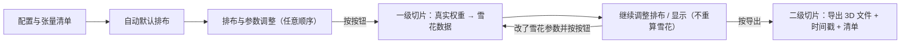

# snowglass 编辑器：排布、一级切片、二级切片（需求与设计）

> **状态：草案，待讨论拍板。** 本文整理自用户 2026-11-17 的口述需求，加上对 `prototype/real_config4.2.html` 的逐行阅读。凡标"用户已明确"的是用户原话里说定的；标"待拍板"的列在第 12 节，编号 Q1–Q14。
>
> **与 `docs/decisions.md` 的分工。** `decisions.md` 记录整个作品的决策（D 编号）和待定项（U 编号），比如"点数是后验结果"（D2）、"框和壳是实体"（D3）、"厂家工艺规格待核实"（U12）。本文只讲**编辑器这个工具怎么工作**：用户在里面按什么顺序做什么，每一步的输入输出，哪些操作会触发重算。本文用到 D/U 编号时，会当场把那条的内容说一遍，不需要去翻 `decisions.md`。
>
> **编号导览。** 本文自己的编号只有 Q1–Q14（第 12 节的待拍板问题），只在本文内有效，与 `decisions.md` 的 D/U 编号互不相干。拍板后，结论会转写进 `decisions.md` 成为 D 条目，并在此处注明转到了哪一条。

---

## 1. 一句话流程

用户借了 3D 打印"切片"的说法，一共两次切片：

1. **排布**：脚本根据模型的配置自动排出一套默认布局。布局本质上是很多"包络块"，每个块是等着装权重雪花的空盒子。用户可以调整这些盒子的位置、缩放和外观。
2. **一级切片**：用户定好雪花参数（降采样、加工精度、底噪等）后按下按钮，后台读取真实权重，做谱分解、滤底噪、降采样，得到每个块的雪花数据，再填回各个盒子。
3. **一级切片之后继续调整**：拖 gumball、改显示参数都不会重算雪花数据，只是把同一份雪花数据在空间里重新摆放。
4. **二级切片**：把整个模型导出成 3D 文件（OBJ / STL 等），文件名带时间戳。

**没有先后锁定（用户已明确）。** 一级切片之前，排布参数和雪花参数都能随时调，不存在"必须先调好包络体积再调雪花参数"。默认排布装不下默认雪花参数切出来的结果，这是完全允许的：可以带着满屏红色先切一次，再慢慢拉 gumball，直到不报红为止。一级切片之前没必要、也做不到预先判断装不装得下。

---

## 2. 术语

- **包络块**：一个功能块的外形盒子，比如"第 3 层的 Q / Gate"。它有毫米尺寸和位置，外面有框（12 根实体方梁）和包络面（6 块实体薄板），里面装雪花。
- **雪花数据**：一级切片的产物。每个包络块对应一个三维格子阵列，每个格子存一个灰度（0 到 1），再按灰度生成点。
- **格间距**：块的毫米尺寸除以格子数，即相邻两个格子中心之间的距离。块被拉大，格间距就变大；块被压小，格间距就变小。
- **点距**：激光机能打的最小点间距，默认 0.08 mm。属于机台参数，也就是用户说的"加工精度"。
- **幽灵毛坯**：参照用的玻璃毛坯外形，可以有多个，可以新建、删除、拖拽、gumball、改尺寸。每个幽灵毛坯带一层"应力预留量"，即从外表面向内偏移的安全距离。它只做参照：模型超出时报红，但不阻止任何操作。
- **报红不阻挠（用户已明确）**：所有检查（出毛坯、超加工精度、超密度参考线、块重叠等）只显示红色或橙色提示，不禁止一级切片，也不禁止二级切片。
- **过期**：一级切片之后，如果改了雪花参数但还没重新切片，现有的雪花数据就是"过期"的。画面上继续显示旧数据，但标明已过期。

---

## 3. 现状盘点（回答"编辑器是手写的还是脚本出的"）

| 部分 | 现在是怎么来的 | 文件 |
|---|---|---|
| 拓扑（有哪些块、每块含哪些张量） | **Python 脚本生成**。读阶段 0 的张量清单，按规则分组，并检查每个张量都恰好归入一个块 | `scripts/build_topology_qwen35.py` → `prototype/data/qwen35_9b.topo.json` |
| 排布（每块的位置和尺寸） | **编辑器里的一段 JS 代码**（`layout()` 函数），按拓扑算坐标。代码是 agent 手写的，里面的比例常量是 agent 自己定的，所以不好看 | `prototype/snowglass_editor.html` |
| 渲染、滑块、后验报告 | 同一个 HTML 文件里手写 | 同上 |

所以，"脚本"其实已经有两个：拓扑脚本（Python）和排布函数（JS）。不需要另起一个生成器，要做的是把排布函数里的常量和规则**整体换成 4.2 的**，同时把拓扑脚本的分组也换成 4.2 的分组（第 4 节）。

"排布只在前端实现一次，由编辑器导出 `layout.json` 交给后续步骤"这条做法保持不变，Python 端不重复写排布逻辑。

---

## 4. 默认排布：以 `real_config4.2.html` 为准

### 4.1 4.2 实际是怎么排的（Qwen3.5-9B，默认"纵向压缩"0.55）

下面的数是按 4.2 源码里的公式逐项算出来的。单位是 4.2 自己的场景单位，不是毫米。

**竖直方向（从下往上，单列，不折行）：**

| 部件 | 中心 y | 高 | 说明 |
|---|---|---|---|
| Token Embedding | −12.20 | 1.40 | 离塔底 1.2 的空隙 |
| 32 层塔体 | 从 −10.30 到 +10.30 | 每层块高 0.396，层距 0.644 | 层高 = 0.72 × 压缩，层间空 = 0.45 × 压缩；层多于 45 时再乘 0.72 |
| Final Norm（"脖子"） | +11.15 | 0.40 | 居中，宽 6.5，比上下两个头窄得多 |
| LM Head | +12.80 | 1.40 | 与 embedding 同尺寸 |
| MTP | +12.80 | 1.19 | 在 LM Head 右侧，x = 10.5 |

**水平方向（每一层，从左往右）：**

| 部件 | x 范围 | 宽 | 深 |
|---|---|---|---|
| Norm 1 | −10.53 … −9.88 | 0.65 | 3.72（主体深度 × 0.6） |
| 序列混合（3 块等宽） | −9.20 … −1.40 | 每块 2.41，块间空 0.28 | 6.2 |
| Norm 2 | −0.88 … −0.23 | 0.65 | 3.72 |
| FFN（3 块等宽） | 0.40 … 10.00 | 每块 2.99，块间空 0.32 | 6.2 |
| Embedding / LM Head | −7.0 … 7.0 | 14 | 7.13（× 1.15） |
| Final Norm | −3.25 … 3.25 | 6.5 | 3.72 |
| MTP | 8.4 … 12.6 | 4.2 | 5.58 |

**视觉塔（独立一列，中心 x = 23.5）：**

| 部件 | 位置 | 尺寸 |
|---|---|---|
| Patch / Position（入口，在下） | y = −10.18 | 8.2 × 1.1 × 5.58 |
| 27 层，每层 4 块：Norm 1、Attention、Norm 2、MLP | 层距 0.65，块高 0.40，总跨度 17.55，上下居中 | 宽分别为 0.45 / 3.6 / 0.45 / 4.0 |
| Merger / Projector（出口，在上） | y = +10.28 | 8.5 × 1.2 × 5.89 |

视觉塔左缘（x = 18.78）离文本主体右缘（x = 10.0）8.8 个单位，离 MTP 右缘 6.2 个单位。这片空白就是你说的"呼吸感"。

**整体包围盒：宽 38.9 × 高 26.4 × 深 7.1**（含视觉塔）；不含视觉塔时是宽 23.1 × 高 26.4 × 深 7.1。

**外观：** 线框透明度 0.18，面透明度 0.024（几乎看不见），点大小 0.065，叠加混合，16 % 的点是亮点（亮度 0.48–1.0），其余是暗点（0.05–0.19）。

### 4.2 与我们现在的编辑器相比，要改什么

| 项 | 4.2 | 现在的编辑器 | 改法 |
|---|---|---|---|
| 残差棒 | 没有 | 有，1.2 mm 实体棒 | **去掉（用户已明确）**。`decisions.md` 的 D11（"加残差棒"）随之撤销 |
| 前后错开 | **没有**，所有块在同一深度平面（z = 0） | 有，注意力列和 MLP 列错开 4 mm | 见 Q1。上一轮的错开是照第一版 `real_config.html` 做的，4.x 系列都没有错开 |
| 每层的块数 | 8 块：Norm 1、混合 ×3、Norm 2、FFN ×3 | 线性层 11 块、全注意力层 10 块（按张量拆） | 见 Q2 |
| 块宽 | 同组内**等宽** | 按参数量的平方根分 | 见 Q3 |
| norm 的位置 | Norm 1 在最左，Norm 2 夹在混合和 FFN 之间 | 两条 norm 都在最外侧 | 照 4.2 |
| 头的尺寸 | 宽 14（约等于整层宽 20.5 的 0.68），高 1.4（层块高的 3.5 倍） | 宽是主体的 0.78 倍 | 照 4.2 |
| 头的左右错位 | 没有，embedding 和 LM Head 都居中（x = 0） | 左右各错 0.12 主体宽 | 照 4.2 |
| 视觉塔每层 | 4 块（带两个 norm） | 2 块（norm 并在块里） | 照 4.2，拓扑分组跟着改 |
| 视觉塔位置 | 独立，空 8.8 单位 | 空 3 mm，挤 | 照 4.2 |
| 相机 | 视场角 42°，水平角 0.42，俯角 0.16，按包围盒自动取距离 | 固定位置 | 照 4.2 |

### 4.3 "从 config 出架构"怎么做

4.2 本身就是"读配置出图"的写法：它的模型表里只放配置字段（层数、hidden、FFN 维度、词表、视觉层数、专家数、模型类型），排布由每种模型类型对应的一组规则决定：

- **模型类型 → 混合器名字和拆法**。Qwen 是每 4 层第 4 层为全注意力，其余为 Gated DeltaNet。Gated DeltaNet 拆成"输入投影 / 门控·Conv / 输出投影"，全注意力拆成"Q·Gate / K·V / 输出投影"。
- **块尺寸是常量**：混合区总宽 7.8，FFN 总宽 9.6，深 6.2，norm 宽 0.65，头宽 14。只有竖直方向随层数和"纵向压缩"变化。
- **视觉塔的层距**随文本塔高度变化：层距 = max(0.65, 文本塔高 × 0.85 ÷ 视觉层数)。

我们的做法：

1. **拓扑脚本**（Python）按 4.2 的拆法分组，每个块记下：属于哪一层、在该层排第几个（例如"混合第 2 块"）、含哪些张量。张量全覆盖的检查保留不变。
2. **排布函数**（编辑器 JS）里放一张"布局配方"常量表，内容就是 4.1 节那些数。`layout()` 只读这张表和拓扑，算出每块坐标。现在手写的那些比例常量全部删掉。
3. 以后接别的模型（阶段 5），就是给配方表加一种模型类型、给拓扑脚本加一套分组规则，排布函数本身不动。

### 4.4 比例冲突：4.2 是横向扁块，默认毛坯是竖长条

4.2 的整体比例是**宽 38.9 : 高 26.4 : 深 7.1**，是一块横着放的扁方块。而 `decisions.md` 默认值表里的毛坯是 25 × 25 × 80 mm 的竖长条，四周留 2.5 mm 后可用空间是 20 × 20 × 75。

如果把 4.2 原样等比缩进 20 × 20 × 75：

| 情况 | 能放多大（每单位多少毫米） | 模型毫米尺寸 | 一层块高 |
|---|---|---|---|
| 带视觉塔，竖放 | 0.514 | 20.0 × 13.6 × 3.7 | 0.20 mm（只有 2.5 个点距） |
| 不带视觉塔，竖放 | 0.865 | 20.0 × 22.8 × 6.2 | 0.34 mm（4.3 个点距） |
| 带视觉塔，毛坯横放（75 宽 × 20 高 × 20 深） | 0.758 | 29.5 × 20.0 × 5.4 | 0.30 mm |
| 如果 1 单位 = 1 mm（不缩放） | 1.0 | 38.9 × 26.4 × 7.1 | 0.40 mm（5 个点距） |

宽度方向卡死了，竖长毛坯 80 mm 的高度基本用不上。因为幽灵毛坯只做参照、不阻挠，这不是阻断问题；但"一打开编辑器默认看到多大的模型"需要你定，见 Q4。

---

## 5. 排布阶段的编辑（一级切片前后都能做，都不重算雪花）

### 5.1 选择与 gumball

- **全选**：gumball 作用于整个模型（现在已有）。
- **局部选择（用户已明确）**：单击选一块，Shift 单击加选，屏幕上拖框框选。建议再加"按层选"（选中第 i 层的全部块）和"按列选"（例如选中所有层的 FFN），因为整列一起调是最常见的操作。这两条是 agent 的建议。
- gumball 三种模式：移动、旋转、缩放（三个轴可以分开缩）。
- 缩放改的是块的毫米尺寸。框和壳的毫米厚度不跟着缩放，保持物理值（现在已是这样）。

### 5.2 手动调整怎么存

每个块的手动调整，存成**相对于自动排布位置的偏移量和缩放倍数**，而不是绝对坐标。这样改了"纵向压缩"之类的全局参数、自动排布重算以后，手动调整还能套回去。每块另提供"重置"，全局提供"重置全部手动调整"。具体规则见 Q6。

### 5.3 可调的排布参数

| 参数 | 来源 | 说明 |
|---|---|---|
| 纵向压缩 | 4.2 已有 | 同时改层高和层间空 |
| 主体深度 | 4.2 的 6.2 | 用户说的"块深度"。各部件按 4.2 的倍数跟着变（norm × 0.6，头 × 1.15，视觉块 × 0.85） |
| 前后错开 | 上一轮新增 | 默认值见 Q1 |
| 框：粗细、灰度 | D3 | 框是 12 根实体方梁，灰度在成品里就是点的疏密 |
| 包络面：厚度、灰度 | D3 | 6 块实体薄板 |
| 视觉塔是否进作品 | 已有 | |
| 整体缩放 | 已有 | 与全选 gumball 的缩放是同一件事 |

### 5.4 幽灵毛坯（用户已明确）

- 可以**新建、删除、拖拽、gumball**，可以**编辑特征尺寸**：长方体改三条边长，圆柱改半径和高。还要不要别的形状（球、六棱柱等），按需再加。
- 每个幽灵毛坯有自己的"应力预留量"（向内偏移），画面上同时显示外表面和向内偏移后的内表面。
- **只做参照**：模型或某个块超出内表面就报红，并高亮出界的块。不影响一级切片，也不影响二级切片。
- 毛坯不再驱动排布。现在的编辑器是用毛坯尺寸反算模型大小，以后两者脱钩：毛坯怎么改，模型都不会跟着动。
- 有多个毛坯时，后验报告里和"可用空间"有关的数字以哪个为准，见 Q5。

### 5.5 工程保存（agent 补充的，需你确认）

手动调整、幽灵毛坯、各种参数目前都只存在浏览器内存里，刷新就没了。建议加"保存工程 / 打开工程"，存成一个 `*.snowglass.json` 文件，同时在浏览器本地自动保存最近一次状态。一级切片的结果另外存在磁盘上（第 7 节），工程文件里只记它的编号。

---

## 6. 雪花参数（一级切片的输入）

| 参数 | 作用 | 现状 |
|---|---|---|
| 降采样（压缩倍数，或"每格代表多少个权重"） | 决定每块切成多少格 | 编辑器有滑块，还没接后端 |
| 加工精度（点距） | 机台最小点间距；用来判断"装不装得下"；开自适应时用来反算格子数 | 有 |
| 谱分解设置 | 界外奇异方向的判定（噪声上界）、最多取几个方向 | 脚本里有，界面没有 |
| 底噪地板 | 灰度为 0 的格子也保留的最低出点概率，免得太空 | 有 |
| γ（对比度） | 灰度到出点概率的曲线 | 有 |
| 灰度合成方式 | 用哪种统计量当灰度（abs 均值、行列范数、谱结构、残差的组合） | U7 未定：阶段 2 第一轮测了五种，倾向 abs 均值 |
| 随机种子 | 灰度到点的抽样可复现 | 有 |
| 自适应开关 | 一级切片时按当前块尺寸和点距自动挑降采样 | 新增，见 7.3 |

这些参数随时可以改。改了以后**不自动重算**，只把现有雪花数据标成"过期"，等用户按一级切片按钮。

---

## 7. 一级切片

### 7.1 输入与输出

**输入**：雪花参数（第 6 节）、拓扑、每块的格子数（由降采样决定，开自适应时还要用到当前块尺寸）。

**输出**（存在磁盘上，每次切片一个编号）：

- 每个块的灰度格子阵列（三维，0–1）。
- 每个块的点集，坐标是**块内归一化坐标**（每个轴 0 到 1），与块的毫米尺寸无关。
- 每块的统计：格子数、每格代表多少权重、谱分解界外方向数、平均灰度、出点数、局部峰值等。
- 一份清单：本次切片用的全部参数、源文件校验和、切片编号、时间。

### 7.2 同一份雪花数据在空间里伸缩（用户的理解，agent 确认正确）

一级切片之后，每块的格子数 $(n_x, n_y, n_z)$ 和点集就固定了。块的毫米尺寸 $(L_x, L_y, L_z)$ 由排布决定，随 gumball 变化。两者一除就是格间距：

$$
\text{格间距} = \left(\frac{L_x}{n_x},\ \frac{L_y}{n_y},\ \frac{L_z}{n_z}\right)
$$

- **任一轴的格间距小于点距**：相邻两点比机器能打的还近，就是"装不下"，报红。
- **格间距大于点距**：点变稀，不是问题，就是你说的"张开自然张开"。
- **雪花点的总数不随缩放变**。随尺寸变的只有框和壳，它们是几何件。

举例（按 1 单位 = 1 mm）：一个混合块是 2.41 × 0.40 × 6.2 mm。如果切成 30 × 5 × 77 格，格间距正好约 0.08 mm。之后把它缩到 0.9 倍，格间距变成 0.072 mm，小于点距，报红；放大到 1.2 倍，格间距变成 0.096 mm，正常，只是更稀。

用户之前问过两种缩放语义（"锁点密度动压缩力度"还是"动压缩力度锁采样力度"），在这个框架下两种都有：

- **锁数据（默认）**：一级切片后随便缩放，数据不变，只是密度变。
- **锁密度**：缩放后想让点的密度保持不变，就得按新尺寸重新算格子数。这必须重新做一次一级切片（打开自适应再按按钮），**不做实时自动重算**。

### 7.3 自适应选项（用户已明确：可选）

勾选后，一级切片会根据配置、张量形状、当前块尺寸和点距，自动挑出每块的降采样，使格间距尽量接近点距、不超过机器分辨率。目的是"得到一个尽可能合适的默认值"。不勾时，按用户填的降采样执行。默认勾不勾，见 Q7。

### 7.4 哪些改动触发什么（用户已明确的规则）

| 改动 | 一级切片 | 立刻更新的东西 |
|---|---|---|
| 全局或局部 gumball、纵向压缩、主体深度、前后错开、间隙 | **不重算** | 位置、格间距检查、后验报告、结构件点数 |
| 框 / 壳的厚度和灰度 | 不重算 | 结构件、后验报告 |
| 显示参数（点大小、亮度、屏幕上画多少点、标签） | 不重算 | 画面 |
| 幽灵毛坯 | 不重算 | 出界检查 |
| 雪花参数（第 6 节那张表） | **标过期，按了按钮才重算** | 画面继续显示旧数据，并标明已过期 |

点距算不算雪花参数，有一处细节，见 Q8。

### 7.5 怎么跑

- 一级切片要读真实权重，必须在 Python 里做。编辑器上按按钮，经由本地 Python 服务启动一个后台任务（第 11 节）。
- 界面上显示进度：当前处理到哪个块、已用时间、预计剩余时间。
- **耗时（量级估计）**：阶段 2 第一轮实测，一个 5000 万参数的张量，解码约 1 s，池化约 1.3 s，谱分解约 0.1 s。全模型文本部分 89.5 亿参数，按这个速度第一次全量切片约 7–10 分钟。embedding 和 LM Head 各 10 亿参数，解码成 float32 要 4 GB 内存，需要分块读。
- **缓存**：第一次切片时，把每个张量解码后的细粒度统计存到磁盘（`decisions.md` D5 定的做法：改参数时不重新读权重，从细粒度中间统计重新池化）。以后只改 γ、底噪、灰度合成时，只重跑最后几步，应在秒级到一分钟内完成。缓存粒度在实现时实测确定。
- 建议支持"只切选中的块"，方便先拿两三层验证效果，见 Q13。

---

## 8. 后验报告与报红（全部不阻挠）

沿用 `decisions.md` D2 的原则：点数是算出来的结果，不是配额。超了就标出来，由用户回去改前置条件再切。

| 检查 | 什么时候有 | 判据 |
|---|---|---|
| 出幽灵毛坯 | 一直有 | 块是否超出各毛坯向内偏移后的内表面；列出出界的块 |
| 加工精度装不下 | 一级切片后 | 任一块、任一轴的格间距 < 点距；列出块名和最小格间距 |
| 密度 | 一级切片后（之前用模拟数据） | 每块的平均与局部峰值，对照"密度告警参考线"。这条线是 agent 拍的 10 %，没有外部依据，要问厂家（U12） |
| 块重叠 | 一直有 | 手动调整后可能出现。现在是"通过 / 不通过"，改成报红不阻挠 |
| 结构件过薄 | 一直有 | 框或壳薄于 2 倍点距，切出来可能断断续续 |
| 一级切片过期 | 一级切片后 | 改了雪花参数还没重切 |
| 机时、总点数 | 一直有 | 只报数，不判对错 |

二级切片导出时，当时所有报红项都写进导出清单，事后可以查。

---

## 9. 二级切片（导出）

### 9.1 导出什么

- 雪花点：把每块的归一化点集，按当前排布（含手动调整）换算成毫米坐标。
- 结构件：每块的框（12 根方梁）和包络面（6 块薄板），按当前厚度。
- 文件名带时间戳（用户已明确），例如 `out/export/qwen35_9b_20261117-153012.obj`。同名再出一份清单 `…_manifest.json`，记录排布、一级切片编号、全部参数、源文件校验和、所有报红项、点数和机时。

### 9.2 Python 写不写得出 OBJ / STL

写得出。OBJ 和 STL 都是结构很简单的文本或二进制格式，用 numpy 直接写就行，不需要额外的库。真正的问题在文件大小，以及厂家那边怎么读：

| 写法 | 每点大小 | 300 万点 | 问题 |
|---|---|---|---|
| OBJ，每个点一个顶点，不带面 | 约 30 字节 | 约 90 MB | 很多建模软件能显示；但部分切片软件不认没有面的 OBJ |
| STL，每个点一个小四面体（4 个三角面，二进制） | 约 200 字节 | 约 600 MB | 厂家软件通常会按表面重新生成自己的点，等于把我们的点打散重排 |
| PLY 点云（二进制） | 约 15 字节 | 约 45 MB | 内雕软件常见输入之一，要问厂家认不认 |
| 结构件（框、壳） | — | — | 本身就是实体，OBJ / STL 都很自然 |

`decisions.md` "不做什么"里写着"不默认发纯 XYZ 点云"，这条保留：纯文本 XYZ 只在厂家明确要求时才出。

### 9.3 厂家那边可能还有一次切片

我们的二级切片交出去以后，厂家软件很可能再做一次，按它自己的规则把模型转成激光点。这就是 U12 第 4 问（"收到模型后你们会不会自行改点距、跳点或简化结构，会不会事先告知"）担心的事。如果厂家会重新出点，我们点集的可追溯性就到我们的文件为止。所以导出格式怎么选，取决于问厂家的结果（U1、U12），见 Q11。

---

## 10. 显示

- **一级切片前**：块里显示模拟雪花，外观照 4.2（两档亮度、叠加混合、点大小 0.065 单位），画面上标明"模拟"。
- **一级切片后**：显示真实点集。屏幕上画多少点只是为了不卡，可以抽样，与玻璃里有多少点无关（D2 已定）。
- **灰度怎么显示**：用点的亮度，还是用点的大小（用户还没想好）。两种都可以做成切换。这只影响屏幕显示，不影响导出。见 Q9。
- 线框和面照 4.2 的观感（线 0.18、面 0.024），但我们的框和面是实体（D3 已定：零厚度的线和面切不出点，WebGL 的线宽在 Windows 上又固定为 1 像素）。默认的粗细和灰度要调到看起来接近 4.2。

---

## 11. 技术结构

| 部分 | 做什么 | 文件 |
|---|---|---|
| 前端编辑器 | 排布、选择、gumball、幽灵毛坯、参数面板、显示、后验报告；发起一级 / 二级切片 | `prototype/snowglass_editor.html`（继续在这个文件上改） |
| 拓扑脚本 | 按 4.2 的拆法分组，检查张量全覆盖 | `scripts/build_topology_qwen35.py`（直接改） |
| 本地服务（新） | 同时提供静态文件和接口：发起一级切片、查进度、发起导出。只用 Python 标准库，替代现在 8123 / 8124 两个 `http.server` | `scripts/serve.py` |
| 一级切片（新） | 解码 → 细粒度统计缓存 → 池化 → 谱分解 → 灰度 → 点集。复用 `try_one_block.py` 里已经验证过的解码、池化、谱分解代码 | `scripts/slice1.py` |
| 二级切片（新） | 读排布与一级切片结果，写 3D 文件和清单 | `scripts/export.py` |
| 数据目录 | 拓扑：`prototype/data/`；一级切片结果：`prototype/data/slices/<编号>/`；细粒度缓存：`out/cache/`；导出：`out/export/` | |

---

## 12. 待拍板（Q1–Q14）

每条给出背景、选项和 agent 的倾向。倾向只是建议。

**Q1 前后错开要不要。** 4.x 系列所有块都在同一个深度平面上（z = 0），俯视看没有错开。上一轮的"两列前后错开 4 mm"是照第一版 `real_config.html` 做的。以 4.2 为准，就意味着去掉错开。
- 甲：默认不错开（照 4.2），保留"前后错开"滑块，默认值 0。
- 乙：彻底删掉这个功能。
- 丙：默认保留 4 mm 错开。
倾向甲。

**Q2 块怎么分组。** 照 4.2，每层 8 块，视觉每层 4 块，一个块里可以含多个张量。agent 拟的张量归属：

| 4.2 的块 | 线性层（Gated DeltaNet）含的张量 | 全注意力层含的张量 |
|---|---|---|
| Norm 1 | `attn_norm` | `attn_norm` |
| 混合 1 | 输入投影：`attn_qkv` | Q / Gate：`attn_q`、`attn_q_norm` |
| 混合 2 | 门控 / Conv：`attn_gate`、`ssm_alpha`、`ssm_beta`、`ssm_conv1d`、`ssm_a`、`ssm_dt`、`ssm_norm` | K / V：`attn_k`、`attn_v`、`attn_k_norm` |
| 混合 3 | 输出投影：`ssm_out` | 输出投影：`attn_output` |
| Norm 2 | `post_attention_norm` | `post_attention_norm` |
| FFN 1–3 | `ffn_gate` / `ffn_up` / `ffn_down` | 同左 |

视觉每层：Norm 1 = `ln1`；Attention = `attn_qkv` + `attn_out`（含 bias）；Norm 2 = `ln2`；MLP = `ffn_up` + `ffn_down`（含 bias）。
总块数：文本 32 × 8 + embedding + final norm + LM Head = 259，视觉 27 × 4 + 入口 + 出口 = 110，另加一个只画框的 MTP（U9）。
倾向照此执行。

**Q3 块宽等宽，还是按参数量。** 4.2 同组等宽。比如全注意力层的"K / V"只有 840 万参数，"Q / Gate"有 3360 万，两块却一样大。等宽的话，参数量的差异体现在每格代表的权重数上，后验报告会列出来。倾向照 4.2 等宽。

**Q4 一打开编辑器，模型默认多大。** 见 4.4 节的比例表。
- 甲：1 单位 = 1 mm，模型默认 38.9 × 26.4 × 7.1 mm。毛坯另行参照。
- 乙：启动时按主参照毛坯自动缩到 90 %（不顶头）。用默认 25 × 25 × 80 竖放的话，模型只有 18 × 12 × 3.3 mm。
- 丙：换一个和 4.2 比例相配的默认毛坯，比如 50 × 35 × 15 横放。
需要你定。

**Q5 有多个幽灵毛坯时，报告里"可用空间"的数字按哪个算。** 倾向：指定一个"主参照"毛坯，用于报告里的可雕区格点数和平均填充率；其余毛坯只做出界检查。

**Q6 手动调整之后又改了全局排布参数，手动调整怎么办。** 倾向：手动调整存成相对偏移和缩放倍数，自动排布重算后照样套回去；提供"重置选中块"和"重置全部"。

**Q7 一级切片的分辨率怎么定义，自适应默认开不开。**
- 不开自适应：用户直接定"每格代表多少行 × 多少列权重"，跟块的毫米尺寸无关。装不下就报红。
- 开自适应：按当前块尺寸和点距反算。
倾向：第一次切片默认开，之后用户可以关掉，把降采样锁住。

**Q8 点距改了，一级切片算不算过期。** 你说过"除非改降采样参数或加工精度参数，才重新切片"。细节是：不开自适应时，点距只影响"装不装得下"的判断，不改变雪花数据本身。
- 甲：一律标过期（简单、一致）。
- 乙：只在开了自适应时标过期，否则只重跑检查。
倾向甲，和你的原话一致。

**Q9 灰度怎么变成点，屏幕上怎么显示。** 倾向：每格最多出一个点，出点概率由灰度经 γ 和底噪地板换算。这样"格间距 ≥ 点距"就等价于"不超机器分辨率"，检查最简单。显示上默认用亮度，点大小作为切换选项。

**Q10 一个块里有多个张量时怎么填。** 比如"门控 / Conv"含 7 个张量，大小从 1680 万到 32 个参数不等。
- 甲：在块内沿宽度方向，按参数量比例切成几段，每段装一个张量。小张量至少给一层格子。
- 乙：几个张量拼成一个大矩阵，统一折叠。
倾向甲，因为每段仍能对应到具体张量，可以追溯。清单里记录每段的边界。

**Q11 二级切片先做哪些格式。** 在问到厂家（U1、U12）之前，倾向先做：OBJ（雪花点作顶点 + 结构件作网格）和 STL（雪花点作小四面体 + 结构件），各带清单。PLY 等问过厂家再说。

**Q12 加工精度装不下时的"可选自适应"放在哪。**
- 甲：一个按钮"按当前尺寸自适应重切"，等于勾上自适应再跑一次一级切片。
- 乙：导出时自动把间距不够的相邻格合并。
倾向甲。所有数据都由一级切片的规则产生，追溯链不断。乙会在导出时悄悄改数据。

**Q13 一级切片能不能只切选中的块。** 倾向能，用于先拿两三层验证效果，不必每次都等 7–10 分钟的全量。

**Q14 要不要工程保存（5.5 节，agent 补充的）。** 倾向要。不然刷新一次，所有手动调整就丢了。

---

## 13. 实施计划（拍板后执行）

每一步做完都能单独验证，再进入下一步。

| 步 | 内容 | 改哪些文件 | 做完的标准 |
|---|---|---|---|
| 1 | 拓扑分组改成 4.2 的拆法（Q2、Q10） | `scripts/build_topology_qwen35.py` | 张量全覆盖检查通过；块数与 Q2 一致；每块带层号、列位置、张量列表 |
| 2 | 默认排布换成 4.2 的配方表；去掉残差棒；按 Q1 处理错开；相机和外观照 4.2；毛坯与排布脱钩（Q4） | `prototype/snowglass_editor.html` | 编辑器导出的 `layout.json` 逐块坐标与 4.1 节按 4.2 公式算出的数一致（写一个小脚本自动比对）；你目测与 4.2 并排对比 |
| 3 | 选择（单击、加选、框选、按层、按列）、局部 gumball、手动调整存储（Q6）、工程保存（Q14） | 同上 | 局部调整后改纵向压缩，调整保留；保存后刷新能恢复 |
| 4 | 幽灵毛坯：多个、长方体和圆柱、应力预留量、出界报红（Q5） | 同上 | 新建、删除、拖拽、改尺寸都可用；出界的块高亮 |
| 5 | 本地服务 + 一级切片（先支持选中块，再全量）+ 进度 + 过期标记 + 结果载入（Q7、Q8、Q9、Q13） | `scripts/serve.py`、`scripts/slice1.py`、编辑器 | 选中两三层先切，画面显示真实点；改 γ 后显示"过期"，按钮后更新。**全量切片前先报告预计耗时，经你同意再跑** |
| 6 | 后验检查补全：加工精度逐块逐轴、块重叠改报红（第 8 节） | 编辑器 | 缩小一个块到格间距 < 点距时报红，放大后消失 |
| 7 | 二级切片导出 + 时间戳 + 清单（Q11） | `scripts/export.py`、编辑器 | 导出文件能在常见 3D 查看器里打开；清单里有当时全部报红项 |

---

## 14. 拍板后要同步到 `decisions.md` 的地方

- D11（残差棒）：撤销，原因是用户要求照 4.2，4.2 不画残差连线。
- D13（二维怎么拆成三维）：补上"一个块含多个张量"的填法（Q10）。
- D14（编辑器可调项表）和"阶段计划"：改成指向本文，并按两级切片重新划分阶段。
- "阶段 1 现状"里的布局规则第二版：改成 4.2 配方。
- U1（发给厂家的格式）：补上第 9 节的格式与大小对比。
